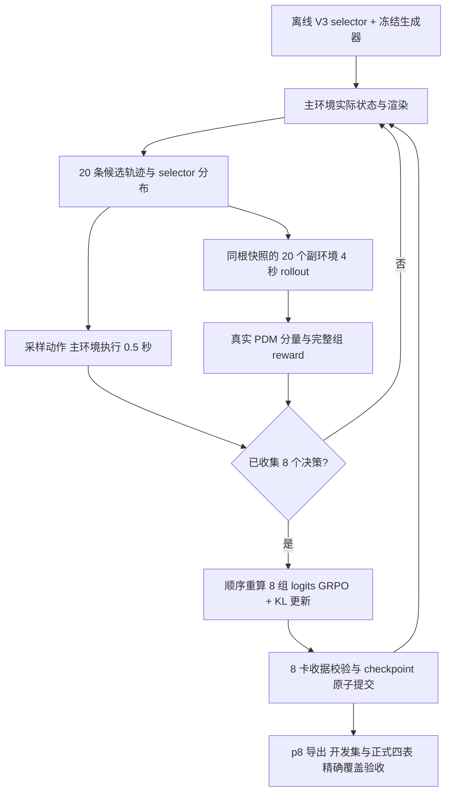

# 在线闭环 B 代码带读（给学长）

学长已经看过 V3 离线代码，可以从下面第 1 步继续。先阅读主线，再看 checkpoint 与评测工程；源码链接都指向这份代码仓库。

## 1. 从离线 V3 父模型出发

[learner.py](../../projects/AlgEngine/scripts/diffusiondrive/innovation3/learner.py) 的 `OnlineV3Learner` 使用 `v3_initialized_selector_finetune`：将离线 V3 selector 拷贝为可训练 selector，同时留一份完全冻结的 reference，供 KL 使用。感知、候选轨迹生成器、原始 base logits 不训练。

这是继续微调已有 selector。旧代码中 `frozen_v3_plus_zero_residual` 是历史模式，本次 B 不启用它。全模型推理由 [visual_model.py](../../projects/AlgEngine/scripts/diffusiondrive/innovation3/visual_model.py) 接入 AlgEngine。

## 2. 数据集、epoch 和场景顺序

[coverage_manifest.py](../../projects/AlgEngine/scripts/diffusiondrive/innovation3/coverage_manifest.py) 读取外部冻结清单并检查场景、资产、技术准入收据和原始 log 的划分。实际主环境训练池是 **150 个场景、25 个 origin log**：124 个来自 navtrain_50pct_collision，7 个来自 navtrain_failures_per1，19 个来自 navtrain_ep_per1。每个场景的一次训练 rollout 是 8 个决策。

开发集有 83 个场景、12 个 log，包含历史训练池划出的 log；它不是独立最终测试集。原保护 holdout 不用于这次续训。正式四表的样本集合另行冻结，不能用开发集 R/NR 代替正式表。

[ddp_session_boundary.py](../../projects/AlgEngine/scripts/diffusiondrive/innovation3/ddp_session_boundary.py) 的 `assignment()` 用 seed 给训练场景排序，随后按全局 episode 下标循环取样。8 卡每轮各处理一个不同场景。

若把 150 场景各访问一次叫一个 epoch：p6 由于必须在完整 DDP 轮结束，实际是 **904 episodes = 113 DDP rounds**；146 个场景访问 6 次、4 个访问 7 次。p8 目标是 **1200 episodes = 150 rounds**，150 个场景恰好各 8 次。接续增加 296 episodes、37 rounds。训练没有换数据集，也不重新从场景 0 开始。

## 3. 主环境产生真实在线输入

从 [ddp_online_session.py](../../projects/AlgEngine/scripts/diffusiondrive/innovation3/ddp_online_session.py) 的 `main()` 看总循环，再进入 [online_probe.py](../../projects/AlgEngine/scripts/diffusiondrive/innovation3/online_probe.py)。每个 rank 保持模型与模拟器进程，切换场景时重新建立 episode。

[fixed_client.py](../../projects/AlgEngine/scripts/diffusiondrive/innovation3/fixed_client.py) 管理独立模拟器进程；[fixed_worker.py](../../projects/AlgEngine/scripts/diffusiondrive/innovation3/fixed_worker.py) 负责主环境、观察与奖励反馈。主环境渲染图像，冻结的感知/生成器产生 20 条轨迹和 selector context。训练从当前 selector 分布采样动作，主环境实际前进 0.5 秒，再用新的状态继续决策。

## 4. 从同一状态分支，拿 simulator 的实际回报

[expert_fixed_rollout.py](../../projects/SimEngine/worldengine/online/expert_fixed_rollout.py)、[fixed_parallel.py](../../projects/SimEngine/worldengine/online/fixed_parallel.py) 和 [headless.py](../../projects/SimEngine/worldengine/online/headless.py) 是副环境的关键。每次决策都从主环境相同快照评估 20 个候选，每条向前执行 4 秒 / 8 个步长。主环境只执行被选中的首个 0.5 秒，然后重规划。

训练使用 cached headless WorldEngine，ego 使用 LogPlayController，其他交通参与者使用 R/IDM 反应。副环境不渲染图像，只计算动力学与奖励。MotionRFT 相关加速思想/组件在这一条支路中使用，不能表述为整个训练直接运行于 MotionRFT 原生模拟器。

主状态恢复、选中轨迹首步、快照和 scorer 一致性都有代码验收。`fixed_full_audit_every=32` 是额外完整审计频率，**不是每 32 次才打奖励**；每次决策仍完整打分 20 条候选。

## 5. 闭环 reward 的组成

[expert_segment_reward.py](../../projects/SimEngine/worldengine/online/expert_segment_reward.py) 与 [expert_fixed_rollout.py](../../projects/SimEngine/worldengine/online/expert_fixed_rollout.py) 计算真实分支轨迹上的 NC、DAC、行驶方向、EP、TTC、comfort。expert future 仅用于评分参考并按实际状态重定位，不作为 selector forward 的输入。

当前实现可概括为 `G * (5 * gated_EP + 5 * TTC + 2 * comfort) / 12`，其中 `G = NC * DAC`，`gated_EP = G * EP`。direction 是记录的诊断项，当前 scorer 中权重为 0，不参与 G。这里 EP 的额外门控按已有实现保留，不在本次整理中修改。奖励不是模型预测值，也不是训练前一次性缓存的固定轨迹标签；主车走到哪个实际状态，就从该状态模拟候选再计算回报。

## 6. A 与 B 的差别：B 跑完 8 步再更新

[fixed_learning.py](../../projects/AlgEngine/scripts/diffusiondrive/innovation3/fixed_learning.py) 的 `FixedLiveLearning` 支持两种时序：A = `per_step`，每个决策得到反馈就更新；B = `after_rollout8`，先固定 actor，完成本场景 8 个决策并收集 8 组 context/reward。

B 在 rollout 结束后，按原顺序重新前向、依次处理 8 组数据，**执行 8 次 optimizer update**。不是走一步更新一步，也不是收完一轮只做一次 update，更不是整个 epoch 才更新一次。context/reward 暂存在 CPU，收集时的计算图不会一直保留。

## 7. GRPO + KL，具体优化什么

[grpo_selector_v3_cached_common.py](../../projects/AlgEngine/scripts/diffusiondrive/grpo_selector_v3_cached_common.py) 的 `normalized_advantage()` 和 `exact_group_loss()` 实现沿用 V3 的完整候选组目标：组内 20 条 reward 标准化，`policy_loss = -sum(p * advantage)`，加 `0.001 * KL(p_current || p_reference)`。这是代码中的 exact-group 目标，不应写成未实际使用的 PPO clipped loss。

AdamW：学习率 3e-5、weight decay 1e-4、gradient clip 1.0。8 rank 同步梯度、同步更新，每轮 8 个 global optimizer steps；p6 实际累计 904 步，p8 若全部有信号则为 1200 步。报告同时保存 attempts 和实际 policy version，避免把零信号组当作有效更新。

## 8. 8 卡状态与 p6 → p8 接续

[ddp_online_probe.py](../../projects/AlgEngine/scripts/diffusiondrive/innovation3/ddp_online_probe.py) 负责 DDP learner；[ddp_session_boundary.py](../../projects/AlgEngine/scripts/diffusiondrive/innovation3/ddp_session_boundary.py) 验证 8-rank 收据并原子提交。checkpoint 包含 selector、reference、optimizer、每 rank RNG、version 和 attempts。

[continuation.py](../../projects/AlgEngine/scripts/diffusiondrive/innovation3/continuation.py) 仅通过显式带 SHA 的导入清单接受旧 p6：父 ledger 不重写；旧记录保留旧 source contract；新记录采用新 source contract。全局场景下标从 904 接续。普通 resume 仍严格拒绝源代码、配置或数据清单变化。

[scripts/online/audit.py](../../scripts/online/audit.py) 检查实体备份和完整 learner digest、共享模型/optimizer 一致性。每 rank RNG 可以不同，分别校验，不能强制彼此相等。首个新 DDP round 通过连续性验收后才继续后面的 36 轮。

## 9. 从训练到正式评测与曲线

[scripts/online/run.py](../../scripts/online/run.py) 是任务编排入口：续训 → 审计 → selector 导出 → 与冻结 baseline 合并 → 开发集 R/NR → 正式四表。正式四表是 navtest open-loop、rare open-loop、closed-loop NR、closed-loop R，eval seed 固定 0、replan interval 固定 0.5 秒。

[eval_runtime.py](../../scripts/online/eval_runtime.py) 沿用已经完成 p6 四表的运行命令，AlgEngine 负责轨迹推理，SimEngine 负责闭环模拟，open-loop 使用 official NAVSIM rescore；[acceptance.py](../../scripts/online/acceptance.py) 检查精确 token 覆盖、重复/缺失、合法分数、ADE/FDE 文件。进程退出码为 0 不等于评测通过。

[curves.py](../../scripts/online/curves.py) 从真正提交的每-rank报告提取 loss、policy loss、KL、训练 context reward 和时间，导出 CSV/PNG/PDF。reward 曲线是当前收集状态上的训练诊断，不能当作独立评测分数；目前也不能仅凭 loss 曲线声称已经收敛。

