# SARA：闭环轨迹对比候选

**新增：[第二批五例（06–10，速度更温和）](round2/README.md)。优先看⑥减速右转、⑦低速左转，交互安全可看⑧。**

第一批⑤的 SARA 采样峰值约 9.84 m/s，按本次选图偏好降为备选。以下保留第一批材料。

2026-11-08。对应论文主表的 **NavTrain50 Base vs SARA online rare-log，seed 0，epoch 2**。

**建议先看 ①跟车避碰 + ②道路走向纠偏；如希望展示路口决策，可以选④右转推进。**

[下载总览 PDF](five_cases_overview.pdf) · [下载完整材料 ZIP](sara_five_cases.zip) · [完整核验说明](README_ZH.txt)

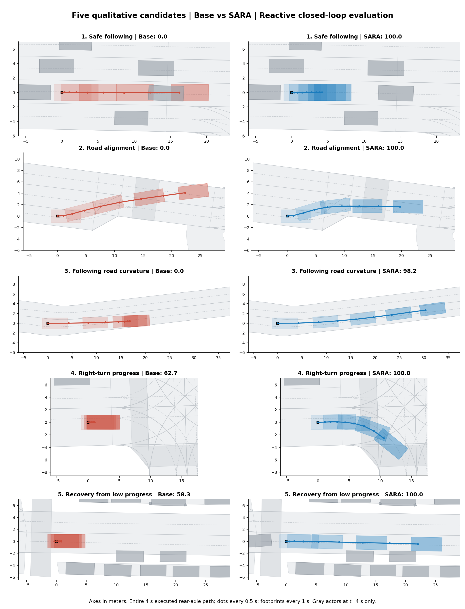

| 案例 | R PDM：Base → SARA | NR PDM：Base → SARA |
|---|---:|---:|
| 1. 跟车减速，避免碰撞 | 0.00 → 100.00 | 0.00 → 100.00 |
| 2. 道路走向处纠偏（R 模式） | 0.00 → 100.00 | 100.00 → 100.00 |
| 3. 沿弯道继续行驶 | 0.00 → 98.18 | 0.00 → 98.18 |
| 4. 路口右转推进 | 62.72 → 100.00 | 62.44 → 100.00 |
| 5. 解除低速停滞 | 58.33 → 100.00 | 58.33 → 100.00 |

所有图展示完整 **4 秒闭环评测片段**的实际后轴位姿，每 0.5 秒一帧；不是单次预测轨迹。两边初始 ego、周围车辆状态和时间戳已核对一致。

**②只有 reactive 模式体现优势**；其余四个在 R/NR 下均改善。下方轨迹图与动画统一展示 R 模式。

静态轨迹图中灰色车辆为起点（淡）和末帧（深），判断交互请看同步时间的动画。前视图是原仿真器渲染画面，存在渲染伪影，建议论文以轨迹和地图为主。

## 1. 跟车减速，避免碰撞

Base 继续加速并发生碰撞；SARA 保持跟车并减速。末速约 8.85 → 0.30 m/s，NC/TTC 从失败变为通过。

场景：`2021.06.28.20.24.43_veh-38_03385_04952-1786ef7edac65502`

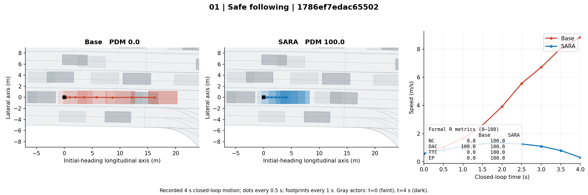

### 同步 BEV 动画

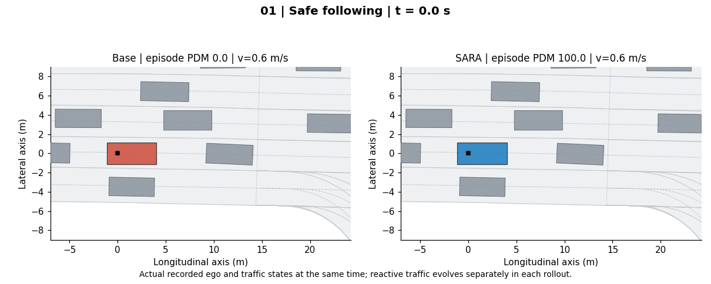

### 前视画面：t=0 / 2 / 4 秒

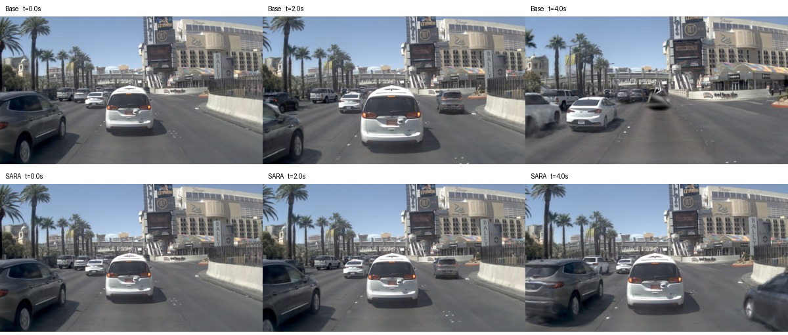

## 2. 道路走向处纠偏（R 模式）

Base 偏向路缘并发生道路合规失败；SARA 较早顺应道路走向。NR 模式二者均为 100，因此必须标注 reactive。

场景：`2021.09.16.19.27.01_veh-45_01749_03230-b02bf210eda55579`

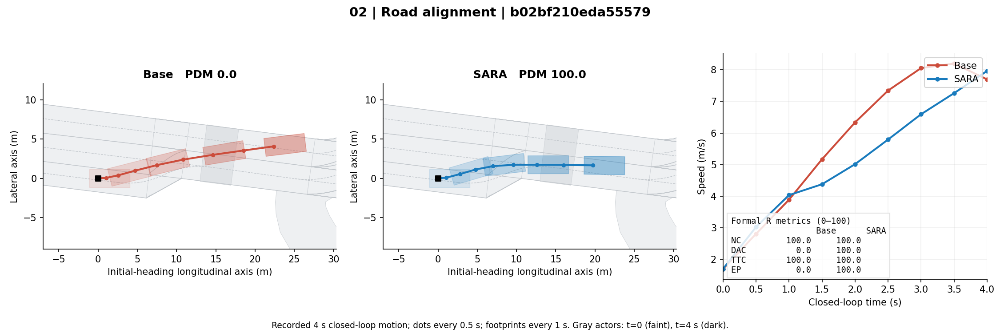

### 同步 BEV 动画

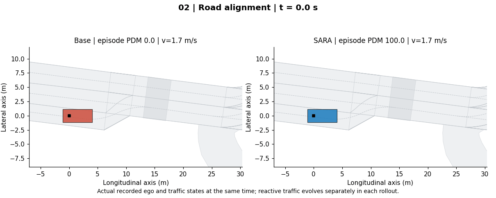

### 前视画面：t=0 / 2 / 4 秒

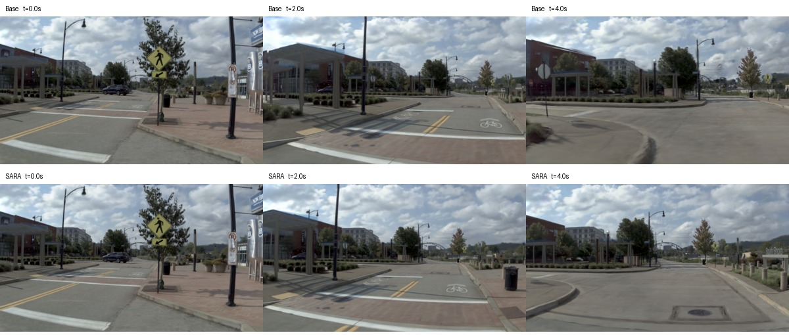

## 3. 沿弯道继续行驶

Base 未充分跟随道路弯曲方向，DAC 失分并明显减速；SARA 沿道路继续行驶。4 秒实际行驶距离约 16.83 → 30.51 m。

场景：`2021.09.16.14.39.34_veh-42_00032_00186-cd9d029138325c2c`

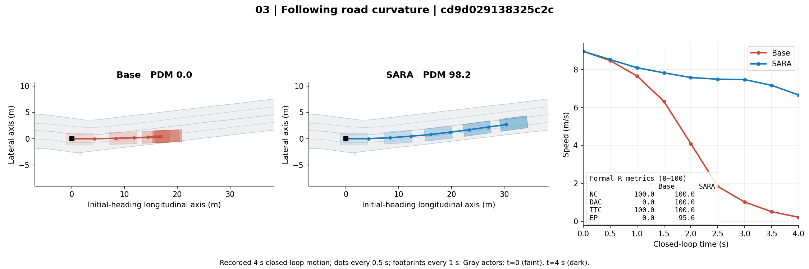

### 同步 BEV 动画

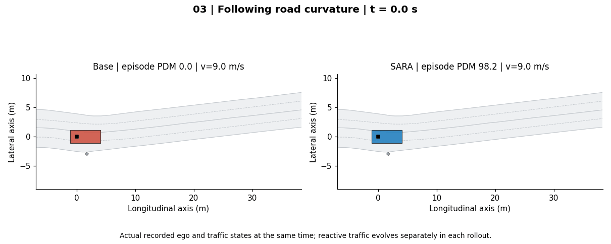

### 前视画面：t=0 / 2 / 4 秒

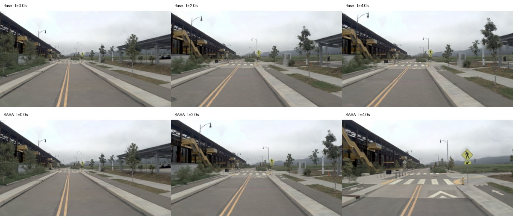

## 4. 路口右转推进

Base 在路口明显减速，SARA 持续启动右转。4 秒实际行驶距离约 2.18 → 11.20 m；NC/DAC/TTC 均通过。此片段展示右转推进，不代表完成整次转弯。

场景：`2021.09.16.13.53.10_veh-42_00860_01069-0802a51b0a1d512c`

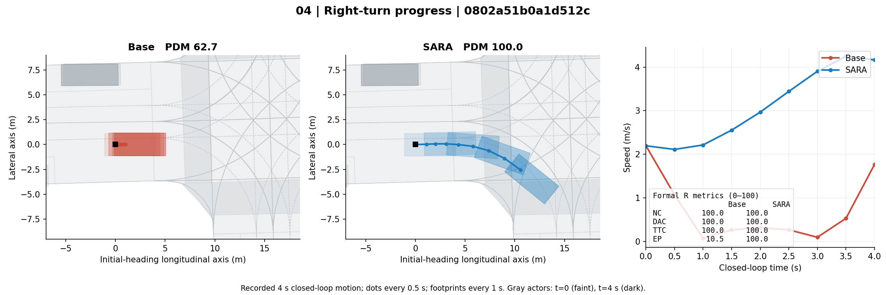

### 同步 BEV 动画

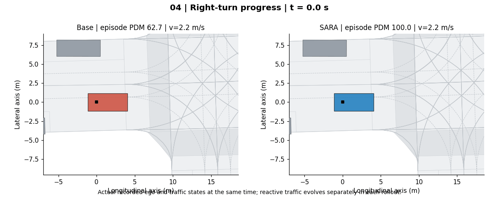

### 前视画面：t=0 / 2 / 4 秒

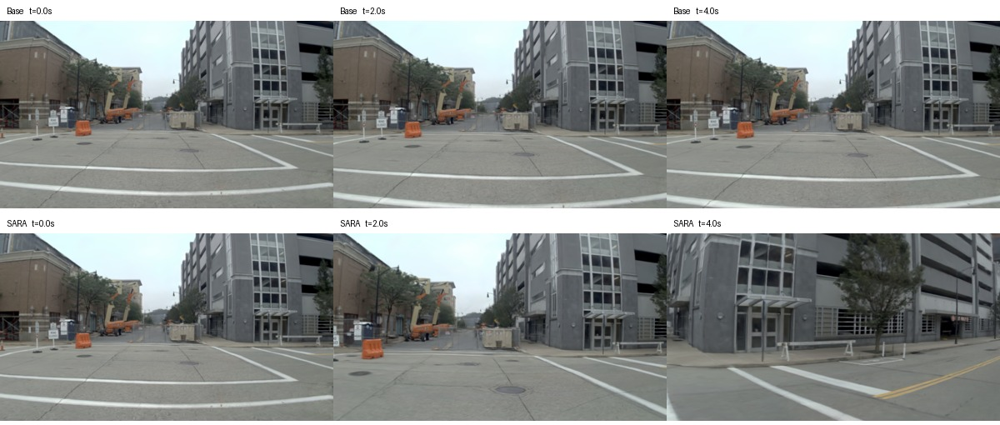

## 5. 解除低速停滞

Base 始终低速，SARA 恢复正常推进。4 秒实际行驶距离约 2.00 → 22.06 m，NC/DAC/TTC 均通过。

场景：`2021.08.30.16.16.44_veh-40_00779_01088-551cf39c34f75b25`

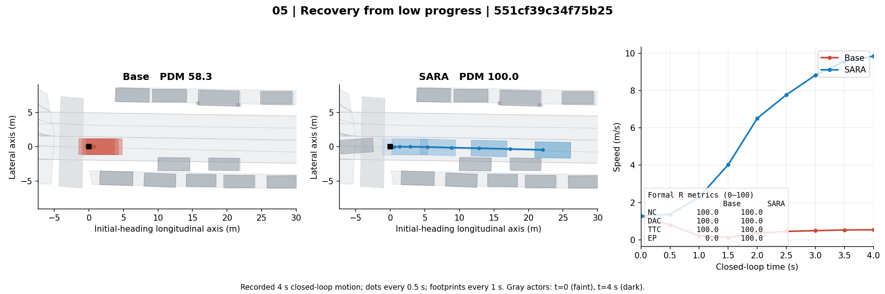

### 同步 BEV 动画

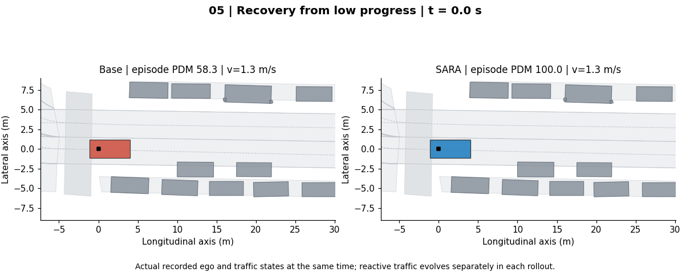

### 前视画面：t=0 / 2 / 4 秒

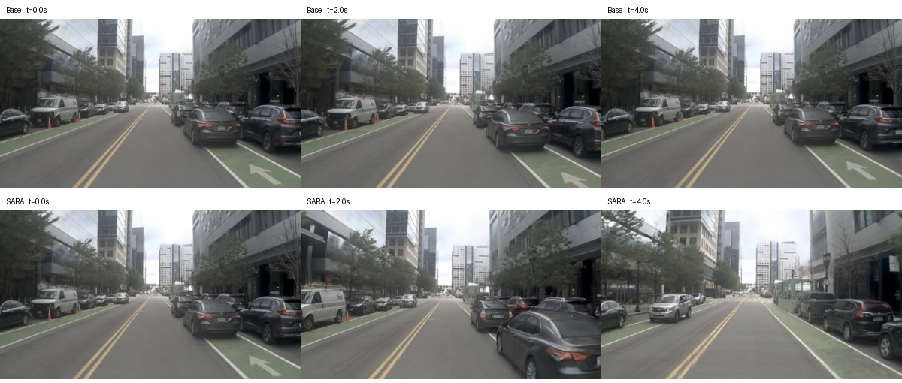

## 证据与使用范围

这是按正式评测结果事后筛选的定性案例。完整配对数据保留了改善和退化场景：[paired_scores.csv](paired_scores.csv)。

[selected_cases.json](selected_cases.json) 保存模型 SHA256、原始评分路径、各场景 metadata SHA256 和图像来源；[verification.json](verification.json) 记录文件、动画帧数和时间窗口核验。

EP 是评分器返回的 gated/normalized progress；碰撞或道路合规失败时 EP=0 不代表车辆没有移动，实际距离由位姿另外计算。

10 月 6 日历史分析针对旧 parent/在线模型和反事实干预，不能直接改标签套用。本页重新使用当前论文主表模型及自然闭环评测记录。论文正文尚未改动。
