# DAC 退化与更积极推进：D01–D06

**先看 D02、D04，再对照 D01（原 F05）。** D03、D05、D06 是补充候选，几何差异较细。这轮全部严格满足同一评测模式下 **Base DAC=1、SARA DAC=0**，不再混入 Base 同样失败的例子。

[下载全部六例 ZIP](sara_DAC_regressions_D01_D06.zip) · [可修改 Python](sara_DAC_regressions_D01_D06/plot_cases.py) · [数据与改图说明](sara_DAC_regressions_D01_D06/README.md) · [数值表](sara_DAC_regressions_D01_D06/summary.csv)

R 模式的全部 13 个 DAC 退化场景中，SARA 四秒行程都更长，2 秒速度也都更高；NR 的 15 个场景中分别是 14 个和 12 个。**这是以 DAC 退化为条件的描述，不能据此宣称 SARA 整体更激进，或证明更高速度导致越界。**

上排 Base、下排 SARA，左列 2 秒、右列 4 秒；面板直接显示速度。深色轮廓为辅助地图可行驶区域并集，洋红色为自车车身超出该区域的部分。图下另有速度曲线、越界面积曲线和最大越界时刻的原比例细节。没有箭头、轨迹平滑或位置修正。

## D01 · 柱廊入口继续推进后越界（R）

原 F05，保留参照；越界最明显。 四秒行程 Base 3.8 m → SARA 10.7 m；2 秒速度 0.4 → 3.1 m/s；4 秒速度 0.2 → 1.8 m/s。辅助几何首次检出越界约 3 s，最大角点超出约 2.05 m。

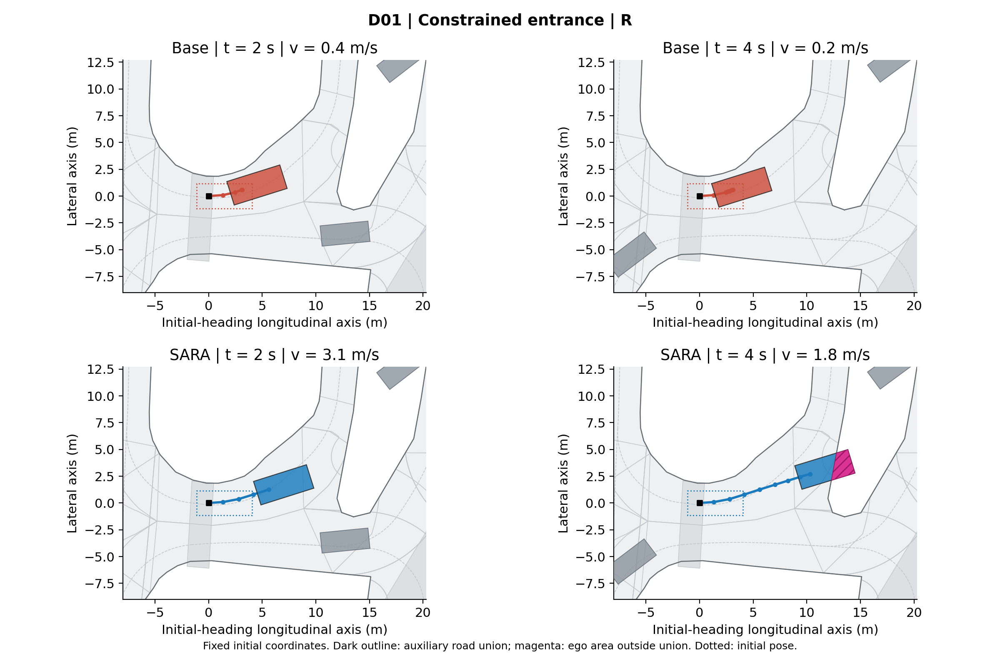

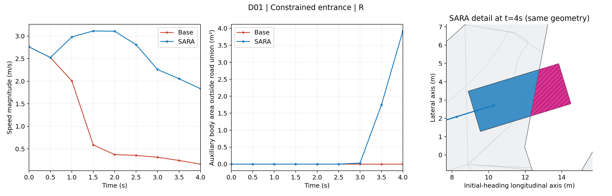

[完整 GIF](sara_DAC_regressions_D01_D06/figures/case_01.gif) · [原始前视](sara_DAC_regressions_D01_D06/camera/case_01_camera.jpg) · [PDF](sara_DAC_regressions_D01_D06/figures/case_01_2s_4s.pdf) · [SVG](sara_DAC_regressions_D01_D06/figures/case_01_2s_4s.svg)

## D02 · 左转后继续加速，压出道路边缘（R）

Base 后半段减速，SARA 持续加速；道路越界约 0.20 m，局部细节较小。 四秒行程 Base 13.7 m → SARA 23.2 m；2 秒速度 4.4 → 5.8 m/s；4 秒速度 0.1 → 7.6 m/s。辅助几何首次检出越界约 3.5 s，最大角点超出约 0.20 m。

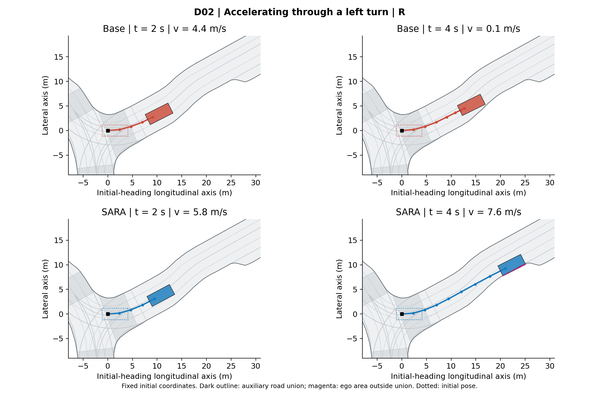

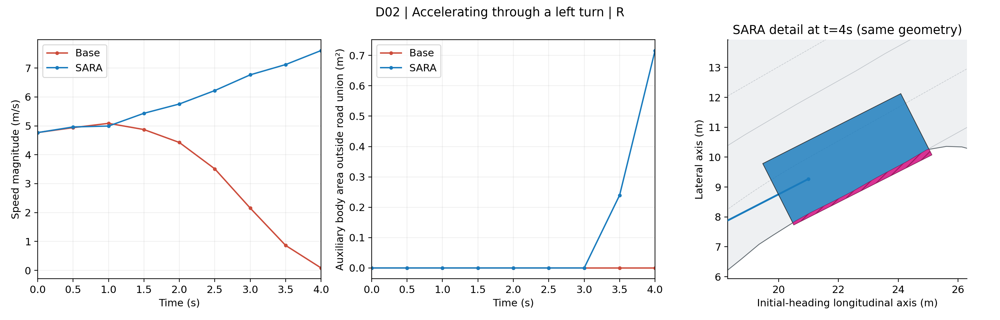

[完整 GIF](sara_DAC_regressions_D01_D06/figures/case_02.gif) · [原始前视](sara_DAC_regressions_D01_D06/camera/case_02_camera.jpg) · [PDF](sara_DAC_regressions_D01_D06/figures/case_02_2s_4s.pdf) · [SVG](sara_DAC_regressions_D01_D06/figures/case_02_2s_4s.svg)

## D03 · 路沿附近收速不足，车身越界增加（R）

Base 停在前方，SARA 继续推进；采样最大角点越界约 0.34 m。 四秒行程 Base 11.8 m → SARA 18.3 m；2 秒速度 2.4 → 4.6 m/s；4 秒速度 0.0 → 1.1 m/s。辅助几何首次检出越界约 2 s，最大角点超出约 0.34 m。

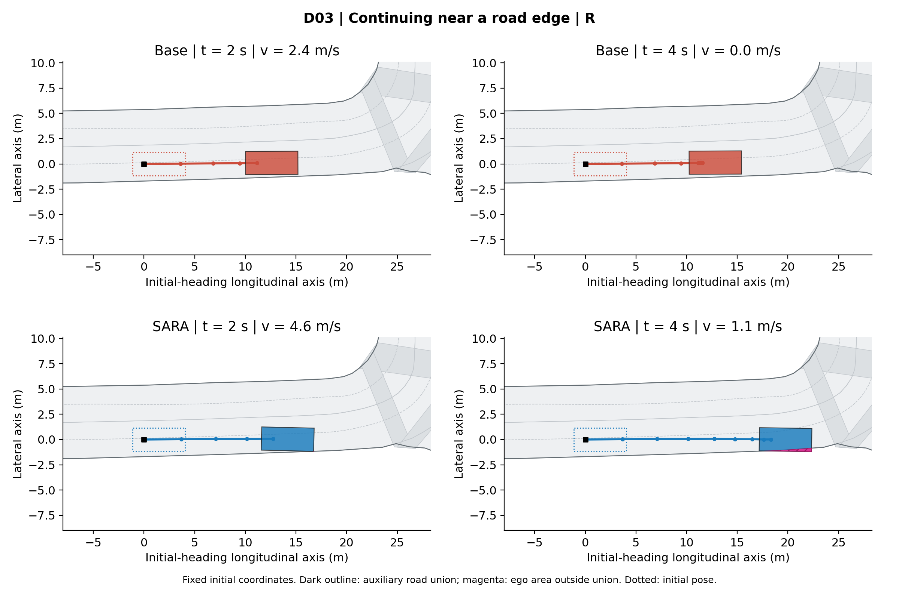

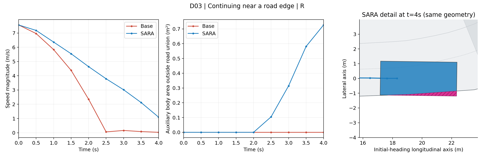

[完整 GIF](sara_DAC_regressions_D01_D06/figures/case_03.gif) · [原始前视](sara_DAC_regressions_D01_D06/camera/case_03_camera.jpg) · [PDF](sara_DAC_regressions_D01_D06/figures/case_03_2s_4s.pdf) · [SVG](sara_DAC_regressions_D01_D06/figures/case_03_2s_4s.svg)

## D04 · 沿路边继续前行，右侧车身越出（NR）

此例仅 NR 满足 DAC 1→0；R 两边均 DAC=0。不能跨模式混用。 四秒行程 Base 12.6 m → SARA 18.4 m；2 秒速度 1.4 → 3.6 m/s；4 秒速度 0.3 → 3.5 m/s。辅助几何首次检出越界约 1 s，最大角点超出约 0.52 m。

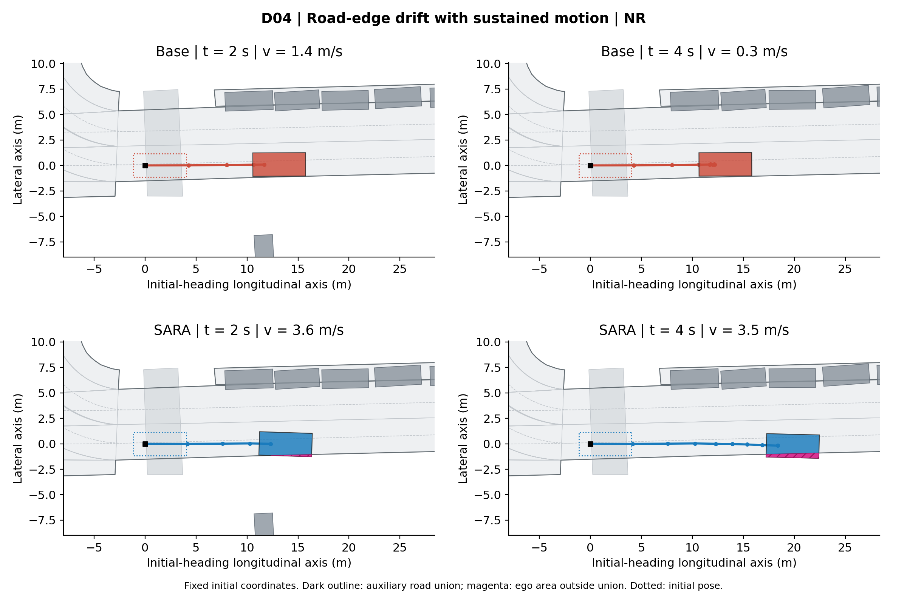

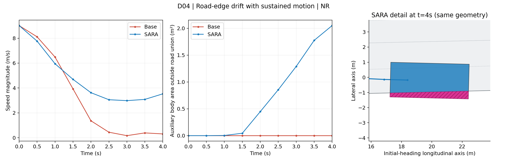

[完整 GIF](sara_DAC_regressions_D01_D06/figures/case_04.gif) · [原始前视](sara_DAC_regressions_D01_D06/camera/case_04_camera.jpg) · [PDF](sara_DAC_regressions_D01_D06/figures/case_04_2s_4s.pdf) · [SVG](sara_DAC_regressions_D01_D06/figures/case_04_2s_4s.svg)

## D05 · 出口弯道保持较高速度，中段越界（R）

越界主要发生在 2.5–3.5 秒，4 秒已减轻；附 3 秒关键时刻。 四秒行程 Base 22.2 m → SARA 28.9 m；2 秒速度 5.9 → 7.4 m/s；4 秒速度 3.5 → 7.5 m/s。辅助几何首次检出越界约 2 s，最大角点超出约 0.16 m。

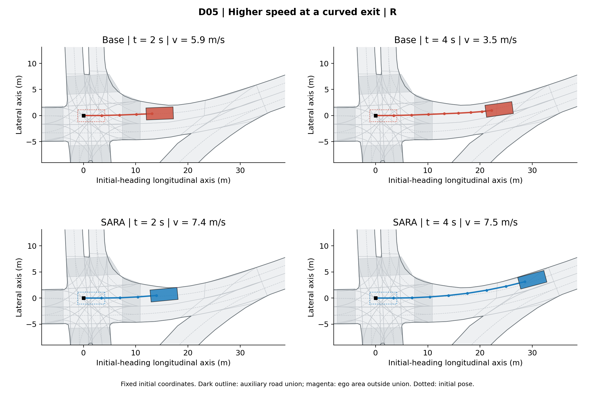

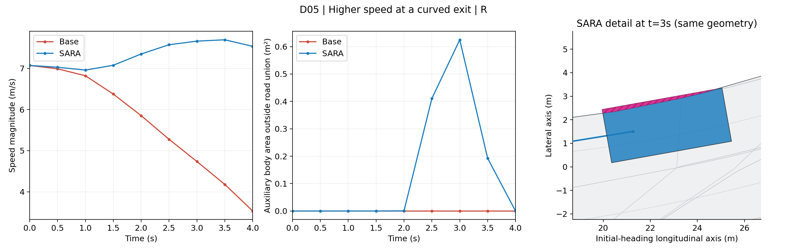

[完整 GIF](sara_DAC_regressions_D01_D06/figures/case_05.gif) · [原始前视](sara_DAC_regressions_D01_D06/camera/case_05_camera.jpg) · [PDF](sara_DAC_regressions_D01_D06/figures/case_05_2s_4s.pdf) · [SVG](sara_DAC_regressions_D01_D06/figures/case_05_2s_4s.svg)

D05 的越界峰值在 3 秒，总览的 4 秒已经减轻，请结合 GIF 和诊断曲线查看。

## D06 · 减速较晚，多走后贴出路边（R）

简单路段，转向差异细；展示减速时机与边缘余量的备选。 四秒行程 Base 9.7 m → SARA 13.4 m；2 秒速度 1.1 → 3.3 m/s；4 秒速度 0.3 → 0.1 m/s。辅助几何首次检出越界约 3 s，最大角点超出约 0.23 m。

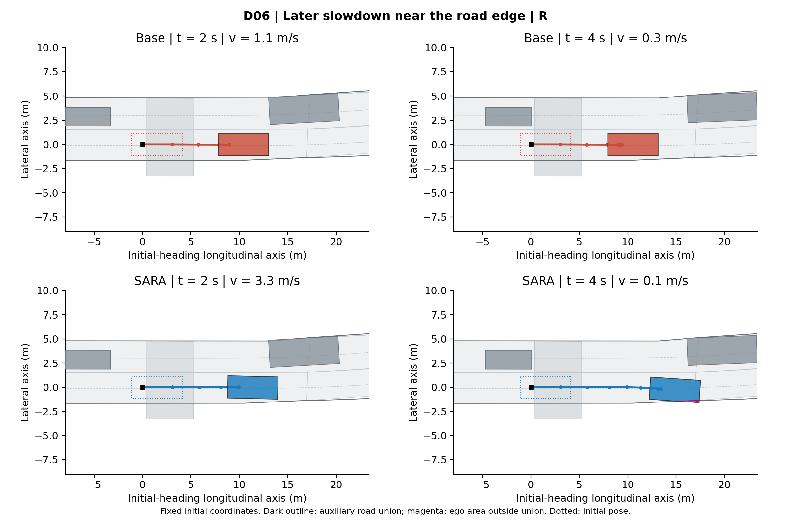

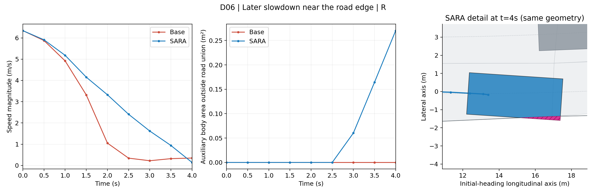

[完整 GIF](sara_DAC_regressions_D01_D06/figures/case_06.gif) · [原始前视](sara_DAC_regressions_D01_D06/camera/case_06_camera.jpg) · [PDF](sara_DAC_regressions_D01_D06/figures/case_06_2s_4s.pdf) · [SVG](sara_DAC_regressions_D01_D06/figures/case_06_2s_4s.svg)
