# 多类型失败候选 M01–M07（补充 DAC 组）

**建议先看 M01、M03、M06。** M01 是侧向车辆未通过时继续加速、NC 下降；M03 是加速靠近对向车辆、TTC 下降；M06 是相反的迟缓反应，前车已起步而自车仍降到近停。M02/M04 是交互备选，M05 是包含回退的混合失败，M07 的停车原因仍有不确定性。

[下载七例 ZIP](sara_diverse_failures_M01_M07.zip) · [可编辑 Python](sara_diverse_failures_M01_M07/plot_cases.py) · [说明与限制](sara_diverse_failures_M01_M07/README.md) · [分项指标](sara_diverse_failures_M01_M07/summary.csv)

这批每例 **Base 与 SARA 的 DAC 都为 1**，差异来自碰撞、TTC 或推进，继续采用“Base 的对应结果更好、画面与运动差异可核对”的筛选。没有使用正文七例的同一场景 token。部分交互采用 NR 模式，进度案例用 R；每个对比图内两种方法模式一致，模式写在标题上。

上排 Base、下排 SARA；左 2s、右 4s。橙色车辆逐帧使用同一个 track token 核对，不是按空间最近物体临时切换。速度、行程和间隙曲线一起提供；M01–M05 另附 2/3/3.5/4s 关键帧，以免漏掉中间的接触或危险接近。没有箭头、轨迹平滑或坐标修正。

## M01 · 侧向车辆尚未通过就继续加速（NR）

**碰撞 · 优先。** Base NC/TTC=1；SARA NC/TTC=0，2.5–3.5s 与橙色车辆出现采样车身重叠。Base 先等再起步，SARA 提前加速。 实际四秒行程 4.1→14.1m；2 秒速度 0.4→3.3m/s。

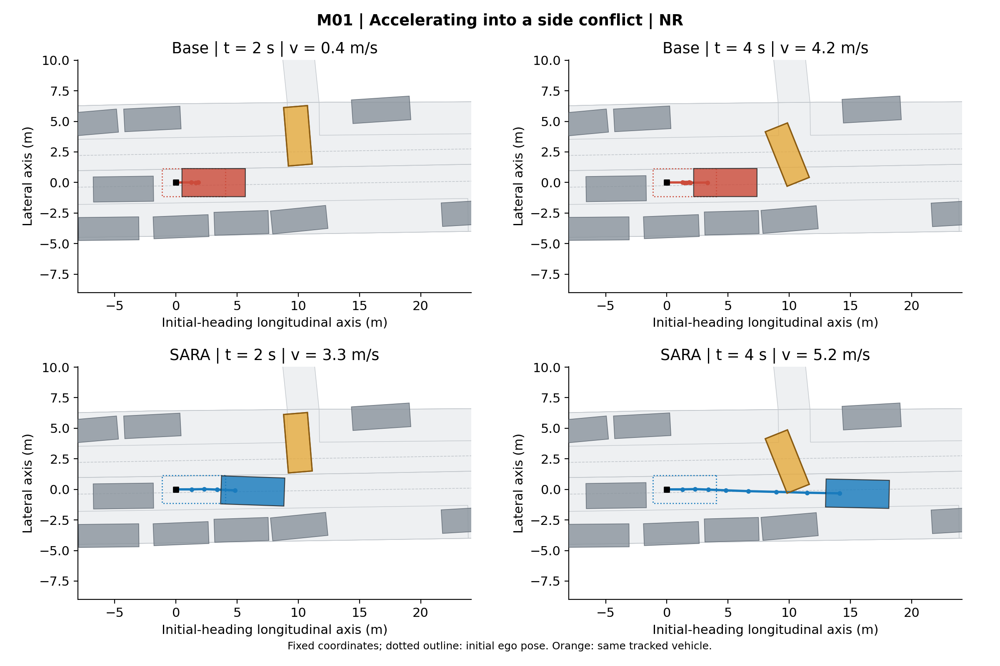

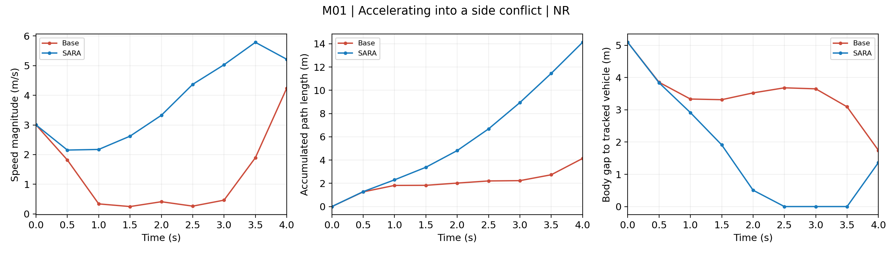

[GIF](sara_diverse_failures_M01_M07/figures/case_01.gif) · [前视画面](sara_diverse_failures_M01_M07/camera/case_01_camera.jpg) · [PDF](sara_diverse_failures_M01_M07/figures/case_01_2s_4s.pdf) · [SVG](sara_diverse_failures_M01_M07/figures/case_01_2s_4s.svg)

[2/3/3.5/4s 关键帧](sara_diverse_failures_M01_M07/figures/case_01_critical_2s_4s.png)

## M02 · 路口加速后与卡车发生冲突（NR）

**碰撞 · 备选。** Base 按右转方向减速，SARA 加速并更趋直行，3.5s 起与橙色卡车重叠，NC/TTC 1→0。此例同时有路线差异，不能只归因速度。 实际四秒行程 13.2→25.7m；2 秒速度 5.0→7.1m/s。

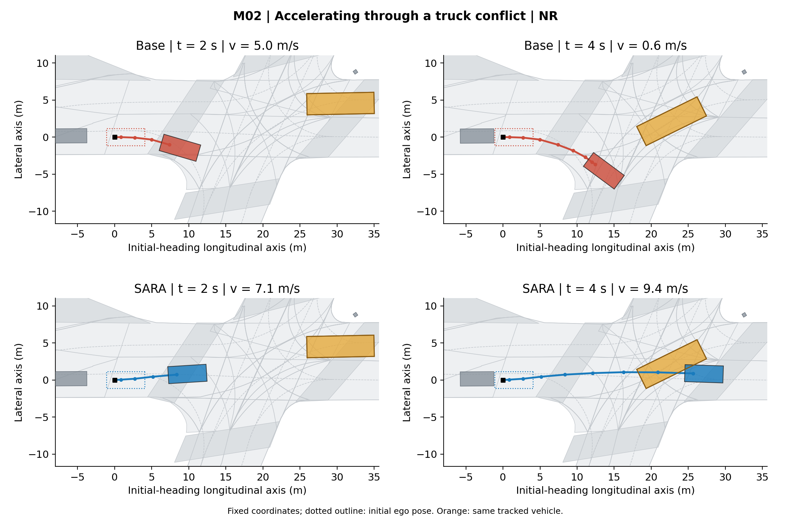

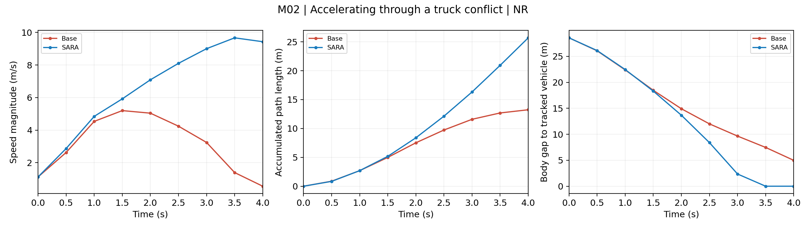

[GIF](sara_diverse_failures_M01_M07/figures/case_02.gif) · [前视画面](sara_diverse_failures_M01_M07/camera/case_02_camera.jpg) · [PDF](sara_diverse_failures_M01_M07/figures/case_02_2s_4s.pdf) · [SVG](sara_diverse_failures_M01_M07/figures/case_02_2s_4s.svg)

[2/3/3.5/4s 关键帧](sara_diverse_failures_M01_M07/figures/case_02_critical_2s_4s.png)

## M03 · 遇到对向来车仍加速通过（NR）

**危险接近 · 优先。** 两边 NC/DAC=1，TTC 1→0。SARA 在减速后重新加速，3s 左右与目标车最近间隙约 0.11m；未检出离散采样车身重叠。 实际四秒行程 10.1→29.2m；2 秒速度 1.4→7.9m/s。

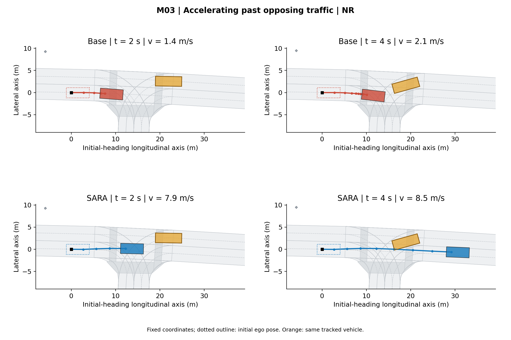

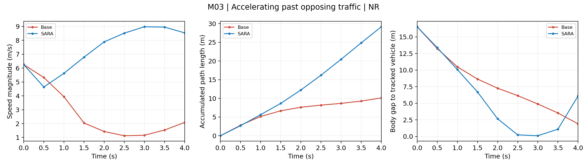

[GIF](sara_diverse_failures_M01_M07/figures/case_03.gif) · [前视画面](sara_diverse_failures_M01_M07/camera/case_03_camera.jpg) · [PDF](sara_diverse_failures_M01_M07/figures/case_03_2s_4s.pdf) · [SVG](sara_diverse_failures_M01_M07/figures/case_03_2s_4s.svg)

[2/3/3.5/4s 关键帧](sara_diverse_failures_M01_M07/figures/case_03_critical_2s_4s.png)

## M04 · 横向来车前继续加速穿过路口（NR）

**危险接近/接触 · 备选。** 正式 NC/DAC 两边均为 1，TTC 1→0；SARA 在 3–3.5s 有几何车身重叠，不能称为无接触，也不能改写为正式有责碰撞。 实际四秒行程 4.2→21.6m；2 秒速度 0.1→5.4m/s。

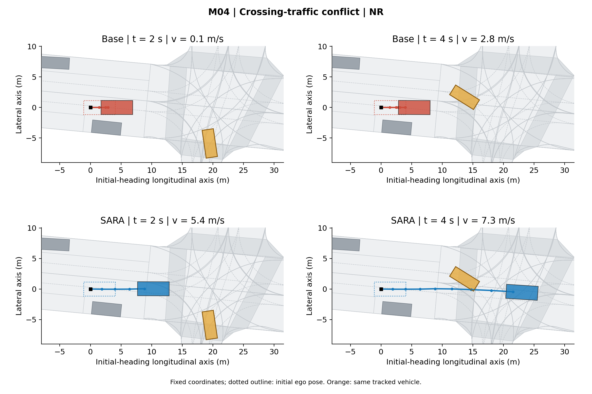

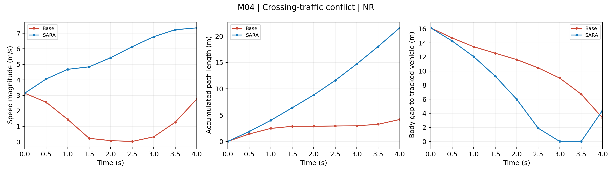

[GIF](sara_diverse_failures_M01_M07/figures/case_04.gif) · [前视画面](sara_diverse_failures_M01_M07/camera/case_04_camera.jpg) · [PDF](sara_diverse_failures_M01_M07/figures/case_04_2s_4s.pdf) · [SVG](sara_diverse_failures_M01_M07/figures/case_04_2s_4s.svg)

[2/3/3.5/4s 关键帧](sara_diverse_failures_M01_M07/figures/case_04_critical_2s_4s.png)

## M05 · 较早急减速后，右后侧仍发生接触（NR）

**减速与侧后方交互 · 混合因素备选。** Base NC=1，SARA NC=0。SARA 更早接近停车，随后右后侧车辆接近并在 3.5s 出现重叠。SARA 另有约 0.87m 累计回退，不能把失败全归因于减速。 实际四秒行程 7.9→5.6m；2 秒速度 1.7→0.3m/s。

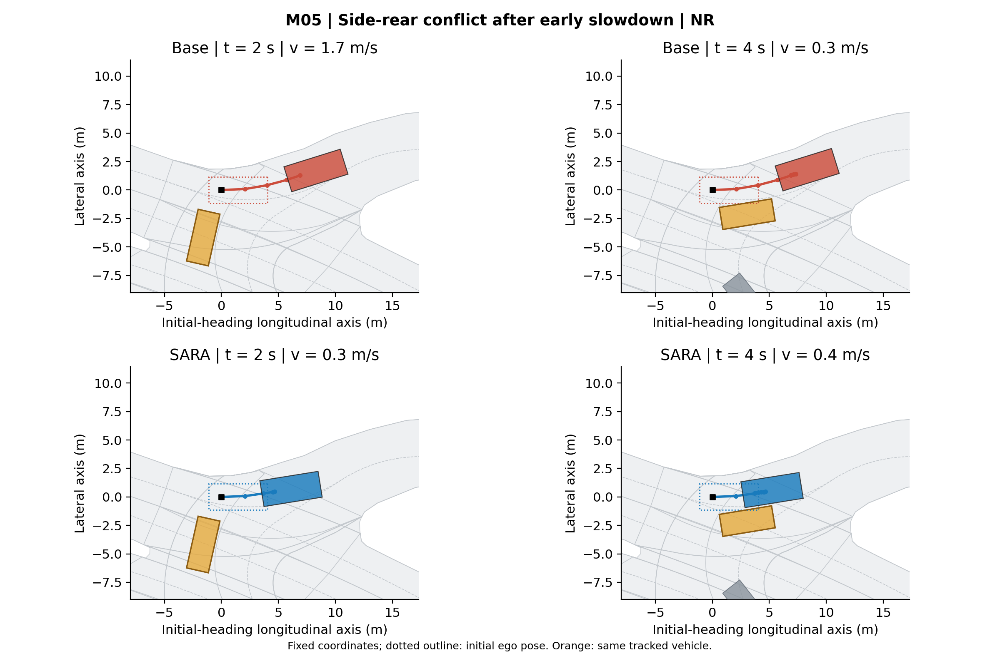

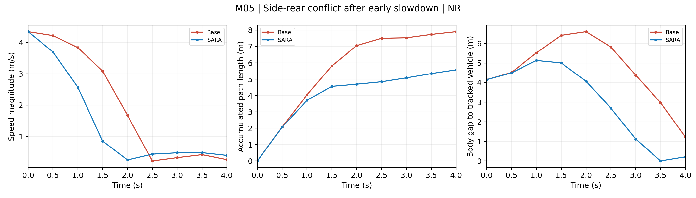

[GIF](sara_diverse_failures_M01_M07/figures/case_05.gif) · [前视画面](sara_diverse_failures_M01_M07/camera/case_05_camera.jpg) · [PDF](sara_diverse_failures_M01_M07/figures/case_05_2s_4s.pdf) · [SVG](sara_diverse_failures_M01_M07/figures/case_05_2s_4s.svg)

[2/3/3.5/4s 关键帧](sara_diverse_failures_M01_M07/figures/case_05_critical_2s_4s.png)

[M05 在 3.5 秒的多视角相机](sara_diverse_failures_M01_M07/camera/case_05_surround_3p5s.jpg)

## M06 · 前车已起步，SARA 仍降到近停（R）

**推进下降 · 优先。** 两边 NC/DAC/TTC=1。Base 跟随前车加速，SARA 继续降到近停，与前车间隙从约 8.2m 扩到约 17.9m，EP 1→约0.19。 实际四秒行程 9.9→1.7m；2 秒速度 1.9→0.3m/s。

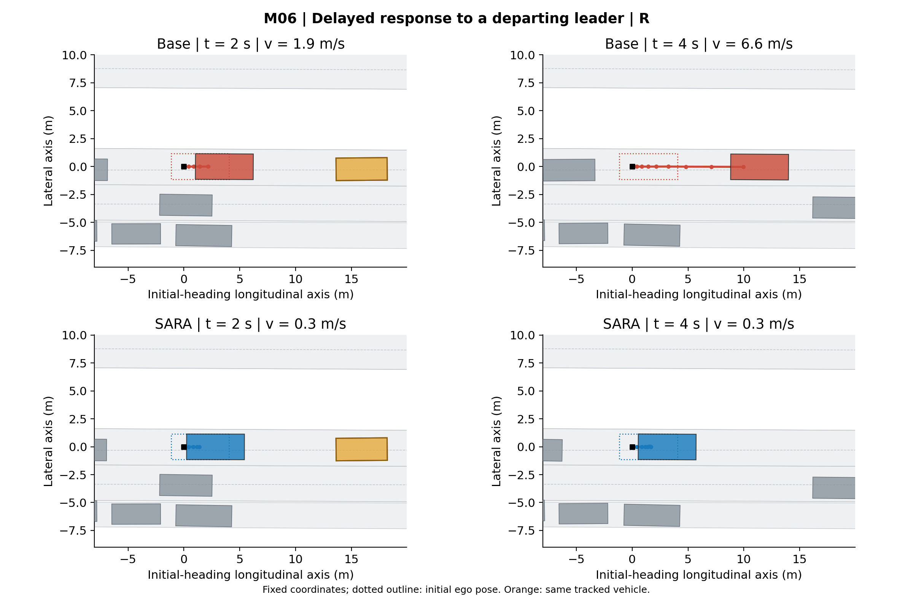

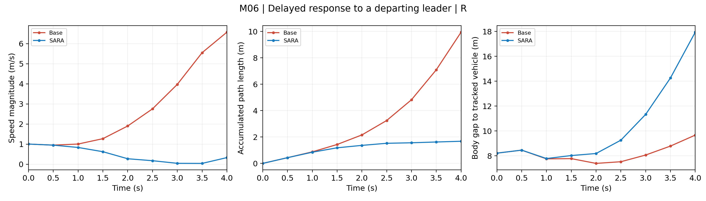

[GIF](sara_diverse_failures_M01_M07/figures/case_06.gif) · [前视画面](sara_diverse_failures_M01_M07/camera/case_06_camera.jpg) · [PDF](sara_diverse_failures_M01_M07/figures/case_06_2s_4s.pdf) · [SVG](sara_diverse_failures_M01_M07/figures/case_06_2s_4s.svg)

## M07 · 接近路口时过早停下，推进明显落后（R）

**推进下降 · 备选，解释较弱。** 两边 NC/DAC/TTC=1；Base 四秒推进约27m，SARA 约4m，EP 1→约0.19。SARA 有约0.28m 回退；其停车动机和完整路权无法仅凭画面确认。 实际四秒行程 27.3→3.8m；2 秒速度 6.7→0.4m/s。

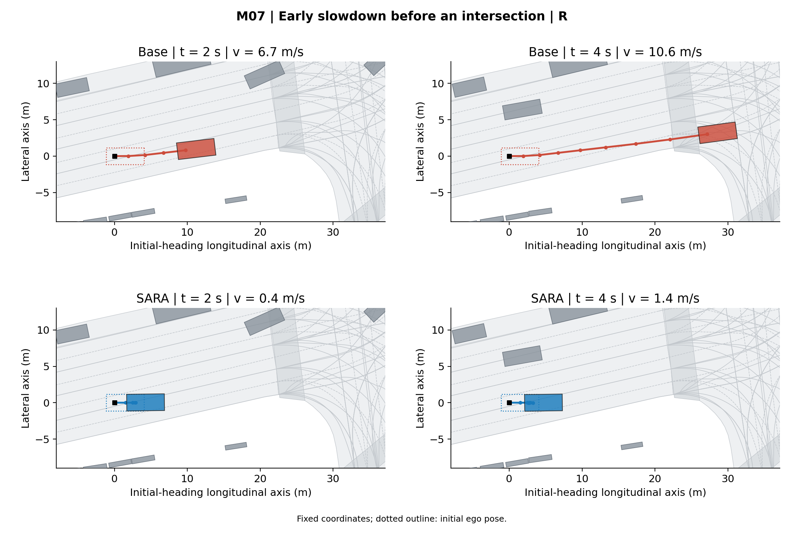

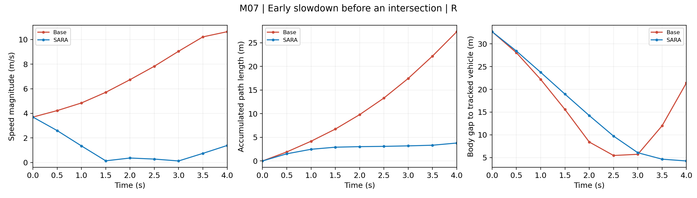

[GIF](sara_diverse_failures_M01_M07/figures/case_07.gif) · [前视画面](sara_diverse_failures_M01_M07/camera/case_07_camera.jpg) · [PDF](sara_diverse_failures_M01_M07/figures/case_07_2s_4s.pdf) · [SVG](sara_diverse_failures_M01_M07/figures/case_07_2s_4s.svg)
