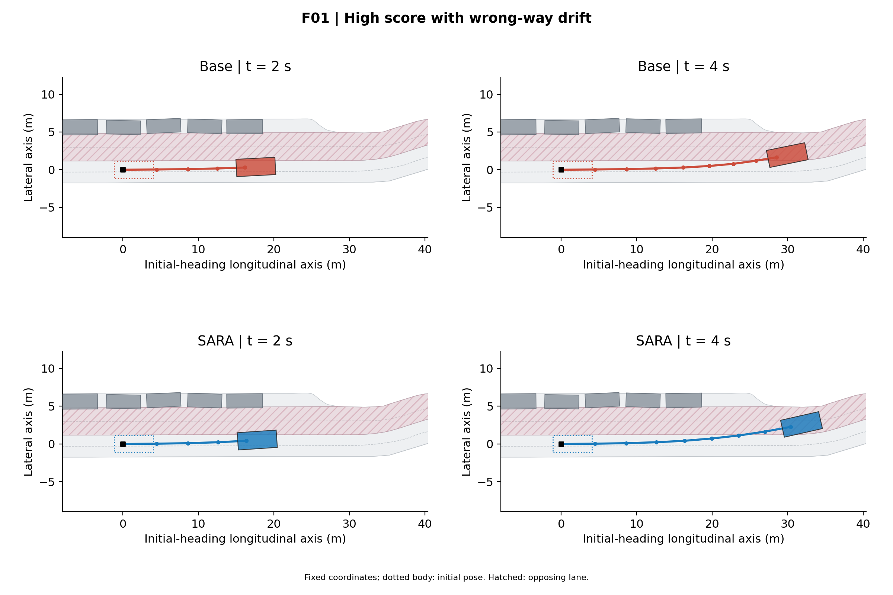
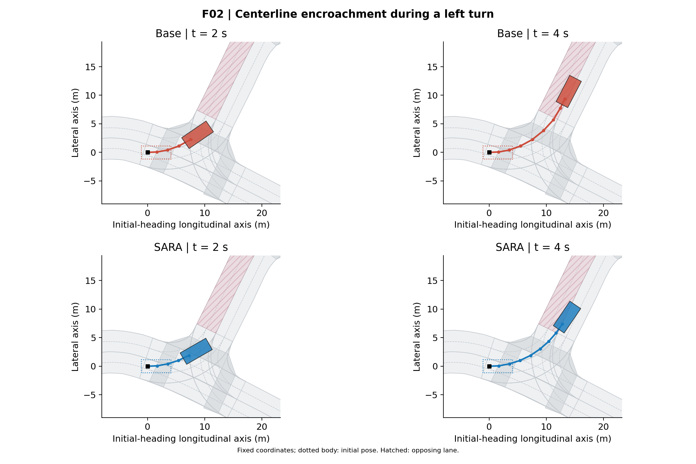
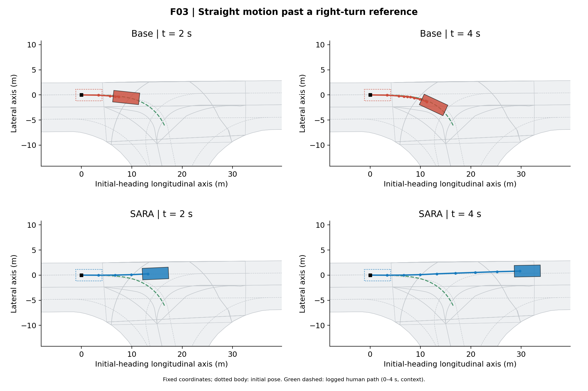
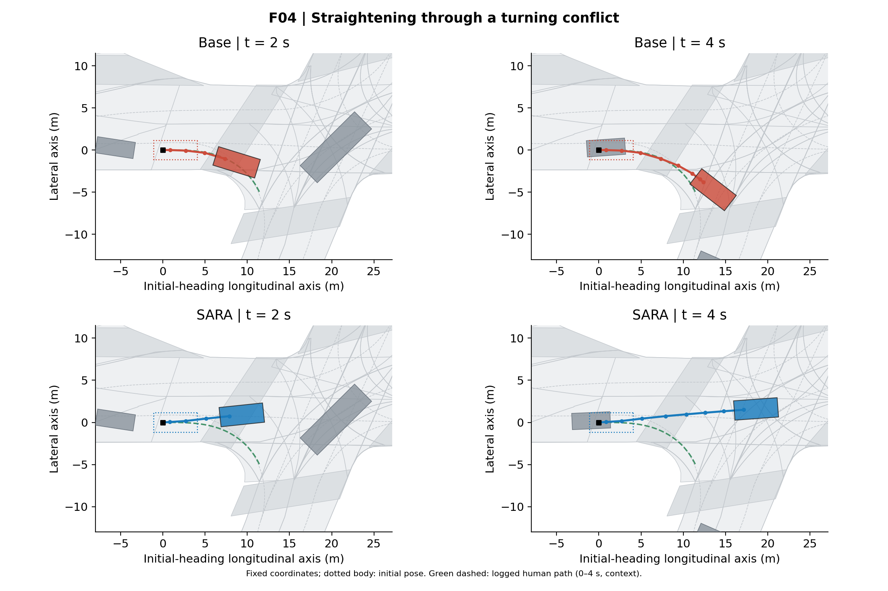
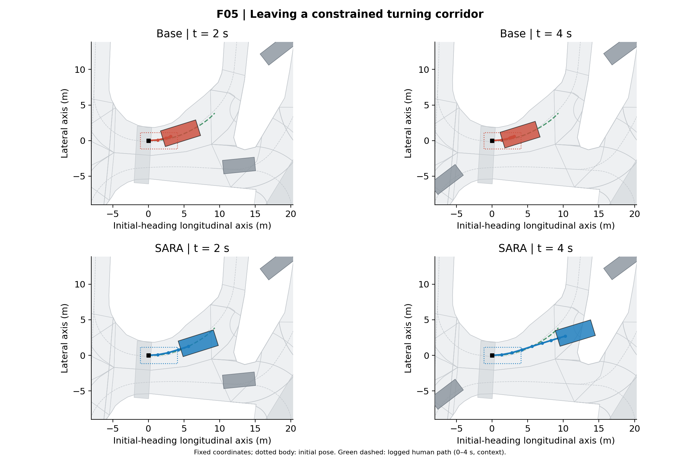
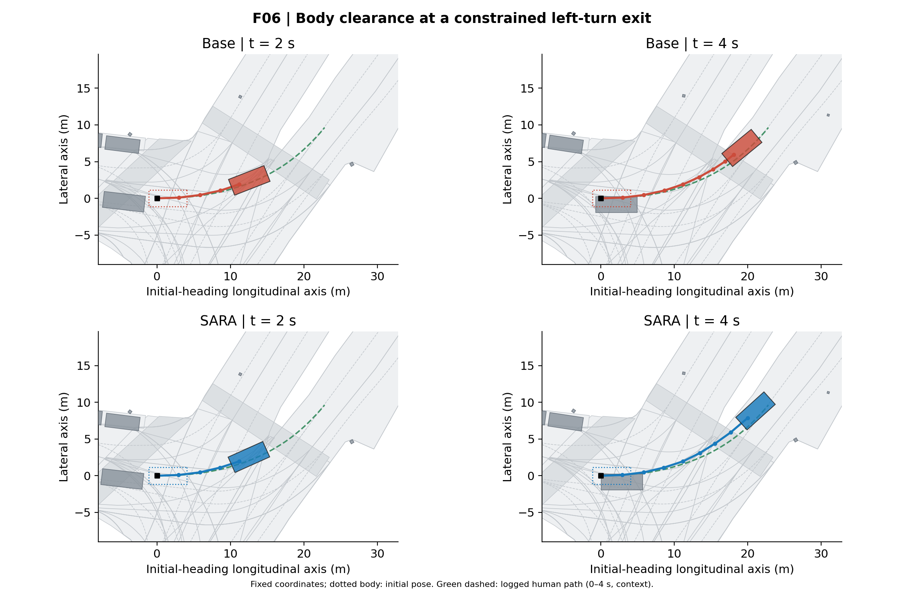
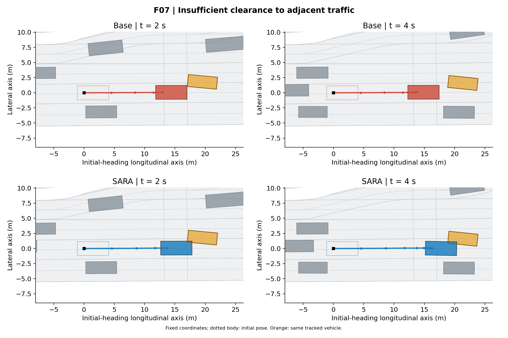
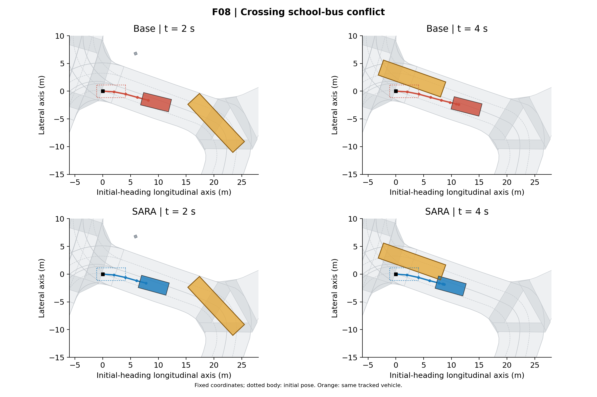
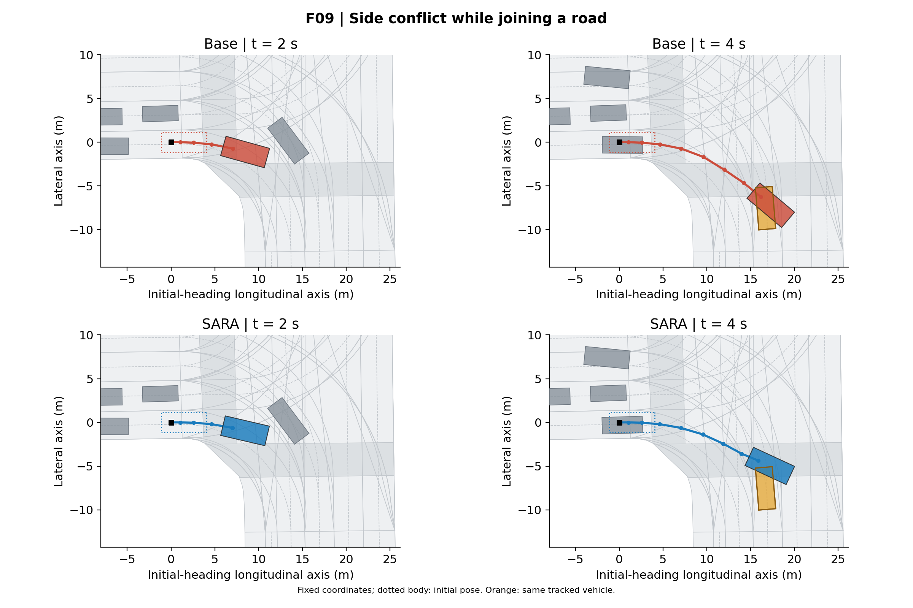
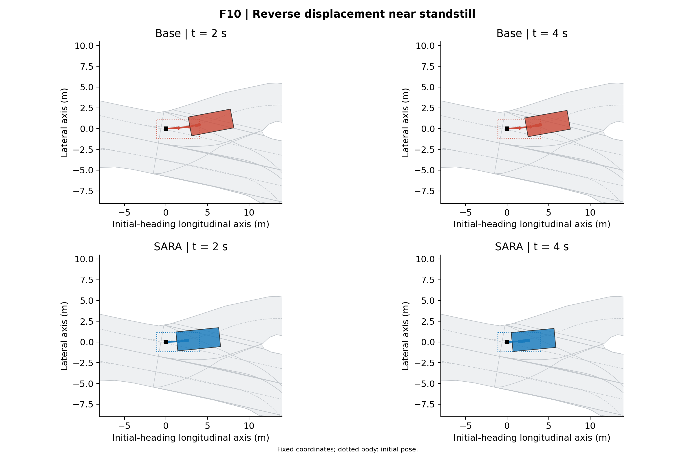

# SARA 失败候选 F01–F10

**先看 F01、F03、F05、F08、F10**：分别对应方向语义、路线任务、复杂静态空间、横穿大车交互和近停执行。F10 偏执行机制；如果更希望第五例也强调交通决策，可以换成 F09。F02/F04/F06 分别是 F01/F03/F05 的同类替换项。

[下载全部十例 ZIP](sara_failure_candidates_F01_F10.zip) · [可编辑 Python](sara_failure_candidates_F01_F10/plot_failures.py) · [完整分析与使用说明](sara_failure_candidates_F01_F10/README.md) · [指标汇总](sara_failure_candidates_F01_F10/summary.csv)

使用与正文七例相同的 Base / SARA checkpoint 和 R 模式。排除了七例所在的同一记录片段；保留 Base 对照，不把双方共同的问题说成 SARA 独有的退化。此次筛查 52 个候选，选出 10 个；这些数量不能用于估计各失败类型的发生率。

**图例：** 上排 Base、下排 SARA；左列 2s、右列 4s。粉色斜线区域为已核对的普通对向车道；橙色是跨帧核对过身份的交互车辆；绿色虚线是同一初始位姿的原始人类记录路径（0–4s，只作任务上下文，不是额外模型或预测）。无箭头、无轨迹修正。F08 另附 2/3/4s 关键时刻，避免仅看首尾遗漏冲突峰值。

| 候选 | 主题 | 选图建议 |
|---|---|---|
| F01 | 高分之下逐步驶入对向车道 | 优先 |
| F02 | 左转时压过中心线，评分几乎不变 | 同类备选 |
| F03 | 安全与进度满分，却走错路口出口 | 优先 |
| F04 | 有横向车辆时，安全分提升伴随放弃右转参考 | 同类备选 |
| F05 | 柱廊入口附近，没有沿弯曲通道转入 | 优先 |
| F06 | 桥头紧凑左转时的车身越界 | 同类备选 |
| F07 | 与邻车的侧向余量不足，减速后仍擦碰 | 备选 |
| F08 | 横穿转弯的校车占据通行空间 | 优先 |
| F09 | 右转汇入主路时与横向车流重叠 | 备选 |
| F10 | 低速接近停车后出现实际回退 | 优先（偏执行机制） |

### F01 · 高分之下逐步驶入对向车道

**看到什么：** SARA 的 PDM=0.982、DAC=1，但普通对向车道的车身覆盖从 0 增至约 98%；前视画面也显示双黄线移到了自车右侧。Base 同样存在此问题（最大约 81%），不是 SARA 独有的新退化。

**比正文多了什么困难：** 正文 46 展示局部道路边缘保持；这里区分“仍在可行驶路面”与“行驶方向合法”。方向约束是额外的语义要求。

**可以讨论：** 说明这些正式评测分项的高分不足以证明方向正确；与奖励/评测覆盖范围的局限有关。

**不能过度归因：** 没有逐候选训练奖励，不能称为已证实的 reward hacking，也不能证明模型有意利用指标。

[GIF](sara_failure_candidates_F01_F10/figures/failure_F01.gif) · [原始前视](sara_failure_candidates_F01_F10/camera/failure_F01_camera.jpg) · [诊断曲线](sara_failure_candidates_F01_F10/figures/failure_F01_diagnostics.png) · [PDF](sara_failure_candidates_F01_F10/figures/failure_F01_2s_4s.pdf) · [SVG](sara_failure_candidates_F01_F10/figures/failure_F01_2s_4s.svg)

### F02 · 左转时压过中心线，评分几乎不变

**看到什么：** SARA PDM=0.993、DAC=1，普通对向车道最大车身覆盖约 37%；Base 最大约 65%，其 PDM 仍为 1。SARA 比 Base 轻，但并未消除越线。

**比正文多了什么困难：** 区别于正文中“能继续左转”的推进收益，此处要求转弯时同时满足车道方向与完整车身空间约束。

**可以讨论：** 与 F01 一起说明推进/可行驶区域合规并不自动等价于合法车道选择。

**不能过度归因：** 该例不是整车长时间逆行；主要是车身局部越线。建议与 F01 二选一，不把两个同类例子当成两种独立能力。

[GIF](sara_failure_candidates_F01_F10/figures/failure_F02.gif) · [原始前视](sara_failure_candidates_F01_F10/camera/failure_F02_camera.jpg) · [诊断曲线](sara_failure_candidates_F01_F10/figures/failure_F02_diagnostics.png) · [PDF](sara_failure_candidates_F01_F10/figures/failure_F02_2s_4s.pdf) · [SVG](sara_failure_candidates_F01_F10/figures/failure_F02_2s_4s.svg)

### F03 · 安全与进度满分，却走错路口出口

**看到什么：** 同起点原始记录四秒内右转约 64°，Base 右转约 25°；SARA 仅转约 +1°、继续直行，PDM 和 EP 都为 1。原始记录与闭环初始位姿已对齐；数据库指定路线 ID 与闭环输入一致。SARA 从 2.5 s 起进入非路线连接段，路线覆盖降至 0；Base 仍为 100%。

**比正文多了什么困难：** 正文 17/20 是沿明确弯道继续推进；这里在有多个可通行出口的路口，需要把推进与任务分支一致性联系起来。

**可以讨论：** 可以讨论局部安全/推进评分与路线任务完成度之间的差别。

**不能过度归因：** 此例已将数据库路线、闭环输入、地图节点与原始轨迹交叉核对，可描述为偏离指定路线；走错任务路线不等于违反交通法规。原始记录仍不是唯一最优走法的证明。

[GIF](sara_failure_candidates_F01_F10/figures/failure_F03.gif) · [原始前视](sara_failure_candidates_F01_F10/camera/failure_F03_camera.jpg) · [诊断曲线](sara_failure_candidates_F01_F10/figures/failure_F03_diagnostics.png) · [PDF](sara_failure_candidates_F01_F10/figures/failure_F03_2s_4s.pdf) · [SVG](sara_failure_candidates_F01_F10/figures/failure_F03_2s_4s.svg)

### F04 · 有横向车辆时，安全分提升伴随放弃右转参考

**看到什么：** 原始记录四秒内右转约 67°，Base 约 38°；SARA 约 +4°、直行经过路口。SARA TTC=1、PDM=0.931，而 Base TTC=0。前视图有横向经过的卡车。数据库与闭环路线 ID 一致，SARA 从 2.5 s 起完全位于非路线连接段；Base 仍基本留在指定路线。

**比正文多了什么困难：** 比正文单纯避免前车追撞多了任务一致性：不能只看是否避开当前冲突，还要看是否继续完成同一个转弯任务。

**可以讨论：** 展示短时安全与原始路线参考之间可能存在的取舍；作为任务一致性备选。

**不能过度归因：** 无法证明 SARA 是“为了避撞故意直行”，也不能用四秒记录推断之后是否会重新回到路线。与 F03 建议二选一。

[GIF](sara_failure_candidates_F01_F10/figures/failure_F04.gif) · [原始前视](sara_failure_candidates_F01_F10/camera/failure_F04_camera.jpg) · [诊断曲线](sara_failure_candidates_F01_F10/figures/failure_F04_diagnostics.png) · [PDF](sara_failure_candidates_F01_F10/figures/failure_F04_2s_4s.pdf) · [SVG](sara_failure_candidates_F01_F10/figures/failure_F04_2s_4s.svg)

### F05 · 柱廊入口附近，没有沿弯曲通道转入

**看到什么：** 在有柱廊和分叉通道的入口，SARA 推进约 10.7 m 后车身越出地图通道，DAC=0；同向车道覆盖最低约 60%。Base 只推进约 3.8 m，DAC=1。原始记录持续左转，SARA 转向不足。

**比正文多了什么困难：** 正文 46 的普通路段保持与这里的窄通道/柱廊场景不同；后者更依赖可通行空间、路口结构和完整车身几何。

**可以讨论：** 说明仅改善候选选择尚未保证在复杂静态空间中输出几何可行的连续执行。

**不能过度归因：** 没有记录到与柱子的物理碰撞，不能写“撞柱”；也没有完整候选集合，不能断言所有候选都不可行或感知漏检柱子。

[GIF](sara_failure_candidates_F01_F10/figures/failure_F05.gif) · [原始前视](sara_failure_candidates_F01_F10/camera/failure_F05_camera.jpg) · [诊断曲线](sara_failure_candidates_F01_F10/figures/failure_F05_diagnostics.png) · [PDF](sara_failure_candidates_F01_F10/figures/failure_F05_2s_4s.pdf) · [SVG](sara_failure_candidates_F01_F10/figures/failure_F05_2s_4s.svg)

### F06 · 桥头紧凑左转时的车身越界

**看到什么：** 桥头有隔离设施与紧凑出口。Base 与 SARA 的 DAC 均为 0，同向车道车身覆盖最低分别约 37% 和 34%；SARA 推进更多，但仍保留明显空间约束问题。

**比正文多了什么困难：** 这里关注转弯扫过的整车空间，不能用“转向意图正确、推进更远”代替完整通行可行性。

**可以讨论：** 可作为两种策略共享的残余几何弱点，与冻结的感知/生成能力边界相容。

**不能过度归因：** 地图覆盖是辅助诊断，低覆盖不等于所有对应部分都撞上物体；两种模型都失败不能证明候选库缺少好轨迹。F05 的差异更直观。

[GIF](sara_failure_candidates_F01_F10/figures/failure_F06.gif) · [原始前视](sara_failure_candidates_F01_F10/camera/failure_F06_camera.jpg) · [诊断曲线](sara_failure_candidates_F01_F10/figures/failure_F06_diagnostics.png) · [PDF](sara_failure_candidates_F01_F10/figures/failure_F06_2s_4s.pdf) · [SVG](sara_failure_candidates_F01_F10/figures/failure_F06_2s_4s.svg)

### F07 · 与邻车的侧向余量不足，减速后仍擦碰

**看到什么：** 橙色邻车位于左前侧，其中心在初始横向坐标中约由 2.04 m 移到 1.62 m；这不是完整换道。SARA 已明显减速，但 2.0–4.0 s 仍持续有采样车身重叠，峰值约 0.59 m²；两边正式 NC 均为 0。

**比正文多了什么困难：** 正文 41/42 主要是同车道纵向间距；这里额外涉及邻车的侧向侵入与车身角部余量。

**可以讨论：** 说明纵向减速本身不能保证完整车身避碰。

**不能过度归因：** 画面差异较细，且仍包含纵向接近因素；不要夸大为突然大幅加塞。若担心与正文碰撞案例重复，优先选 F08。

[GIF](sara_failure_candidates_F01_F10/figures/failure_F07.gif) · [原始前视](sara_failure_candidates_F01_F10/camera/failure_F07_camera.jpg) · [诊断曲线](sara_failure_candidates_F01_F10/figures/failure_F07_diagnostics.png) · [PDF](sara_failure_candidates_F01_F10/figures/failure_F07_2s_4s.pdf) · [SVG](sara_failure_candidates_F01_F10/figures/failure_F07_2s_4s.svg)

### F08 · 横穿转弯的校车占据通行空间

**看到什么：** 校车从右侧支路转入并横穿自车路径，目标身份已跨帧核对。SARA 虽减速，2.5 s 起出现车身重叠，3.0 s 约 3.81 m²；Base 同样失败，两边 NC/TTC 均为 0。

**比正文多了什么困难：** 与正文跟车追尾不同，这里需要预见横向来车的未来占用空间，以及大车转弯时整车扫过的区域。

**可以讨论：** 可以讨论跨向交互与大车几何的残余困难；选择器对当前特征的改善并未保证正确的未来冲突判断。

**不能过度归因：** SARA 也有约 0.26 m 的低速回退和局部对向车道重叠，已保留；不能把这例归因于单一因素。仅是候选，不能凭它证明规划视野长度是直接原因。

[GIF](sara_failure_candidates_F01_F10/figures/failure_F08.gif) · [原始前视](sara_failure_candidates_F01_F10/camera/failure_F08_camera.jpg) · [诊断曲线](sara_failure_candidates_F01_F10/figures/failure_F08_diagnostics.png) · [PDF](sara_failure_candidates_F01_F10/figures/failure_F08_2s_4s.pdf) · [SVG](sara_failure_candidates_F01_F10/figures/failure_F08_2s_4s.svg)

[F08 的 2/3/4s 关键时刻](sara_failure_candidates_F01_F10/figures/failure_F08_critical_2s_4s.png)

### F09 · 右转汇入主路时与横向车流重叠

**看到什么：** 自车右转时，目标车辆从右侧沿主路接近。4 s 两边均出现采样车身重叠；SARA 约 1.58 m²。正式 TTC=0，但 NC=1。SARA 转向程度也明显小于原始记录。

**比正文多了什么困难：** 正文的同向跟车间距不涵盖右转进入主路时的横向间隙选择与车道接入角度。

**可以讨论：** 既可展示转弯接入的交互困难，也提醒 no-at-fault collision 不是“绝无车身接触”的同义词。

**不能过度归因：** 不能把 NC=1 改写成正式有责碰撞；这里只确认几何重叠与 TTC 失败。责任或路权需要额外信息，不依据单帧灯色推断。

[GIF](sara_failure_candidates_F01_F10/figures/failure_F09.gif) · [原始前视](sara_failure_candidates_F01_F10/camera/failure_F09_camera.jpg) · [诊断曲线](sara_failure_candidates_F01_F10/figures/failure_F09_diagnostics.png) · [PDF](sara_failure_candidates_F01_F10/figures/failure_F09_2s_4s.pdf) · [SVG](sara_failure_candidates_F01_F10/figures/failure_F09_2s_4s.svg)

### F10 · 低速接近停车后出现实际回退

**看到什么：** 在建筑入口附近减速后，SARA 四秒内累计约 0.85 m 车头反方向位移。该变化直接来自全局位姿，诊断图用带符号位移显示，不是相机或坐标轴漂移。

**比正文多了什么困难：** 区别于正文的“是否继续推进”，这里的问题是已选轨迹在近停状态下是否满足执行稳定性约束。

**可以讨论：** 已核对的直接位置执行链没有停车锁定或禁止反向位移的约束，选择适应并不会自动补上这类执行保证。

**不能过度归因：** 不能称为模型有意倒车；候选生成与打分的责任仍不可分。全量可读 R 记录中，SARA 的明显回退发生数低于 Base（56/280 对 96/280），这是仍存在的共性边界，不是整体退化。

[GIF](sara_failure_candidates_F01_F10/figures/failure_F10.gif) · [原始前视](sara_failure_candidates_F01_F10/camera/failure_F10_camera.jpg) · [诊断曲线](sara_failure_candidates_F01_F10/figures/failure_F10_diagnostics.png) · [PDF](sara_failure_candidates_F01_F10/figures/failure_F10_2s_4s.pdf) · [SVG](sara_failure_candidates_F01_F10/figures/failure_F10_2s_4s.svg)
