# SARA：新增五个较低速度的闭环案例（06–10）

**[可编辑绘图包：Python 源码、完整绘图数据、PDF / SVG 矢量图](../editable/README.md)**

对应论文主表的 **NavTrain50 Base vs SARA online rare-log，seed 0，epoch 2**。与第一批五例不重复。

**优先看 ⑥减速右转 + ⑦低速左转；若希望覆盖交互安全，可用⑧跟车避碰替换其中一个。⑨、⑩作为备选。**

[返回第一批](../README.md) · [总览 PDF](five_cases_overview.pdf) · [下载本批材料](sara_five_more_cases.zip) · [数据核验](verification.json)

这次把速度作为选例偏好：五例 SARA 的采样峰值均低于 4.2 m/s（约 15.1 km/h），第一批⑤约为 9.84 m/s（35.4 km/h）。速度来自每 0.5 秒保存的状态，因此不是连续时间峰值保证，也不是安全阈值。

| 案例 | R PDM：Base → SARA | NR PDM：Base → SARA | SARA 采样峰值 |
|---|---:|---:|---:|
| 6. 减速右转，保持道路合规 | 0.00 → 95.95 | 0.00 → 93.91 | 4.18 m/s（15.1 km/h） |
| 7. 低速左转，改善路口停滞 | 64.17 → 100.00 | 65.31 → 100.00 | 3.23 m/s（11.6 km/h） |
| 8. 路口跟车减速，避免碰撞 | 0.00 → 95.40 | 0.00 → 95.42 | 1.49 m/s（5.4 km/h） |
| 9. 拥堵车流中减速，改善 TTC | 58.33 → 80.67 | 58.33 → 78.11 | 2.69 m/s（9.7 km/h） |
| 10. 低速收停，避免道路越界 | 0.00 → 79.00 | 0.00 → 79.00 | 1.87 m/s（6.7 km/h） |

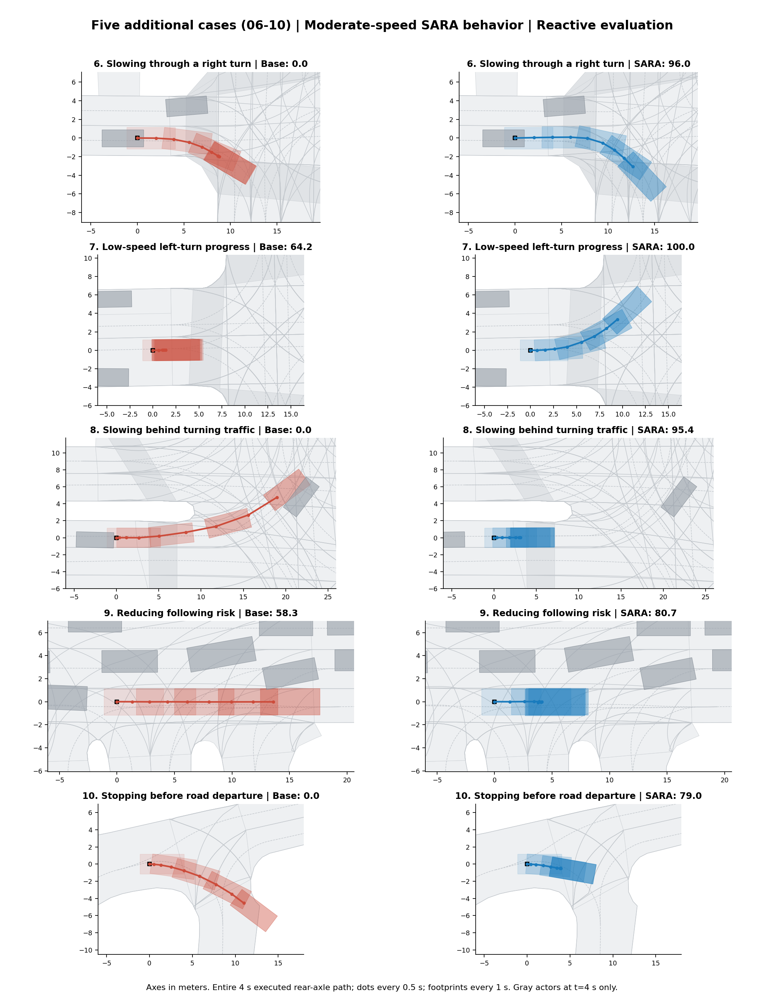

下方图和动画统一展示 R 模式。图中的路径是完整 **4 秒闭环评测片段**的实际后轴位姿（9 帧），不是单次预测轨迹，也不是整段原始驾驶日志。起始 ego、周围车辆状态和时间戳已经核对一致；后续 reactive 交通在两个 rollout 中各自演化。

五例在 R / NR 的得分均提升，SARA 的 NC、DAC、TTC 均通过。总览中的灰色车辆只表示末帧；判断交互请看同步动画。前视画面来自仿真器渲染，可能有渲染伪影。PDM 与 EP 在文中按 0–100 展示，NC/DAC/TTC 按 0/1 表示。

## 6. 减速右转，保持道路合规

Base 右转时较早向内侧切入，DAC=0；SARA 减速沿较外侧路径继续转弯，DAC=1。SARA 从 4.18 降至 2.59 m/s，适合展示道路几何与转向决策。该片段不代表完成整次转弯。

场景：`2021.09.16.15.12.03_veh-42_01037_01434-66dca10d8f315889`

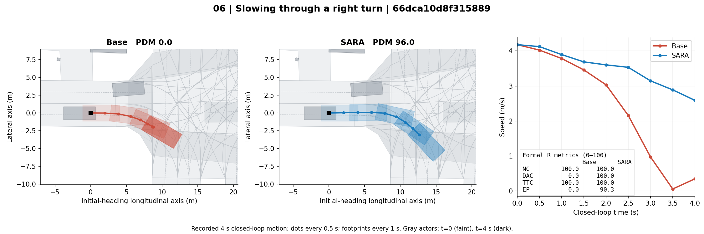

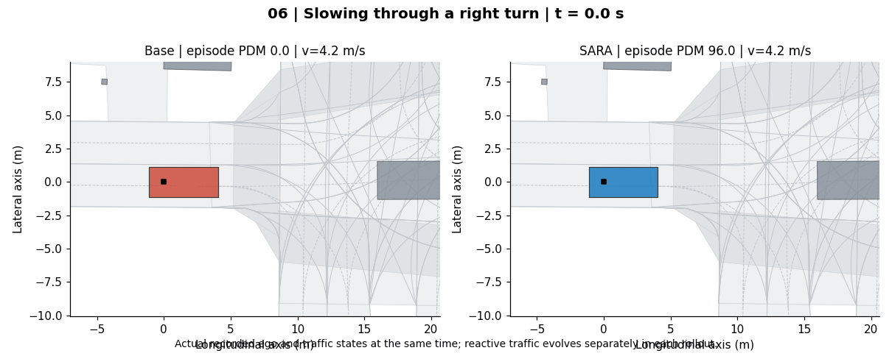

前视画面：上排 Base、下排 SARA；从左到右为 t=0 / 2 / 4 秒。

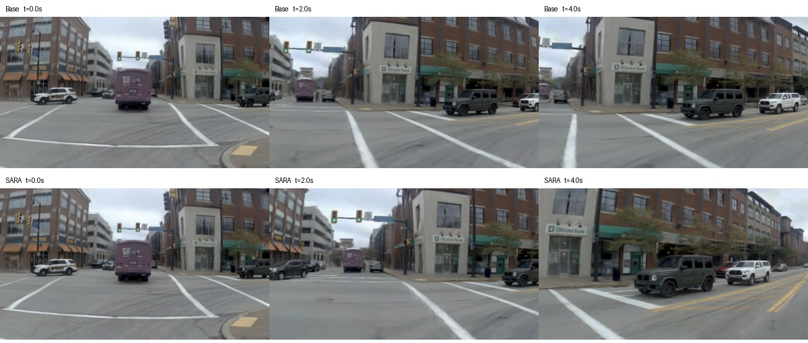

## 7. 低速左转，改善路口停滞

Base 在路口近乎停住，4 秒行驶约 1.79 m；SARA 以低速开始左转，行驶约 10.29 m，EP 从 14.00 提升到 100.00（R）。两者 NC/DAC/TTC 都通过，适合展示安全条件下的推进改善。该片段不代表完成整次左转。

场景：`2021.09.16.16.20.27_veh-08_02435_02525-a2047f9cb3865b75`

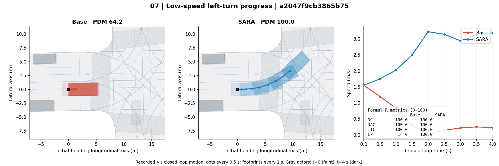

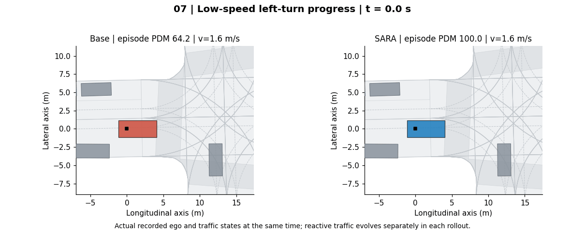

前视画面：上排 Base、下排 SARA；从左到右为 t=0 / 2 / 4 秒。

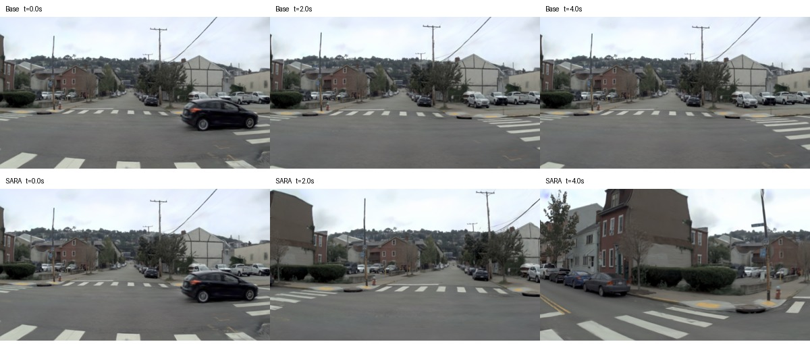

## 8. 路口跟车减速，避免碰撞

前方有转弯车辆时，Base 加速并发生碰撞（NC/TTC=0）；SARA 低速跟进后减速至约 0.16 m/s，NC/TTC=1。建议作为交互安全案例，不推断交通灯状态或让行意图。

场景：`2021.09.29.14.44.26_veh-28_00528_00992-6e3cf172a2755fae`

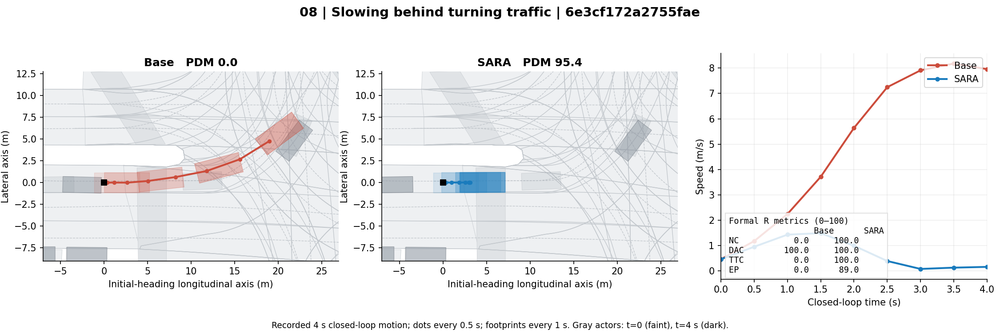

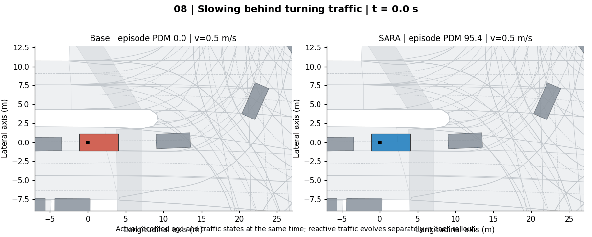

前视画面：上排 Base、下排 SARA；从左到右为 t=0 / 2 / 4 秒。

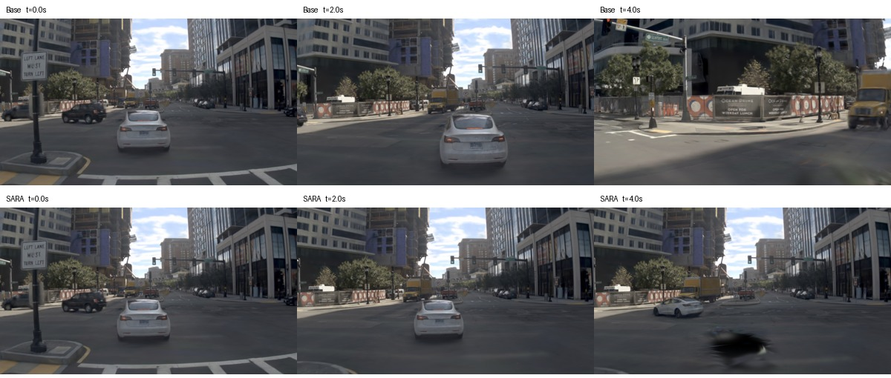

## 9. 拥堵车流中减速，改善 TTC

Base 跟进更快，TTC=0；SARA 放慢并保留间距，TTC=1。NC 与 DAC 两者均通过。但 EP 从 100.00 降至 53.61（R），这是安全与推进效率的取舍，不能描述为全面改善。

场景：`2021.09.29.18.19.40_veh-28_00438_00833-0e272e003af65a71`

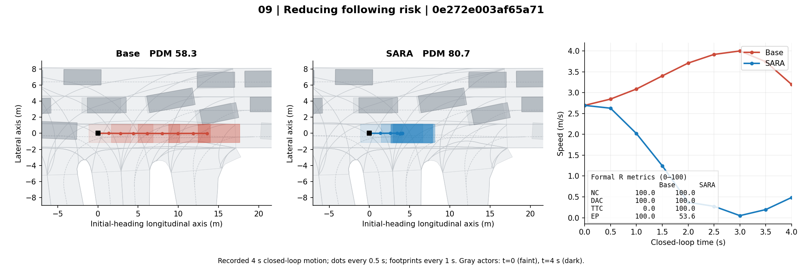

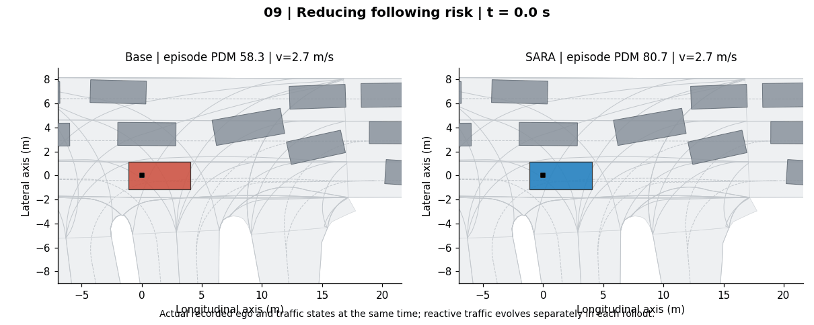

前视画面：上排 Base、下排 SARA；从左到右为 t=0 / 2 / 4 秒。

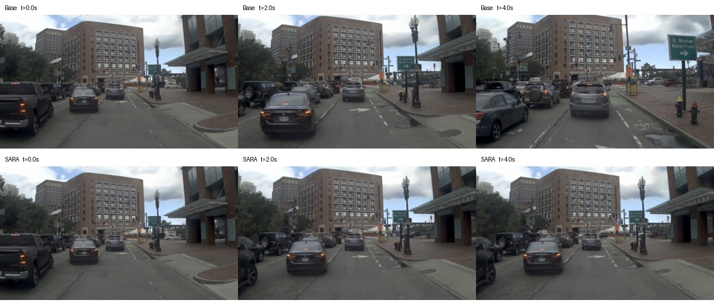

## 10. 低速收停，避免道路越界

Base 朝路缘方向行驶，DAC=0；SARA 低速行驶后收停，末速约 0.16 m/s，DAC=1。该例只说明在此片段中避免道路越界，不代表顺利通过道路；建议留作补充备选。

场景：`2021.10.06.07.26.10_veh-52_01245_02064-3af9cb4d21e15e9e`

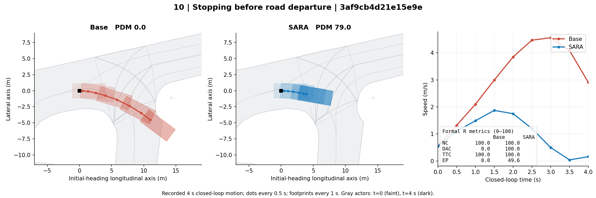

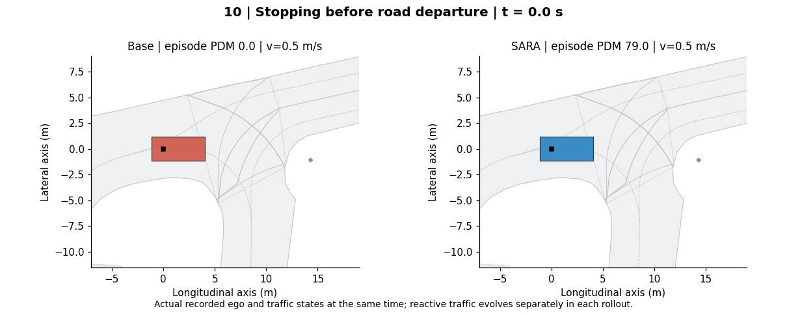

前视画面：上排 Base、下排 SARA；从左到右为 t=0 / 2 / 4 秒。

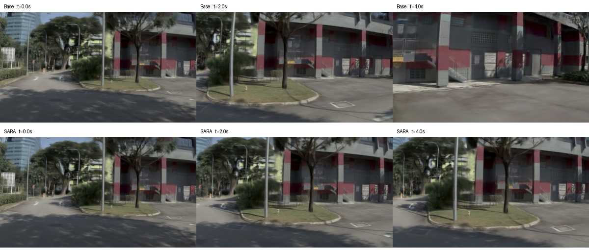

## 来源与选例范围

这些是根据结果事后筛选的定性展示案例，不是新的独立评测集。先在同场景配对结果中按得分与安全指标筛选，读取到 62 个候选的完整轨迹；另有 4 个候选缺少元数据。再结合较低速度偏好、轨迹与前视画面挑出这五个。完整筛选记录见 [speed_screening.json](speed_screening.json)，模型哈希、源文件哈希及各指标见 [selected_cases.json](selected_cases.json)。

这里的低速、减速或停车描述仅针对四秒片段。⑨有明确的推进效率代价，⑩没有证明之后能恢复正常行驶，论文图注应保留这些限制。
