# 第三批：重新筛选的五个候选（11–15）

按反馈重新选例：与①跟车避碰不同，核对正确行驶方向，同时排除以过度保守停车作为主要优点的案例。保持原画法，没有增加方向箭头。

**建议先看⑪分隔岛旁左转、⑫路口直行保持车道。⑬是入弯阶段备选；⑭、⑮是弯道推进备选。**

[下载本批 ZIP](sara_five_reviewed_cases.zip) · [总览 PDF](five_cases_overview.pdf) · [可编辑源码与 PDF / SVG](../editable/README.md) · [核验记录](verification.json)

| 案例 | R PDM：Base → SARA | NR PDM：Base → SARA | SARA 起始 → 末速（m/s） |
|---|---:|---:|---:|
| 11. 分隔岛旁持续左转 | 74.21 → 100.00 | 74.18 → 100.00 | 4.15 → 6.48 |
| 12. 路口直行保持车道 | 0.00 → 100.00 | 0.00 → 100.00 | 6.47 → 5.92 |
| 13. 右转入口控制转入位置 | 0.00 → 93.83 | 0.00 → 67.42 | 3.21 → 5.42 |
| 14. 右弯中减速后继续行驶 | 0.00 → 93.49 | 87.13 → 93.11 | 8.93 → 6.01 |
| 15. 缓弯道路保持正常推进 | 79.79 → 100.00 | 79.79 → 100.00 | 6.51 → 8.75 |

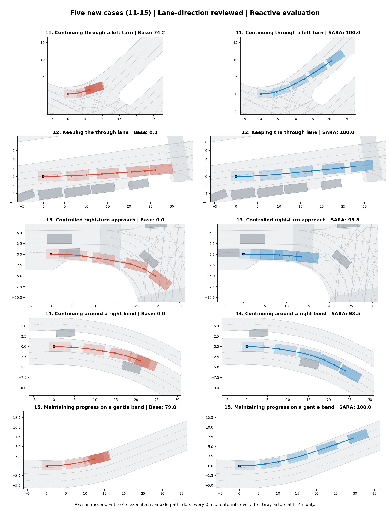

下方展示完整四秒 R 模式闭环片段的实际执行轨迹，每 0.5 秒一帧。起始 ego、周围车辆与时间戳已核对一致；后续 reactive 交通分别演化。灰色车辆在静态图中只表示起点和末帧，交互应看同步动画。前视图为仿真渲染，存在画面伪影。

这次额外核对有向车道中心线、车身覆盖范围及 route roadblock。五个 SARA 案例在九个原始采样点，以及位置/航向按 0.1 秒线性插值得到的几何检查点上，均未发现车身与对向普通车道重叠；车身位于同向、route 内车道或连接区。插值点只是检查辅助，不是新增仿真观测。这不等于证明所有交通规则都满足。

## 11. 分隔岛旁持续左转

Base 在左转过程中逐渐减速至近乎停住；SARA 沿分隔岛旁的正确方向车道持续左转并进入出口道路。R / NR 得分都从约 74 提高到 100。相比①，这个案例体现路口转向与推进，而非跟车避碰。优先推荐。

场景：`2021.10.06.08.16.17_veh-52_00181_00574-18492b6ce9905b13`

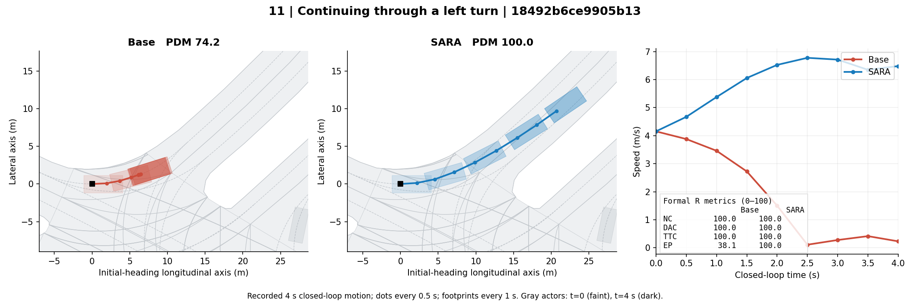

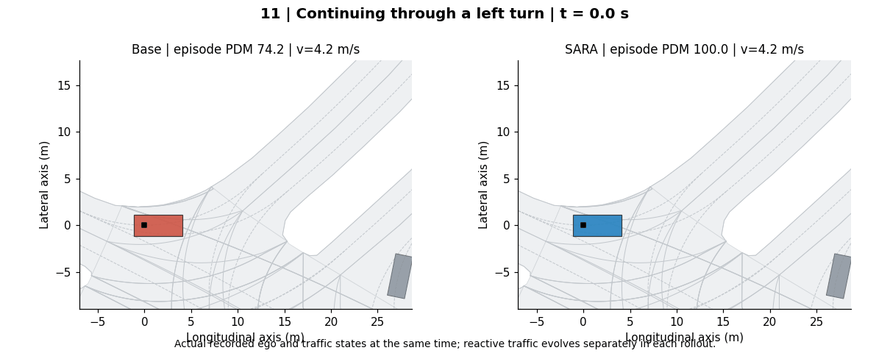

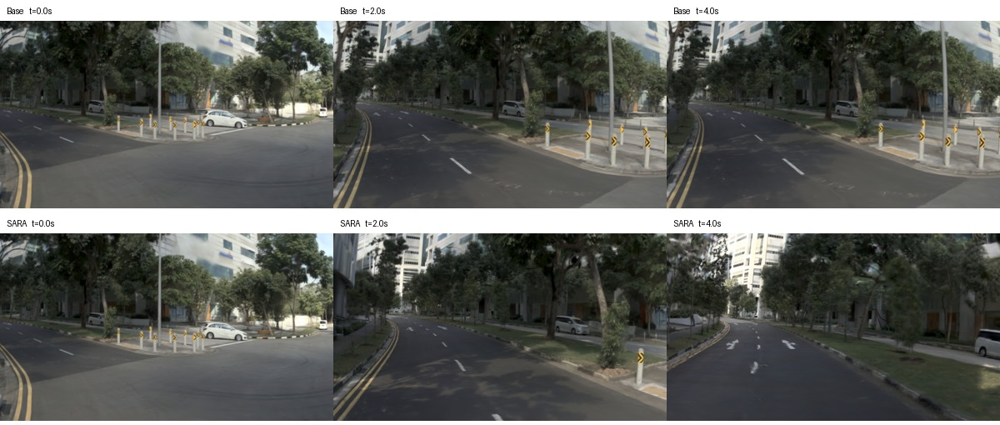

## 12. 路口直行保持车道

Base 通过路口时向右侧边缘偏，正式 DAC 失败；SARA 保持直行车道，R / NR 均为 100。两者行驶距离接近，差别主要在横向位置，适合补充①之外的车道保持决策。优先推荐；不描述为绕行或并线。

场景：`2021.08.30.16.16.44_veh-40_00779_01088-75f5cc1f425c501d`

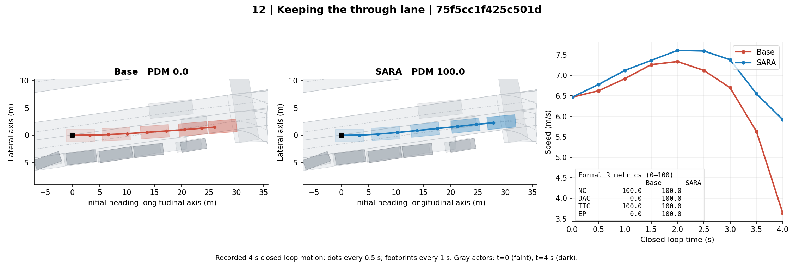

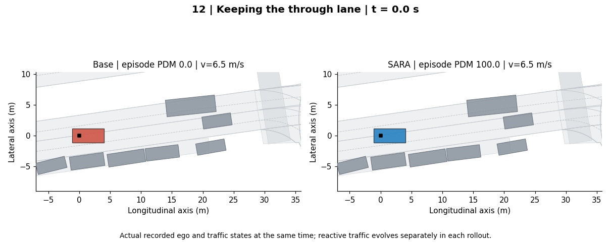

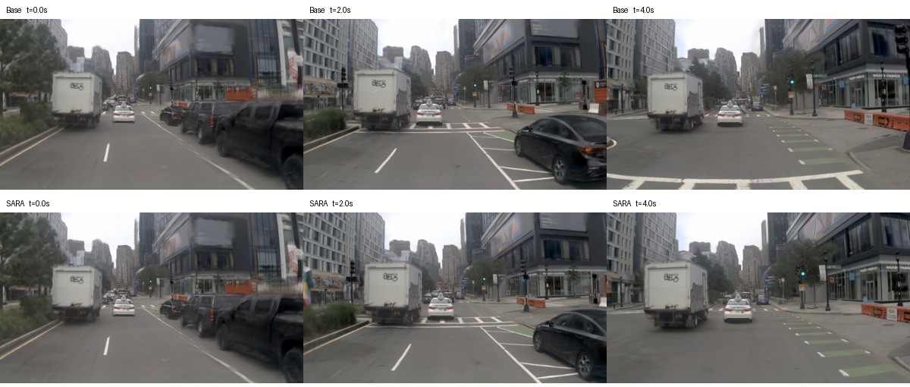

## 13. 右转入口控制转入位置

Base 较早向右转入，末段车身压向弯道内侧边缘，DAC 失败；SARA 先沿入口车道推进，四秒末仍在入弯阶段，末速约 5.42 m/s，并非停车避险。此例只展示入弯位置和时机，不能声称已成功完成右转。NR 虽从 0 提高到 67.42，但 SARA 的 EP 只有 21.80，明显弱于 R 的 85.20，因此列为 R 模式备选。

场景：`2021.09.29.19.02.14_veh-28_00964_01689-f23073987e7956e3`

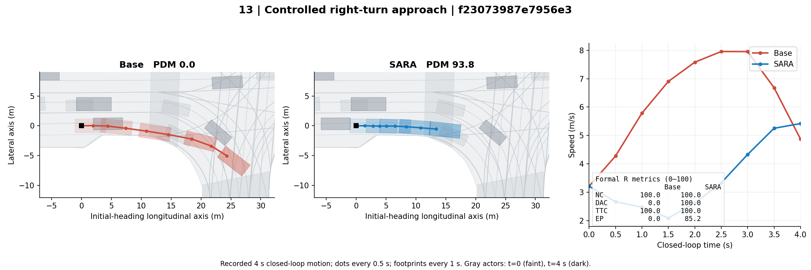

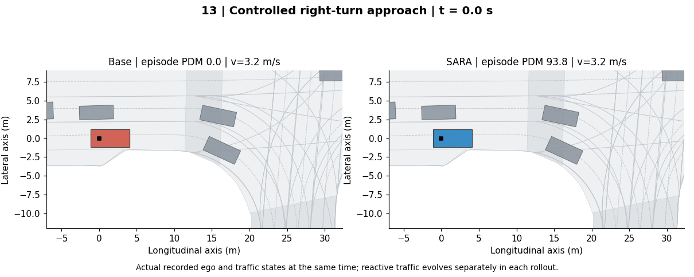

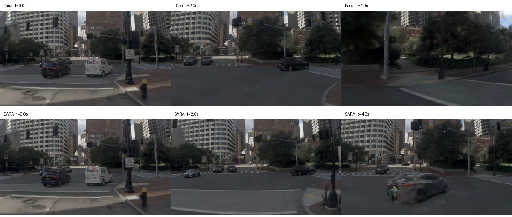

## 14. 右弯中减速后继续行驶

SARA 沿右弯减速后继续行驶，Base 后半段明显减速至接近停止。R 中 Base 的 DAC=0、SARA=1，但几何偏差较小，不把这个例子夸大成明显冲出道路；主要看沿弯道持续推进的行为差异。NR 为 87.13 → 93.11，优势小于 R。

场景：`2021.09.16.19.27.01_veh-45_00472_00711-f0b6499b393152be`

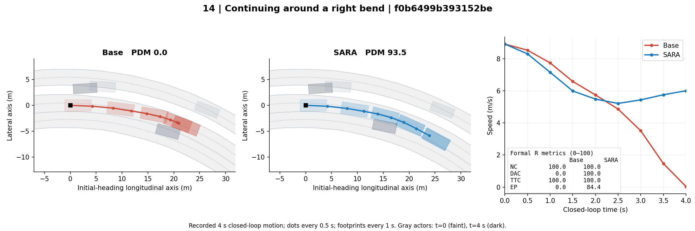

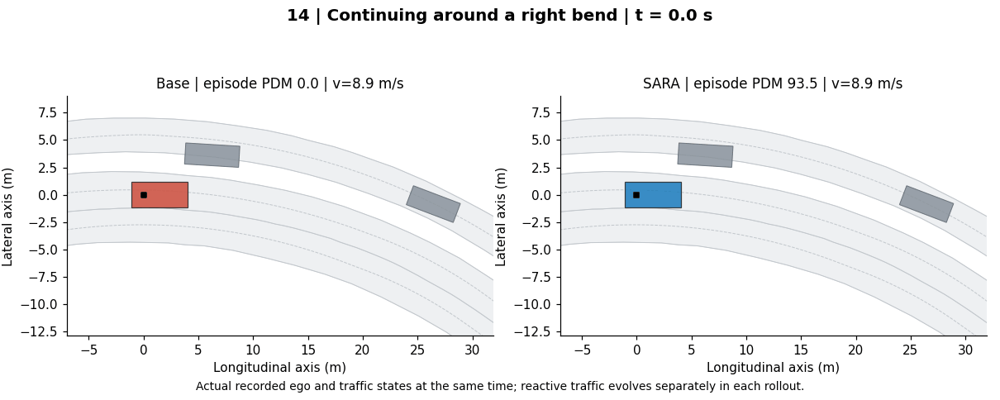

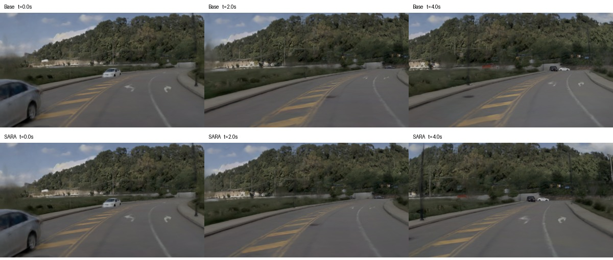

## 15. 缓弯道路保持正常推进

在缓弯道路上，Base 逐渐减速并接近停住；SARA 顺着同向车道继续行驶，R / NR 均为 100。主要体现道路走向下的推进，和⑪有一定相似性，可作为更开阔道路的替代例。SARA 从约 6.51 升至 8.75 m/s，结合完整速度曲线和道路场景判断，不以越慢越好为标准。

场景：`2021.10.06.08.16.17_veh-52_00922_01296-9b0a5826d2d357d8`

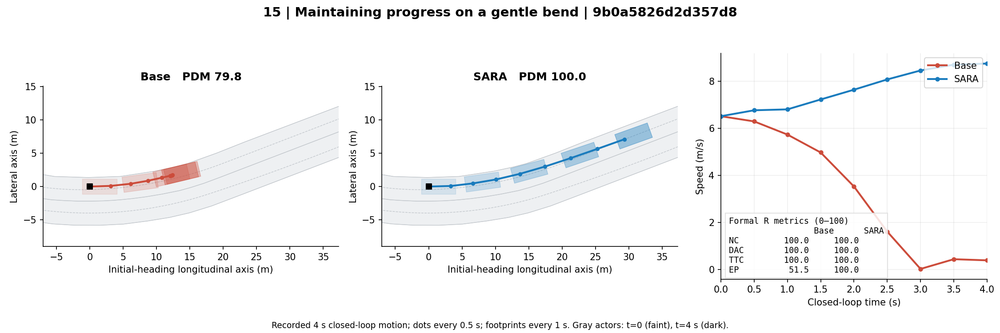

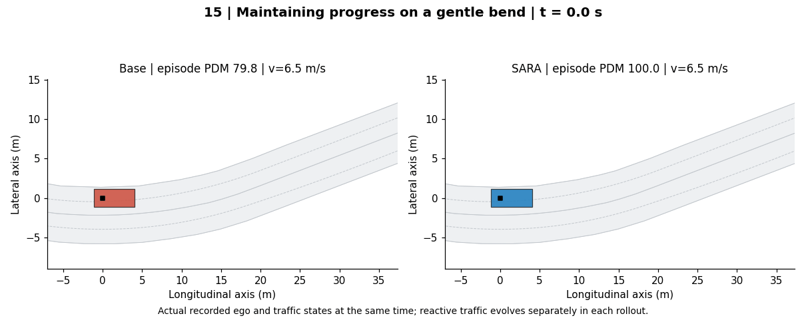

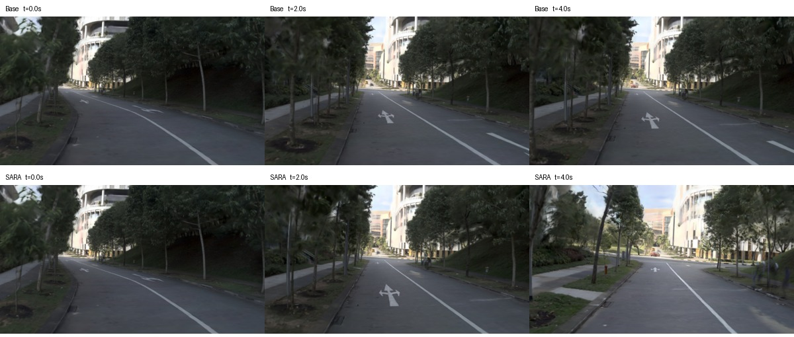

## 旧候选的处理

①保留作为跟车避碰参考。②–⑩不再沿用此前的默认推荐结论，原图作为历史候选保留。复核发现②、③的 SARA 车身有部分与对向车道重叠；⑥、⑦没有达到本次更严格的同向车身覆盖要求。其他旧例也不因高分自动成为合适论文图。

这些仍是事后筛选的定性案例，不能代替整体评测。没有把证据不足的片段标为绕行、并线或完成整次转弯。完整分项指标见 [selected_cases.json](selected_cases.json)。
