# 第四批：先看画面的八个候选（16–23）

这是供挑选的初步候选，不是已确定的论文案例。按反馈先提供画面，不再等所有细节都核验完才展示。保留原画法，没有添加方向箭头。

**建议先看⑯、⑰、⑳，转向意图较明显；⑱、⑲标注为 NR。其余是推进型备选。**

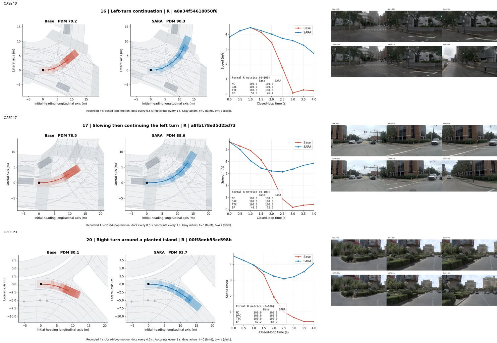

[返回总入口](../README.md) · [下载预览包](sara_eight_previews.zip)

| 编号 | 场景看点 | 模式 | EP：Base → SARA | PDM：Base → SARA |
|---|---|---|---:|---:|
| 16 | 路口左转，转过约66度 | R | 50.0 → 76.7 | 79.2 → 90.3 |
| 17 | 左转中先减速，再继续转入 | R | 48.5 → 72.6 | 78.5 → 88.6 |
| 18 | 分隔岛旁左转（NR） | NR | 65.7 → 90.9 | 85.7 → 96.2 |
| 19 | 路口直行接缓弯（NR） | NR | 58.3 → 100.0 | 82.6 → 100.0 |
| 20 | 右转绕过绿化岛 | R | 52.2 → 84.9 | 80.1 → 93.7 |
| 21 | 路口减速后恢复推进 | R | 35.8 → 71.5 | 73.3 → 88.1 |
| 22 | 前方空间打开后的直行推进 | R | 19.4 → 100.0 | 66.4 → 100.0 |
| 23 | 多车道路口的起步推进 | R | 12.8 → 79.0 | 63.7 → 91.3 |

这些例子的主要得分变化都来自推进 EP；NC、DAC、TTC 和 comfort 在展示模式下两边均通过。因此只能说行为与推进奖励一致，不能用这几张图单独证明奖励的因果作用，也不把它们叫作避碰或 DAC 修复。

全部是实际保存的四秒闭环片段。几何方向筛查已做，但四秒末的高分不保证继续运行仍安全；后续风险仍待复核。你可以先按场景和动作是否典型来挑。

## 16. 路口左转，转过约66度

转向最明确的一组：Base 转到中途接近停住，SARA 继续转入出口方向。主要对应 EP；不能仅凭这段证明长期安全。

场景：`2021.09.09.17.18.51_veh-48_01248_01450-a8a34f54618050f6`。模式：**R**。

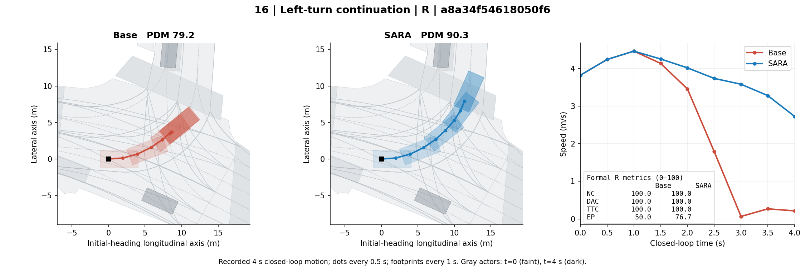

前视图上排 Base、下排 SARA；从左到右 t=0 / 2 / 4 秒，画面来自仿真渲染，可能有伪影。

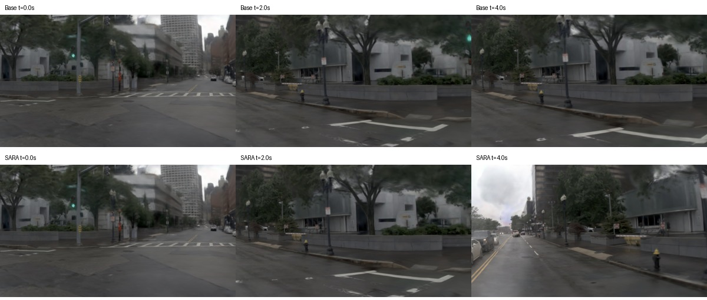

## 17. 左转中先减速，再继续转入

SARA 起初比 Base 更早减速，之后继续完成更多左转过程。既能看减速也能看转向，主要对应 EP。

场景：`2021.09.16.15.12.03_veh-42_01037_01434-a8fb178e35d25d73`。模式：**R**。

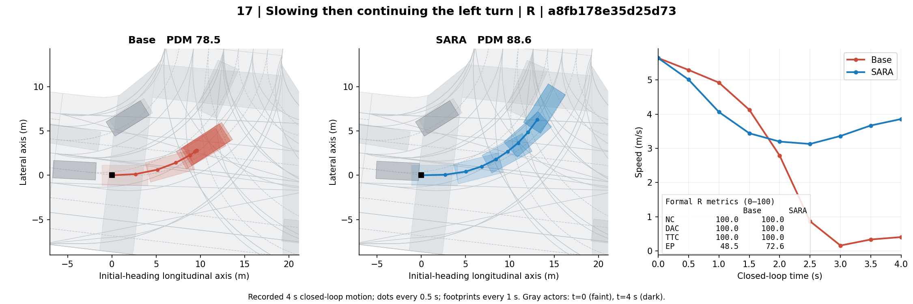

前视图上排 Base、下排 SARA；从左到右 t=0 / 2 / 4 秒，画面来自仿真渲染，可能有伪影。

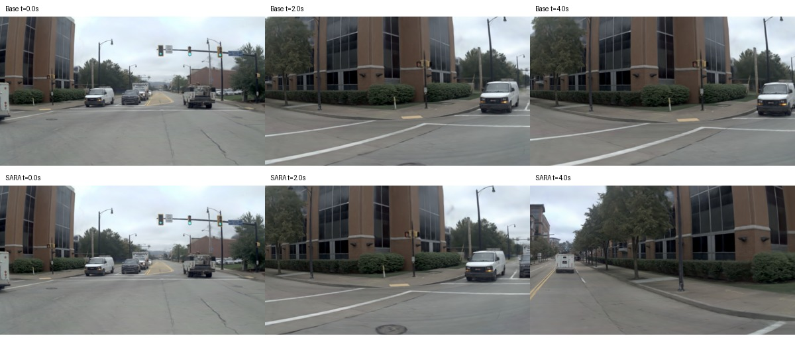

## 18. 分隔岛旁左转（NR）

这组画的是 NR，SARA 在分隔岛旁继续左转，Base 接近停住。需要保留模式标注。

场景：`2021.10.06.07.26.10_veh-52_01245_02064-e74ca27f40755297`。模式：**NR**。

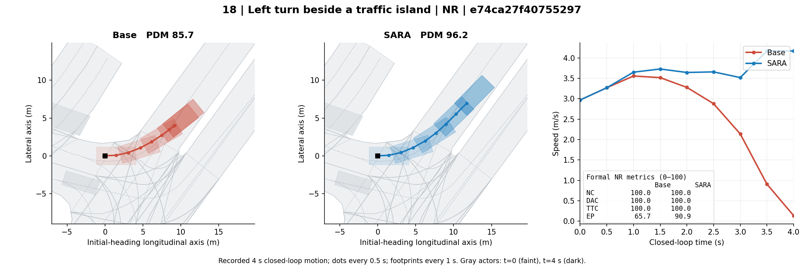

前视图上排 Base、下排 SARA；从左到右 t=0 / 2 / 4 秒，画面来自仿真渲染，可能有伪影。

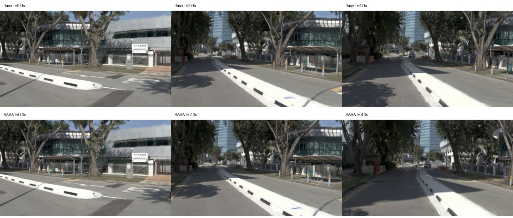

## 19. 路口直行接缓弯（NR）

NR 模式下 SARA 继续穿过路口、沿道路转向；末段有明显减速，先看是否符合你想要的场景。

场景：`2021.10.06.08.16.17_veh-52_01949_02501-02b68b9cc51f506a`。模式：**NR**。

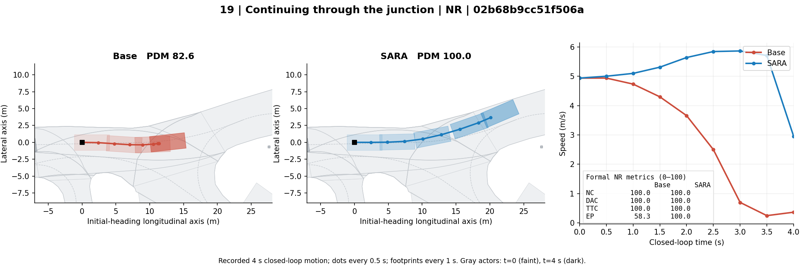

前视图上排 Base、下排 SARA；从左到右 t=0 / 2 / 4 秒，画面来自仿真渲染，可能有伪影。

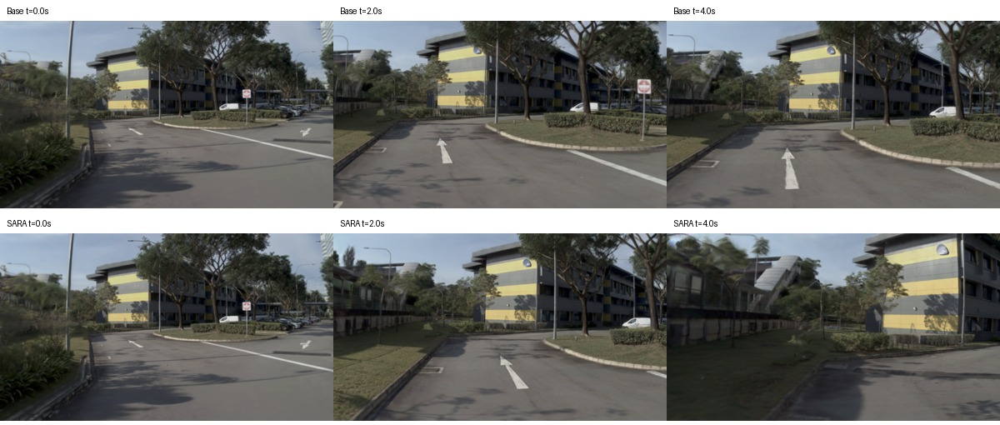

## 20. 右转绕过绿化岛

右转意图清楚，SARA 沿绿化岛右转，Base 中途减速至接近停止。两条路形接近，主要差别仍是推进。

场景：`2021.05.25.15.59.03_veh-30_03499_03671-00ff8eeb53cc598b`。模式：**R**。

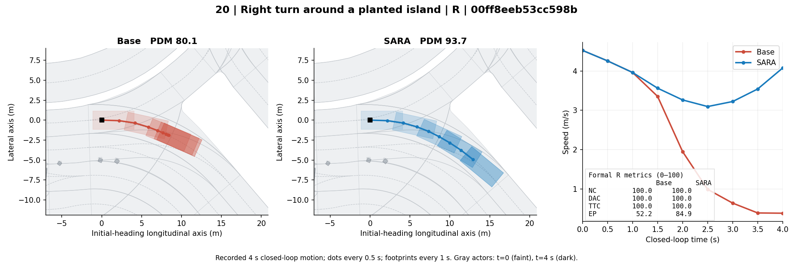

前视图上排 Base、下排 SARA；从左到右 t=0 / 2 / 4 秒，画面来自仿真渲染，可能有伪影。

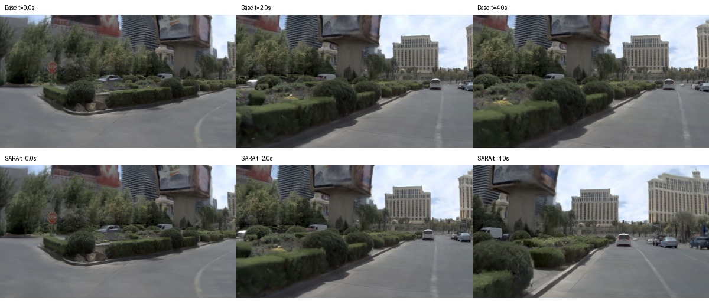

## 21. 路口减速后恢复推进

SARA 先降低速度，之后恢复推进；Base 继续低速。转向差异较小，作为对比备选。

场景：`2021.06.03.13.55.17_veh-35_02572_02855-dd16377ecfa45fe0`。模式：**R**。

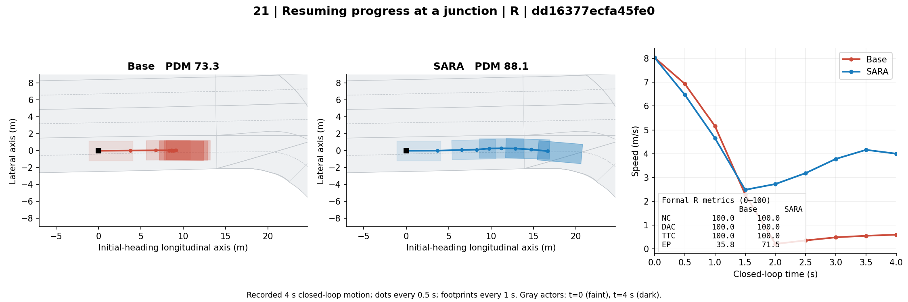

前视图上排 Base、下排 SARA；从左到右 t=0 / 2 / 4 秒，画面来自仿真渲染，可能有伪影。

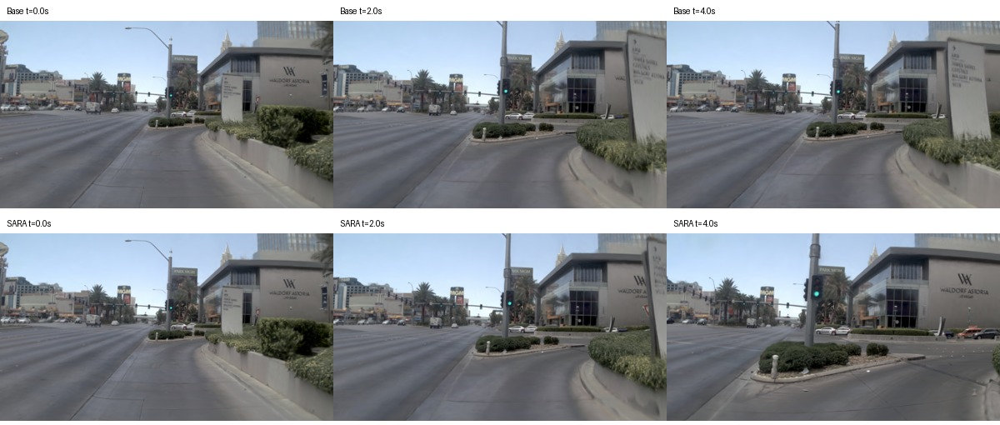

## 22. 前方空间打开后的直行推进

Base 较早停住，SARA 在车辆间继续向前。主要是推进差异，末段与前车关系还需要你看画面挑选。

场景：`2021.06.03.13.55.17_veh-35_00789_00999-a0bc34982a4555ac`。模式：**R**。

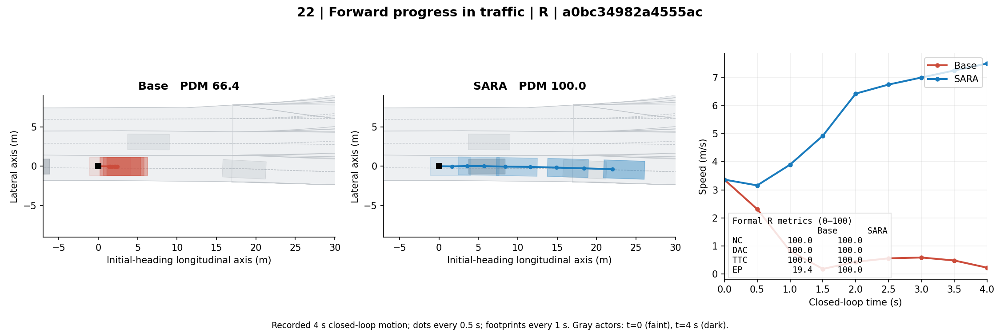

前视图上排 Base、下排 SARA；从左到右 t=0 / 2 / 4 秒，画面来自仿真渲染，可能有伪影。

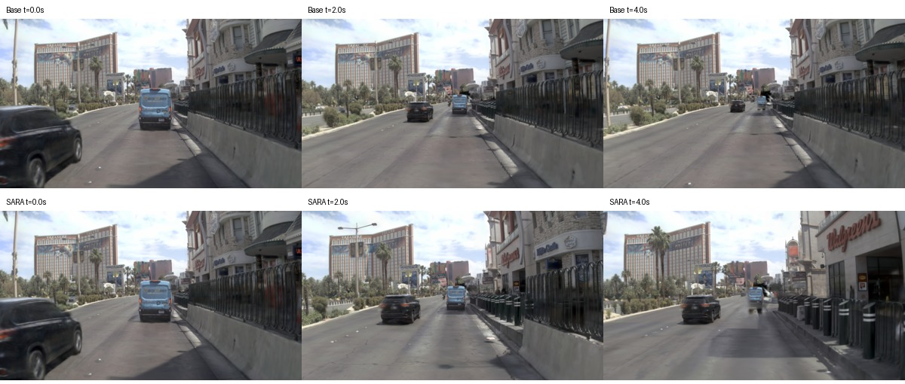

## 23. 多车道路口的起步推进

多车道路口里 SARA 起步向前，Base 基本停住。也是推进型备选，不把它包装成绕行或并线。

场景：`2021.05.25.14.26.37_veh-27_04122_04279-557a287c11cc5960`。模式：**R**。

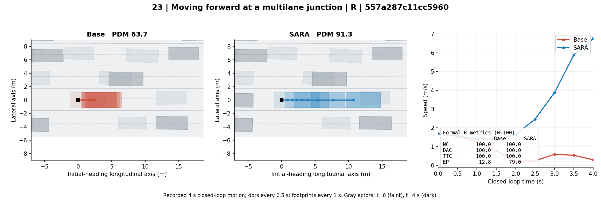

前视图上排 Base、下排 SARA；从左到右 t=0 / 2 / 4 秒，画面来自仿真渲染，可能有伪影。

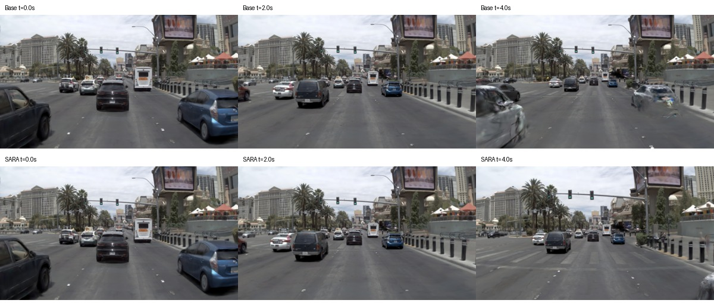
