# 第五批：类似㉒、㉓的六个推进候选（24–29）

按最新偏好选例：前方仍有可见行驶空间，Base 在闭环执行中逐渐低速或停滞，SARA 可以继续推进。**先看㉔、㉕，另看㉗作为不依靠明显加速的对比。**

[回看㉒](../round4/README.md#22-前方空间打开后的直行推进) · [回看㉓](../round4/README.md#23-多车道路口的起步推进) · [下载本批预览包](sara_six_progress_previews.zip) · [总入口](../README.md)

| 编号 | R EP：Base → SARA | R 行驶距离：Base → SARA | R 末速：Base → SARA | NR EP：Base → SARA |
|---|---:|---:|---:|---:|
| 24. 低速起步后继续推进 | 5.6 → 82.5 | 2.8 → 10.8 m | 0.76 → 7.35 m/s | 8.3 → 44.3 |
| 25. 低速车流中恢复行驶 | 5.2 → 100.0 | 2.0 → 14.4 m | 0.38 → 8.70 m/s | 9.7 → 100.0 |
| 26. 直行减速后继续推进 | 47.2 → 100.0 | 8.4 → 20.7 m | 0.11 → 2.50 m/s | 47.6 → 100.0 |
| 27. 沿车流保持直行推进 | 47.4 → 95.7 | 12.3 → 23.2 m | 0.52 → 5.50 m/s | 50.8 → 81.6 |
| 28. 接近路口时持续推进 | 37.7 → 71.5 | 11.3 → 20.4 m | 0.27 → 6.31 m/s | 37.1 → 70.7 |
| 29. 车辆前行时避免停滞 | 43.0 → 97.4 | 10.3 → 21.8 m | 0.07 → 2.99 m/s | 47.9 → 74.5 |

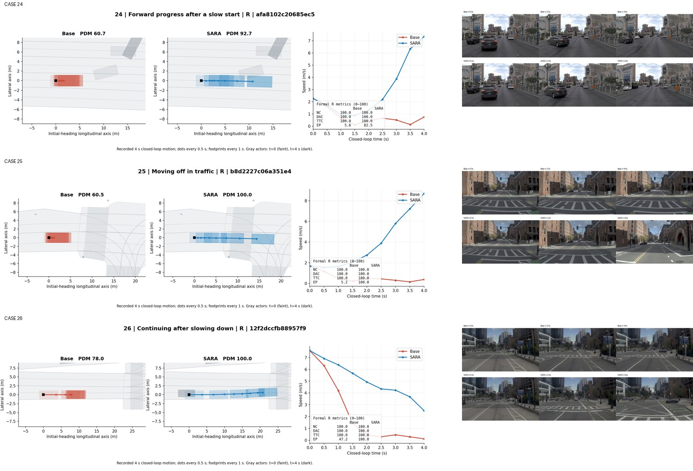

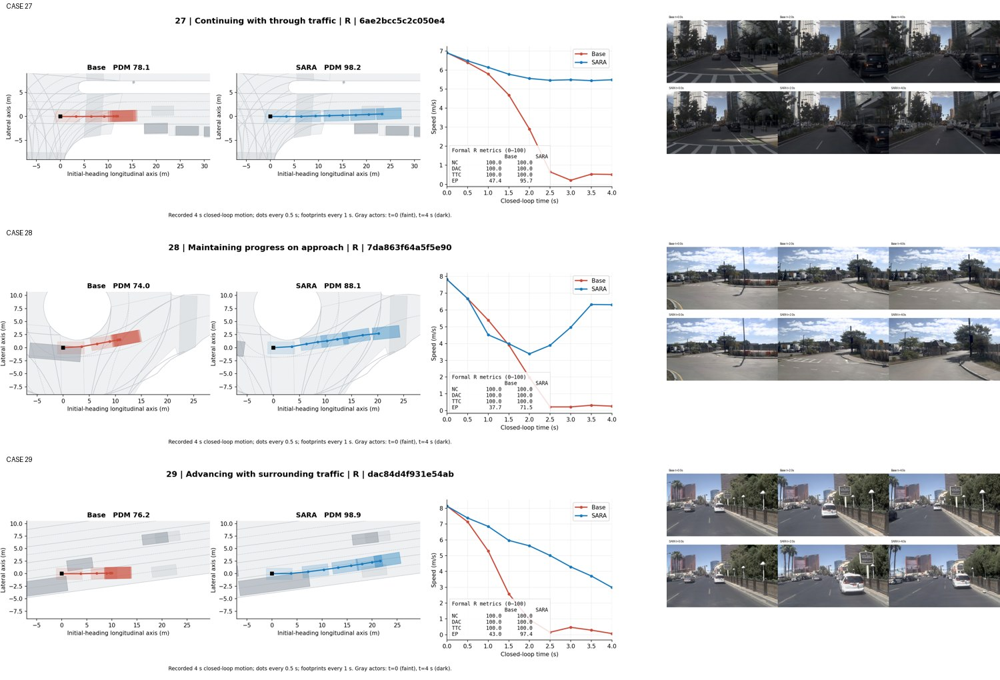

这六个展示模式均为 R，得分改善主要来自 EP，NC / DAC / TTC / comfort 在两边均通过。此前的车道方向筛查没有发现 SARA 与对向普通车道重叠。本批是供挑选的候选，不把四秒内高分等同于更长时间的安全保证。

表述上，**Base 与 SARA 都接受闭环评测**；不同的是 SARA 做过在线后训练。现有图支持“Base 在闭环执行中停滞，SARA 持续推进”这一现象，不能单凭图确定 Base 是因为沿用旧轨迹或缺少某种训练而停住。论文可先写 *SARA sustains progress in closed-loop execution where the base policy stalls.*

## 24. 低速起步后继续推进

最接近㉒、㉓。初始就是低速状态，Base 在前几步减速后一直低速，SARA 先减速、随后重新推进。画面里前方仍有较开阔的直行空间。SARA 后半段加速比较明显，先作为候选看。

场景：`2021.06.03.13.55.17_veh-35_02866_03582-afa8102c20685ec5`

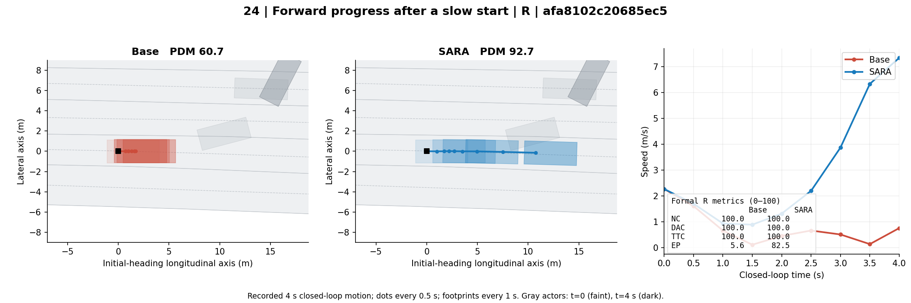

前视图：上排 Base，下排 SARA；t=0 / 2 / 4 秒。仿真渲染存在伪影，主要用于判断场景和周围交通。

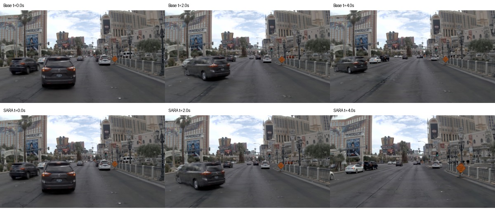

## 25. 低速车流中恢复行驶

也是低速起步场景。Base 基本留在路口前，SARA 开始持续直行，通过更多路口区域。R / NR 的 EP 都达到 100，适合与㉒、㉓一起挑。

场景：`2021.09.29.19.02.14_veh-28_00540_00917-b8d2227c06a351e4`

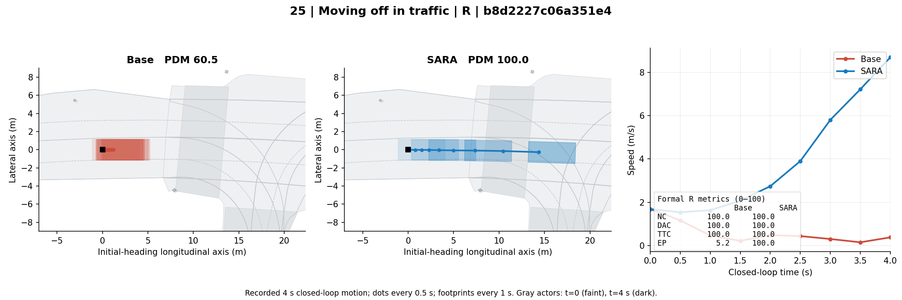

前视图：上排 Base，下排 SARA；t=0 / 2 / 4 秒。仿真渲染存在伪影，主要用于判断场景和周围交通。

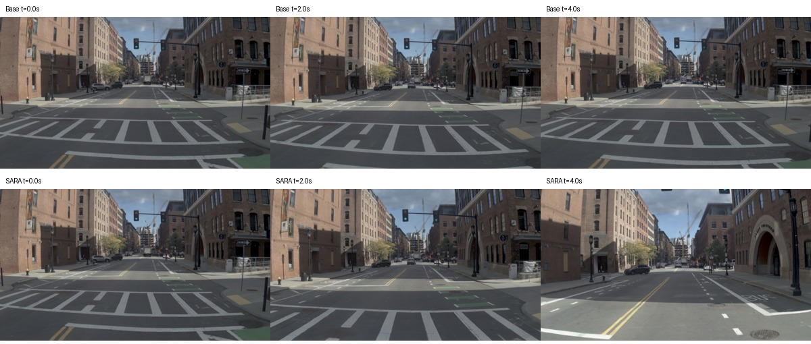

## 26. 直行减速后继续推进

两边都减速，但 Base 接近停住，SARA 仍向路口推进。它体现的是减速过程中保留推进，而不是持续加速；末速约 2.50 m/s。

场景：`2021.09.29.18.19.40_veh-28_00844_01218-12f2dccfb88957f9`

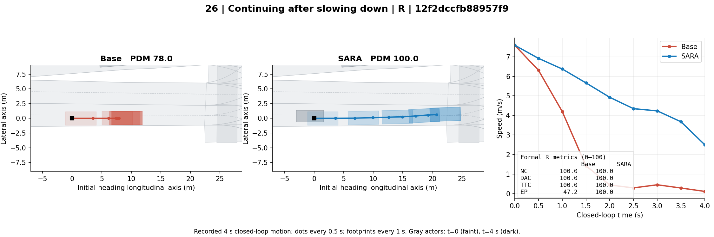

前视图：上排 Base，下排 SARA；t=0 / 2 / 4 秒。仿真渲染存在伪影，主要用于判断场景和周围交通。

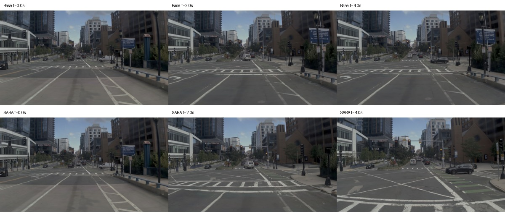

## 27. 沿车流保持直行推进

直行车流场景，SARA 减速后速度稳定在约 5.5 m/s，Base 则继续降到接近停住。相比㉔、㉕，加速差异较小，持续推进的差别更清楚。

场景：`2021.09.29.19.02.14_veh-28_00964_01689-6ae2bcc5c2c050e4`

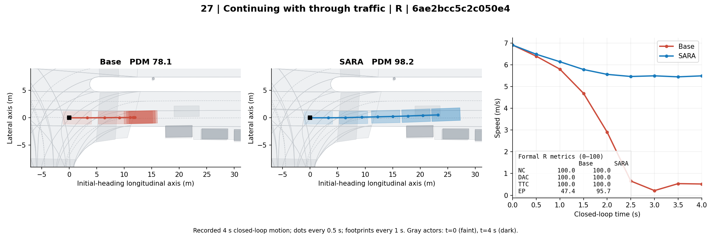

前视图：上排 Base，下排 SARA；t=0 / 2 / 4 秒。仿真渲染存在伪影，主要用于判断场景和周围交通。

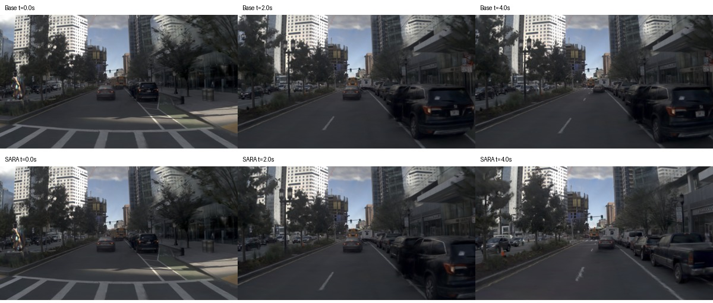

## 28. 接近路口时持续推进

接近路口时，SARA 减速后恢复推进，Base 减速后接近停住。周围交通较少，是较简洁的备选。

场景：`2021.09.29.14.44.26_veh-28_01331_01485-7da863f64a5f5e90`

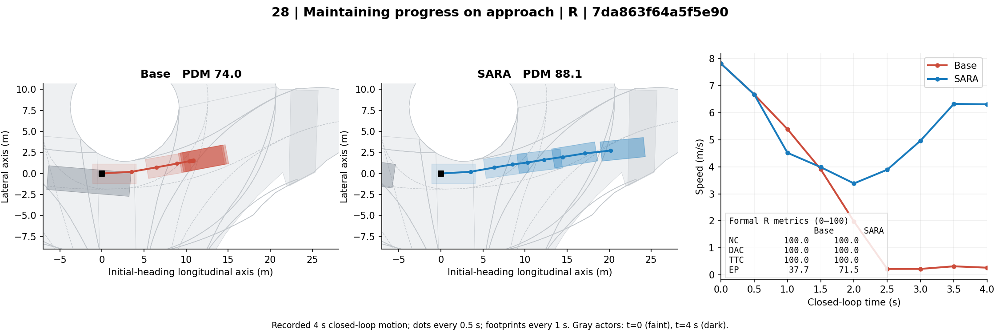

前视图：上排 Base，下排 SARA；t=0 / 2 / 4 秒。仿真渲染存在伪影，主要用于判断场景和周围交通。

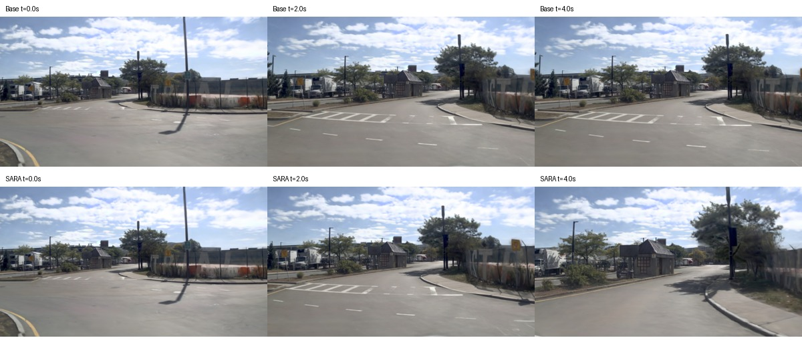

## 29. 车辆前行时避免停滞

周围有车辆继续前行，SARA 减速但仍保持推进，Base 较早接近停止。是否有必要继续减速仍需结合前车关系看图判断。

场景：`2021.06.28.20.24.43_veh-38_03385_04952-dac84d4f931e54ab`

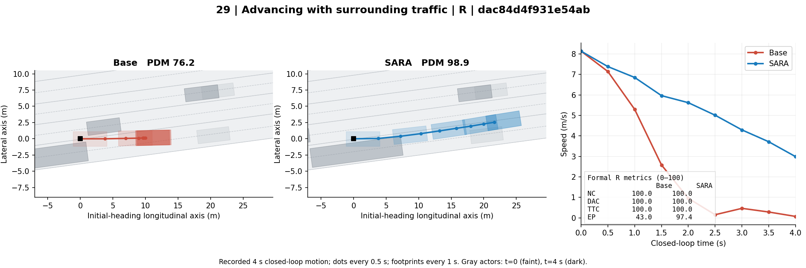

前视图：上排 Base，下排 SARA；t=0 / 2 / 4 秒。仿真渲染存在伪影，主要用于判断场景和周围交通。

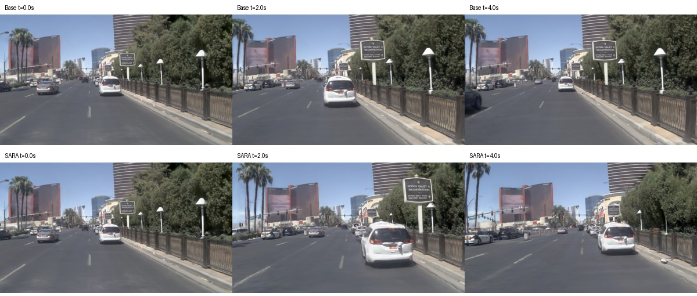
