# 第六批：换看安全交互与道路边界（30–34）

本批不继续找“Base 停滞、SARA 推进”。**优先看 30 的转弯冲突避让、31 的路口道路边界；32–34 是带明确局限的备选。** 五个候选主要覆盖 NC/TTC、DAC 两类反馈，并不代表五种已经确认的独立驾驶能力。

[总入口](../README.md) · [下载图片、动图和可编辑文件](sara_other_behavior_cases.zip) · [Python 绘图脚本](editable/plot_cases.py) · [样式配置](editable/style.json)

| 编号 | 场景关注点 | 模式 | 直接对应的正式指标 | PDM：Base → SARA |
|---|---|---|---|---:|
| 30 | 转弯中的冲突车辆避让 | R | NC、TTC：0 → 100 | 0.0 → 62.8 |
| 31 | 路口避免偏向道路边界 | R | DAC：0 → 100 | 0.0 → 82.3 |
| 32 | 左转入口的减速控制 | R | DAC：0 → 100 | 0.0 → 69.9 |
| 33 | 交叉口提前减速、保留安全距离 | NR | TTC：0 → 100；NC 两边均为 100 | 36.6 → 68.1 |
| 34 | 持续行驶中的道路合规差异 | R | DAC：0 → 100 | 0.0 → 94.5 |

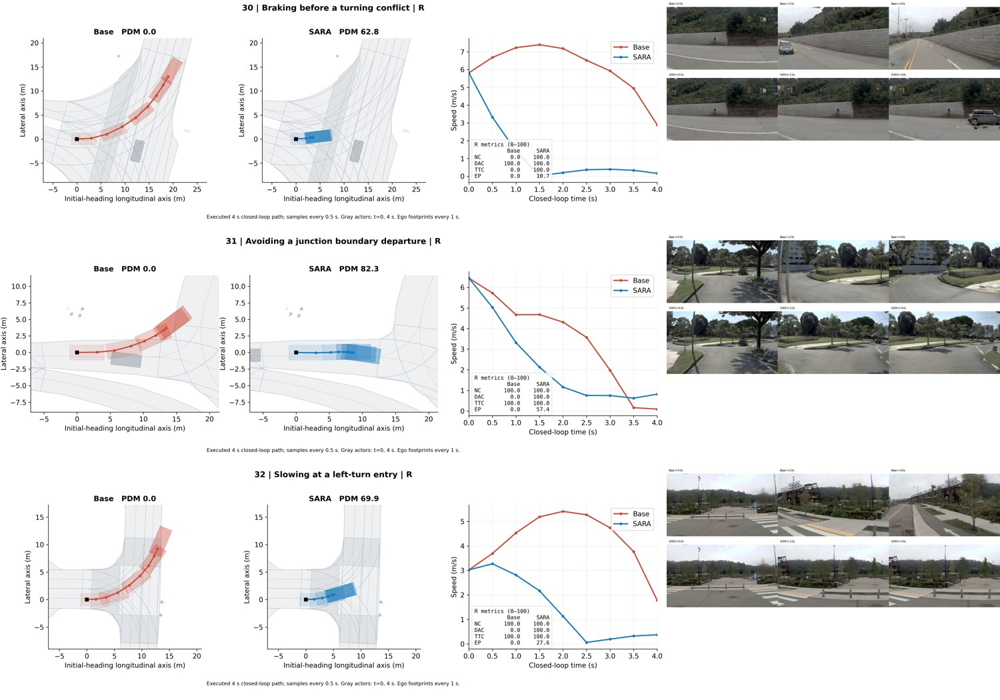

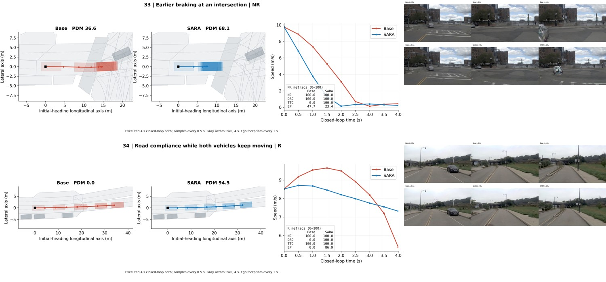

均为同初始状态下记录到的四秒闭环执行，九帧、间隔 0.5 秒；不是规划轨迹，也没有向四秒后外推。30–32、34 为 R，33 为 NR，**不可混写成同一模式的结果**。NC/DAC/TTC/EP 是正式评测指标；车道覆盖是另做的几何筛查，不替代正式指标。图展示行为及评分差异，不能单独证明某项奖励造成了该差异。

## 30. 转弯中的冲突车辆避让

**NC、TTC：0 → 100。** 优先看。Base 左转继续进入冲突区域，约 2.5–3.0 秒与冲突车辆发生几何接触，正式 NC/TTC 均失败；SARA 提前制动，在这段四秒内未发生同样的冲突。这与①同车道追近前车不同。

局限：SARA 基本停车，EP 只有 10.7，不能写成“完成左转”或“确认礼让后重新起步”。同向车道覆盖最低约 96.3%，未发现与对向普通车道重叠。

场景：`2021.09.16.14.39.34_veh-42_00297_00935-2d578825c3a8565f`；模式：**R**。

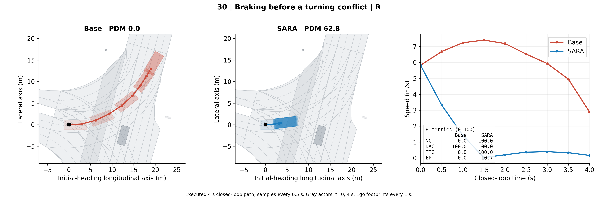

[PDF](case_30.pdf) · [SVG](case_30.svg) · [可编辑数据](editable/data/case_30.json)

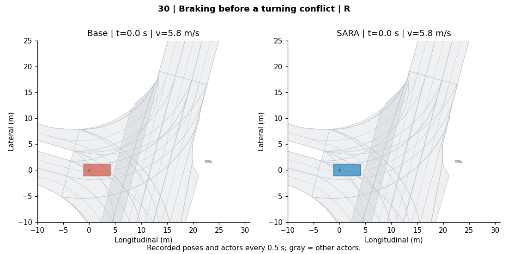

动图仅使用已记录的九帧，最后一帧停留稍长，未增加仿真时间。

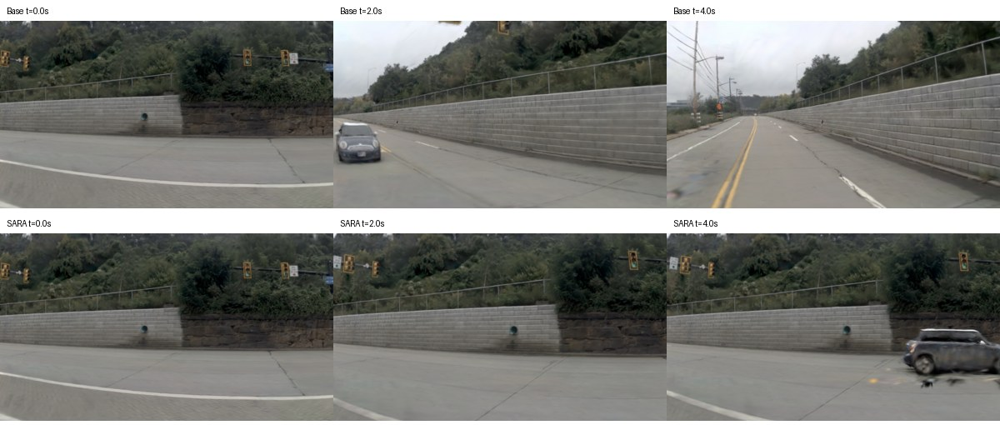

前视图上排 Base，下排 SARA，列为 t=0 / 2 / 4 秒；渲染伪影可能影响观感，以记录的几何与指标为准。

## 31. 路口避免偏向道路边界

**DAC：0 → 100。** 优先看。Base 在路口向左偏转后明显偏出道路区域；SARA 提前减速，保留在原来道路区域内。转向形状差别明显，可以讨论道路边界反馈。

局限：SARA 末速约 0.8 m/s，只支持“避免当前这段路口偏离”，不证明之后一定会正确选路。几何检查中 SARA 同向/路线车道覆盖为 100%。

场景：`2021.10.06.07.26.10_veh-52_01245_02064-59bf40c427da5eb1`；模式：**R**。

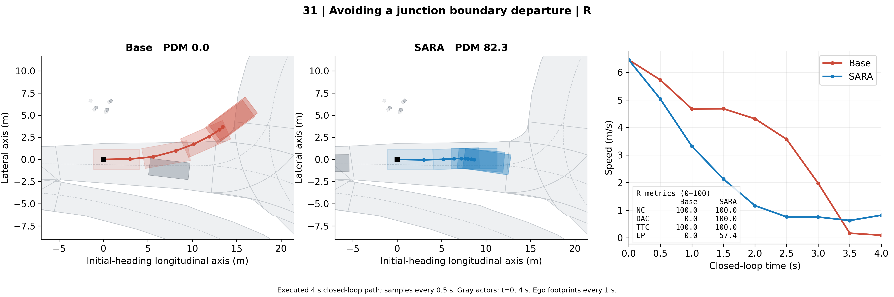

[PDF](case_31.pdf) · [SVG](case_31.svg) · [可编辑数据](editable/data/case_31.json)

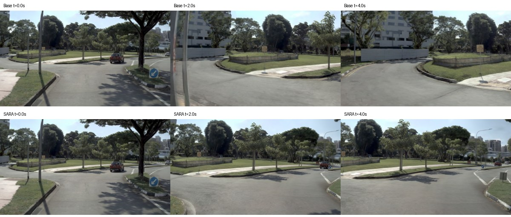

前视图上排 Base，下排 SARA，列为 t=0 / 2 / 4 秒；渲染伪影可能影响观感，以记录的几何与指标为准。

## 32. 左转入口的减速控制

**DAC：0 → 100。** 左转道路边界的备选。Base 继续转向、逐渐偏出弯道的道路范围；SARA 更早减速，停留在入口附近。

局限：更保守，未完成转弯。同向车道覆盖最低约 92.4%，虽未发现对向普通车道重叠，也不能称为完美车道保持。与 31 相比优先级较低。

场景：`2021.09.16.13.53.10_veh-42_00180_00342-f14e7ed78b5d55b4`；模式：**R**。

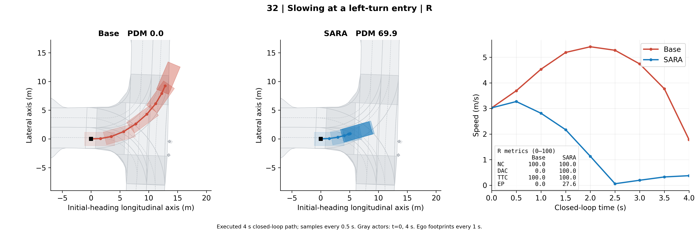

[PDF](case_32.pdf) · [SVG](case_32.svg) · [可编辑数据](editable/data/case_32.json)

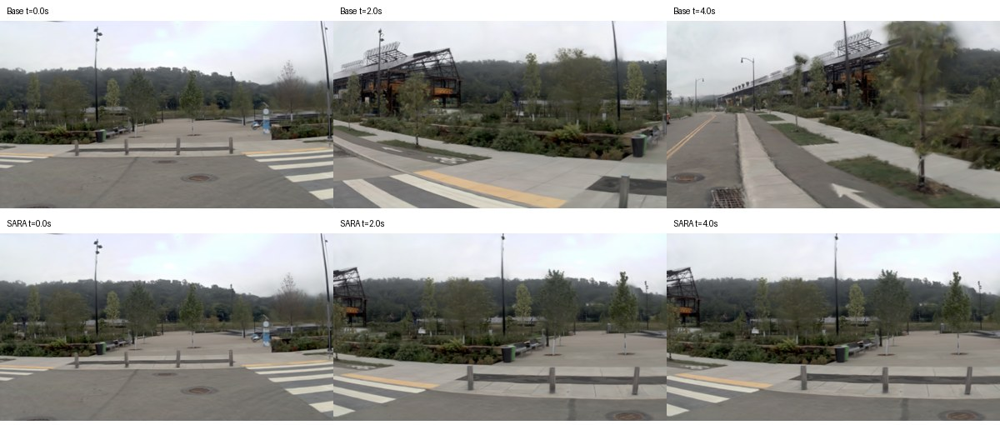

前视图上排 Base，下排 SARA，列为 t=0 / 2 / 4 秒；渲染伪影可能影响观感，以记录的几何与指标为准。

## 33. 交叉口提前减速、保留安全距离

**TTC：0 → 100；NC 两边均为 100。** 交叉口提前制动的备选，展示 NR。Base 行驶约 15.0 m 后停下，SARA 约 8.2 m 后停下；TTC 改善，但 EP 从 47.7 降至 23.4。适合看安全与推进之间的取舍。

局限：不能称为“Base 有责碰撞、SARA 避碰”。动图中还存在后方车辆超越/侧向接近；目前没有定位正式 TTC 失败究竟由哪一个对象触发，所以不把它标成确定的横穿礼让或 cut-in。SARA 同向/路线车道覆盖 100%。

场景：`2021.09.29.18.19.40_veh-28_00438_00833-697c73f258ef5745`；模式：**NR**。

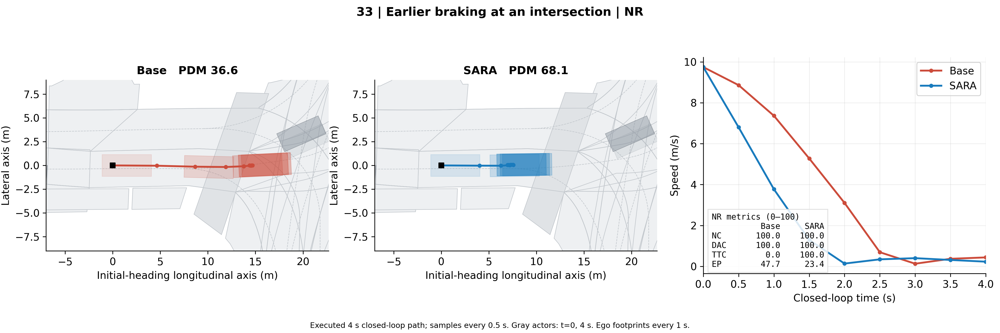

[PDF](case_33.pdf) · [SVG](case_33.svg) · [可编辑数据](editable/data/case_33.json)

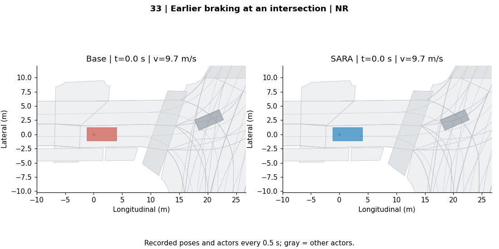

动图仅使用已记录的九帧，最后一帧停留稍长，未增加仿真时间。

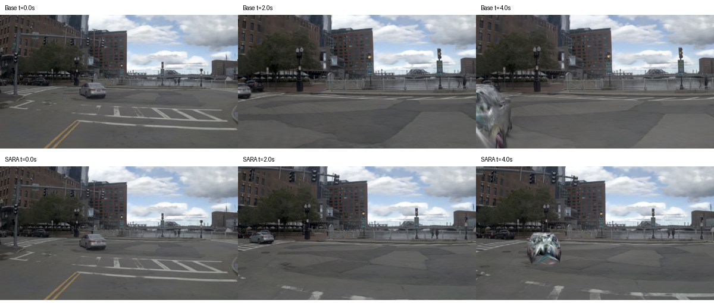

前视图上排 Base，下排 SARA，列为 t=0 / 2 / 4 秒；渲染伪影可能影响观感，以记录的几何与指标为准。

## 34. 持续行驶中的道路合规差异

**DAC：0 → 100。** 低优先级，仅供比较。两边都继续行驶，距离约 34.0 / 32.2 m，SARA 不是靠停住获得合规分。

局限：轨迹差异很小，不宜仅因 PDM 从 0 到 94.5 就当作强定性例子。共同初始状态已有约 8.8% 车身覆盖对向普通车道，SARA 在 1 秒时已无该重叠；不是后续新驶入对向车道，但仍不作为干净的主图推荐。

场景：`2021.09.16.13.53.10_veh-42_00180_00342-da36c99454f65715`；模式：**R**。

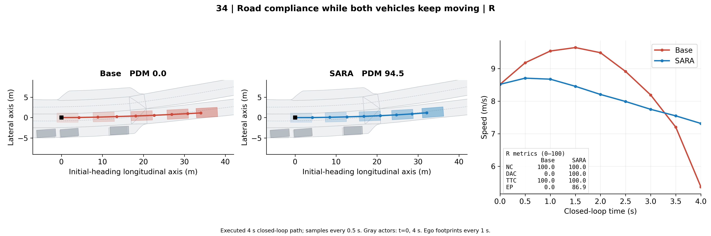

[PDF](case_34.pdf) · [SVG](case_34.svg) · [可编辑数据](editable/data/case_34.json)

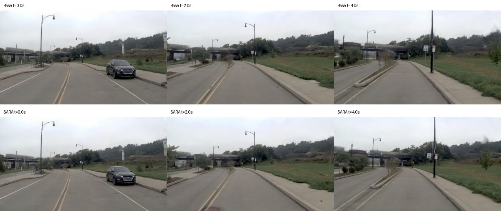

前视图上排 Base，下排 SARA，列为 t=0 / 2 / 4 秒；渲染伪影可能影响观感，以记录的几何与指标为准。

## 自己修改图

本批随包提供独立的 `editable/plot_cases.py`、`editable/style.json` 和 `editable/data/`，不依赖服务器地图或仿真环境。所有图均不画箭头。

```bash
pip install numpy matplotlib pillow
python editable/plot_cases.py --cases 30 31 --formats png pdf svg
python editable/animate_cases.py
```

改字体、配色、坐标范围、显示速度图等请修改 `editable/style.json`；排版修改 `editable/plot_cases.py`。数据已经包含地图、九帧自车轨迹和周围车辆轮廓。默认静态输出到 `editable/figures/`。
