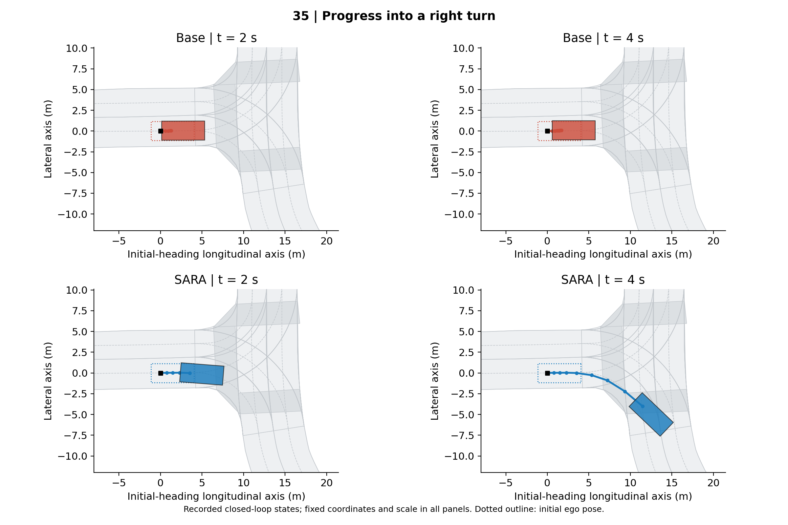
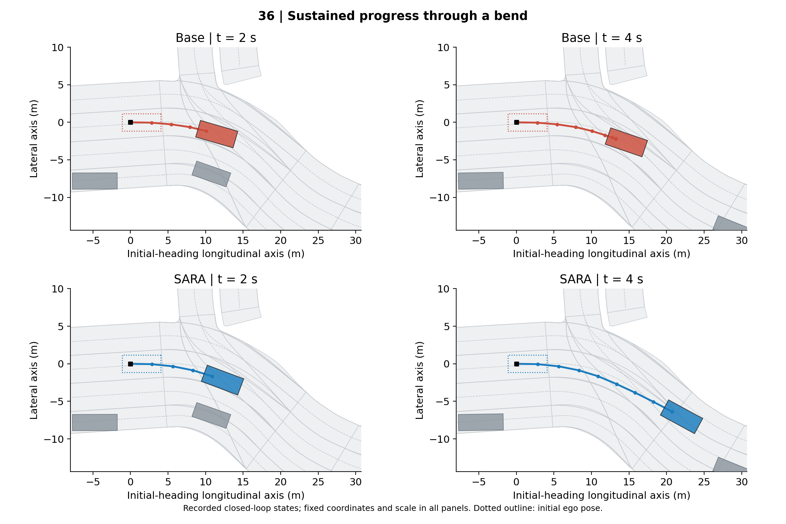
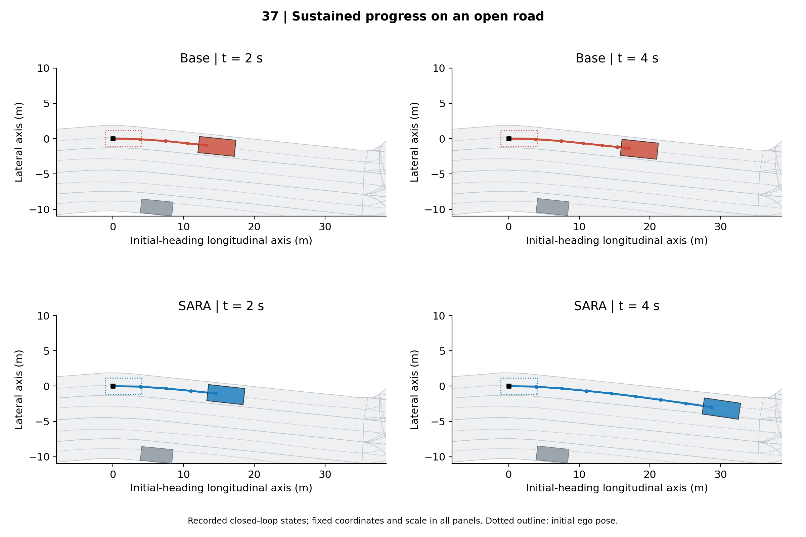
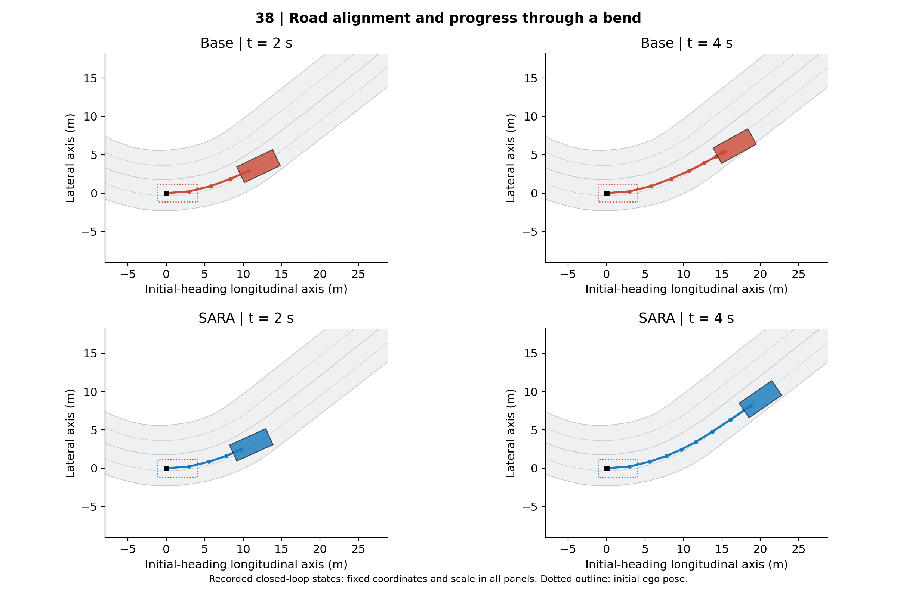
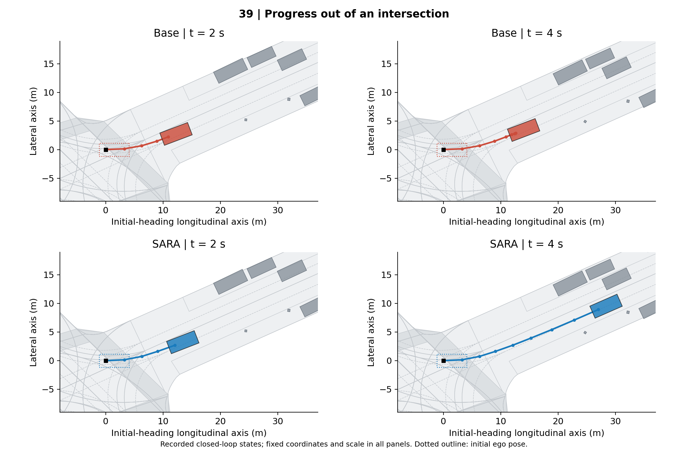

# 新候选 35–39：2 秒 / 4 秒闭环对照

优先看 **36、37**：两种方法在 2 秒时位置相近，之后 Base 明显减速，SARA 持续行驶。**35 最接近原 24 的主题**，但没有采样点回退。

[下载完整 ZIP](sara_candidates_35_39_2s_4s.zip) · [修改绘图 Python](sara_candidates_35_39_2s_4s/plot_cases.py) · [完整说明与逐例局限](sara_candidates_35_39_2s_4s/README.md) · [数值汇总](sara_candidates_35_39_2s_4s/summary.csv)

主图上排 Base、下排 SARA；左列 2 秒、右列 4 秒。四个子图固定初始坐标和尺度，没有箭头。虚线车框为初始自车位置，灰色为对应模型、对应时刻的周边车辆。

原始记录核对：五例的两种方法，每个相邻采样点的前向位移均为正，累计回退为 0。所有观察仅限已记录的四秒，不能据此断言 Base 因误检停车，也不能保证四秒之后的安全。两种方法均在闭环中评测。

## 35 · 右转入口继续推进

Base 在右转入口缓慢挪动，SARA 开始右转。SARA 的转弯轮廓并非完全贴合地图车道，作为候选供选择。

2–4 秒行驶距离：**Base 0.45 米 / SARA 9.08 米**。

[完整 GIF](sara_candidates_35_39_2s_4s/figures/case_35.gif) · [前视画面](sara_candidates_35_39_2s_4s/camera/case_35_camera.jpg) · [PDF](sara_candidates_35_39_2s_4s/figures/case_35_2s_4s.pdf) · [SVG](sara_candidates_35_39_2s_4s/figures/case_35_2s_4s.svg)

## 36 · 弯道中持续行驶

2 秒时两者接近，之后 Base 在弯道中减速至近停，SARA 继续沿弯道行驶。

2–4 秒行驶距离：**Base 3.35 米 / SARA 10.90 米**。

[完整 GIF](sara_candidates_35_39_2s_4s/figures/case_36.gif) · [前视画面](sara_candidates_35_39_2s_4s/camera/case_36_camera.jpg) · [PDF](sara_candidates_35_39_2s_4s/figures/case_36_2s_4s.pdf) · [SVG](sara_candidates_35_39_2s_4s/figures/case_36_2s_4s.svg)

## 37 · 直路行驶中的减速差异

简单直路环境，前两秒位置相近，后两秒的持续推进差异明显。

2–4 秒行驶距离：**Base 3.81 米 / SARA 14.27 米**。

[完整 GIF](sara_candidates_35_39_2s_4s/figures/case_37.gif) · [前视画面](sara_candidates_35_39_2s_4s/camera/case_37_camera.jpg) · [PDF](sara_candidates_35_39_2s_4s/figures/case_37_2s_4s.pdf) · [SVG](sara_candidates_35_39_2s_4s/figures/case_37_2s_4s.svg)

## 38 · 弯道边缘与推进差异

Base 更贴近道路边缘并明显减速。正式 DAC 为 0→1，但可视的越界量很小，不宜夸大为严重冲出道路。

2–4 秒行驶距离：**Base 5.35 米 / SARA 10.74 米**。

[完整 GIF](sara_candidates_35_39_2s_4s/figures/case_38.gif) · [前视画面](sara_candidates_35_39_2s_4s/camera/case_38_camera.jpg) · [PDF](sara_candidates_35_39_2s_4s/figures/case_38_2s_4s.pdf) · [SVG](sara_candidates_35_39_2s_4s/figures/case_38_2s_4s.svg)

## 39 · 有周边车辆的路口驶出

Base 驶出路口后近停，SARA 继续驶出。SARA 末速约 9.57 m/s，末帧最近旁车间隔约 1.16 米；后段提速较多，列为备选。

2–4 秒行驶距离：**Base 1.85 米 / SARA 16.19 米**。

[完整 GIF](sara_candidates_35_39_2s_4s/figures/case_39.gif) · [前视画面](sara_candidates_35_39_2s_4s/camera/case_39_camera.jpg) · [PDF](sara_candidates_35_39_2s_4s/figures/case_39_2s_4s.pdf) · [SVG](sara_candidates_35_39_2s_4s/figures/case_39_2s_4s.svg)
