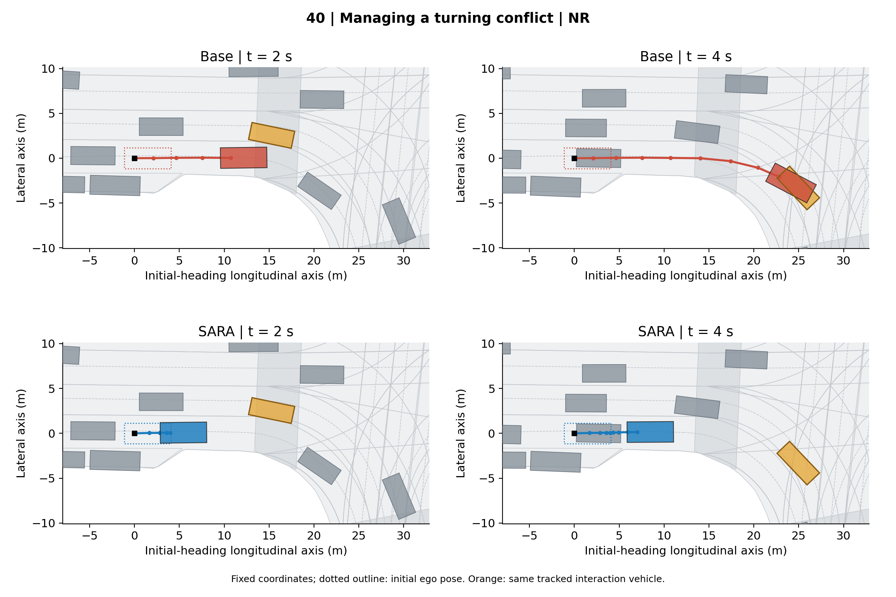
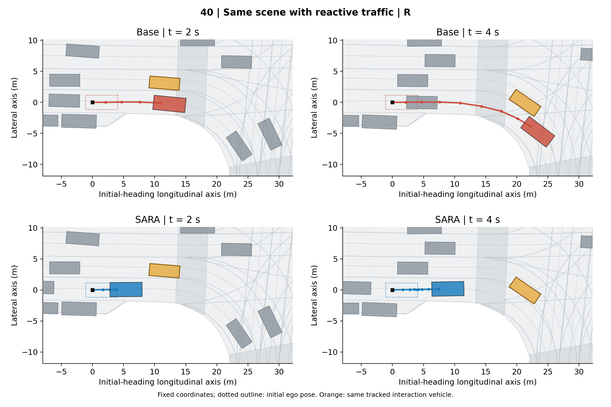
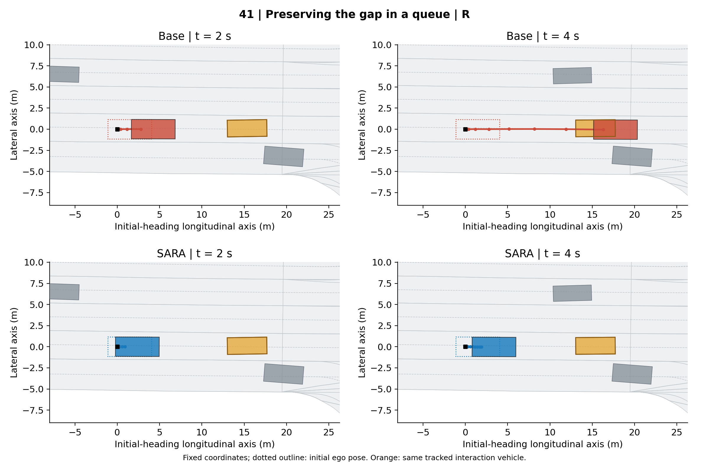
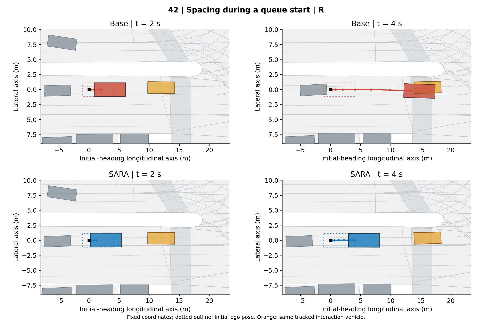

# 新一轮交互类候选 40–42

**优先看 40：右转车流中的冲突避让。** 41、42 是路口排队/起步的安全备选，仍属跟车类。此次没有按“Base 不动、SARA 动”选图。

[下载完整 ZIP](sara_interaction_cases_40_42.zip) · [修改绘图 Python](sara_interaction_cases_40_42/plot_cases.py) · [完整说明与局限](sara_interaction_cases_40_42/README.md) · [数值汇总](sara_interaction_cases_40_42/summary.csv)

上排 Base、下排 SARA；左列 2 秒、右列 4 秒。**橙色是同一辆交互车辆**，其余车辆为灰色。所有组均固定初始坐标与尺度，没有箭头。两种方法均未出现采样回退；SARA 各采样帧未检出自车与记录其他物体重叠或普通对向车道车身重叠。

40 主版本是 NR，另外提供同场景 R 版本。每张对比图两种模型的评测模式相同，没有跨模式拼接。所有结论限于四秒记录。

## 40 · 右转车流中的冲突避让（NR）

Base 转弯时追近橙色车辆，2 秒间隔约 0.43 米，2.5 秒采样起出现车身重叠。SARA 先减速保留间距，4 秒与橙车相隔约 11.59 米。NC/TTC 均为 0→1。SARA 此时尚未完成右转，进度低于 Base，体现安全与进度的取舍。

[完整 GIF](sara_interaction_cases_40_42/figures/case_40.gif) · [前视画面](sara_interaction_cases_40_42/camera/case_40_camera.jpg) · [PDF](sara_interaction_cases_40_42/figures/case_40_2s_4s.pdf) · [SVG](sara_interaction_cases_40_42/figures/case_40_2s_4s.svg)

## 40 · 同一右转场景：反应式交通补充（R）

同场景的反应式交通补充：Base 无采样碰撞，但 4 秒与橙车仅隔约 0.44 米，TTC=0；SARA 与橙车相隔约 7.28 米，TTC=1。此组 NC 两边均为 1，不得描述为 Base 已发生碰撞。

[完整 GIF](sara_interaction_cases_40_42/figures/case_40_R.gif) · [前视画面](sara_interaction_cases_40_42/camera/case_40_R_camera.jpg) · [PDF](sara_interaction_cases_40_42/figures/case_40_R_2s_4s.pdf) · [SVG](sara_interaction_cases_40_42/figures/case_40_R_2s_4s.svg)

## 41 · 路口排队时避免追撞（R）

前车仍在路口排队，Base 持续加速接近，3.5 秒采样起出现碰撞；SARA 保持低速与间距，4 秒距橙车约 7.06 米。NC/TTC 均为 0→1。属于跟车安全备选。

[完整 GIF](sara_interaction_cases_40_42/figures/case_41.gif) · [前视画面](sara_interaction_cases_40_42/camera/case_41_camera.jpg) · [PDF](sara_interaction_cases_40_42/figures/case_41_2s_4s.pdf) · [SVG](sara_interaction_cases_40_42/figures/case_41_2s_4s.svg)

## 42 · 路口车流起步时保持间距（R）

路口车流起步时，Base 追近过快，3.5 秒采样起发生碰撞；SARA 跟随前进后减速，4 秒距橙车约 5.69 米。NC/TTC 均为 0→1。与 41 同属跟车大类，供选择其中一例。

[完整 GIF](sara_interaction_cases_40_42/figures/case_42.gif) · [前视画面](sara_interaction_cases_40_42/camera/case_42_camera.jpg) · [PDF](sara_interaction_cases_40_42/figures/case_42_2s_4s.pdf) · [SVG](sara_interaction_cases_40_42/figures/case_42_2s_4s.svg)
