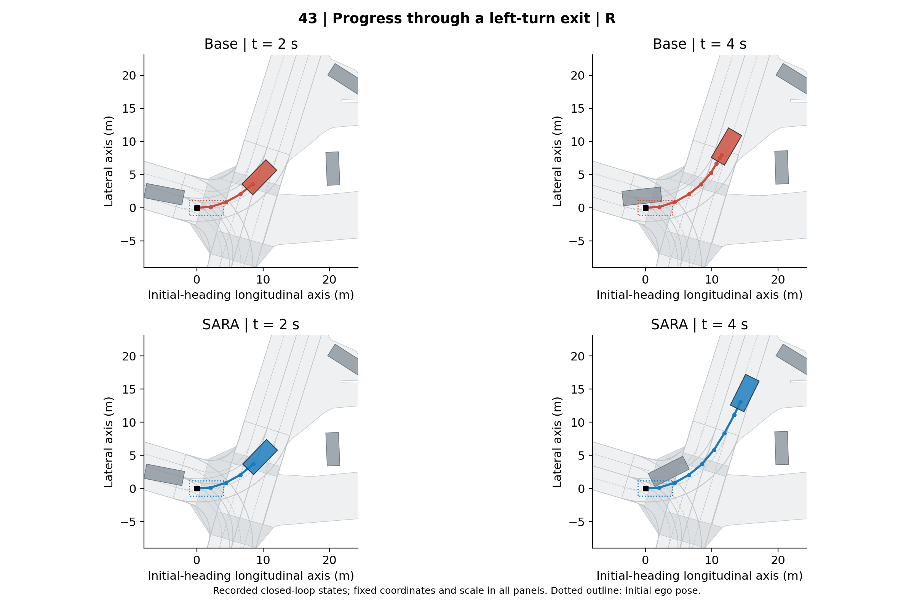
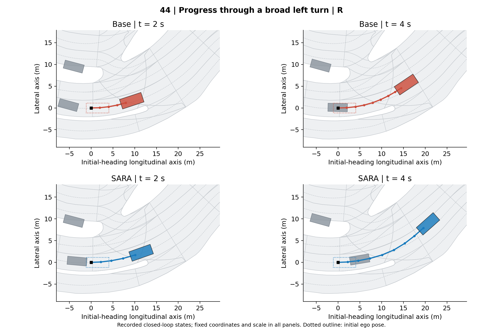
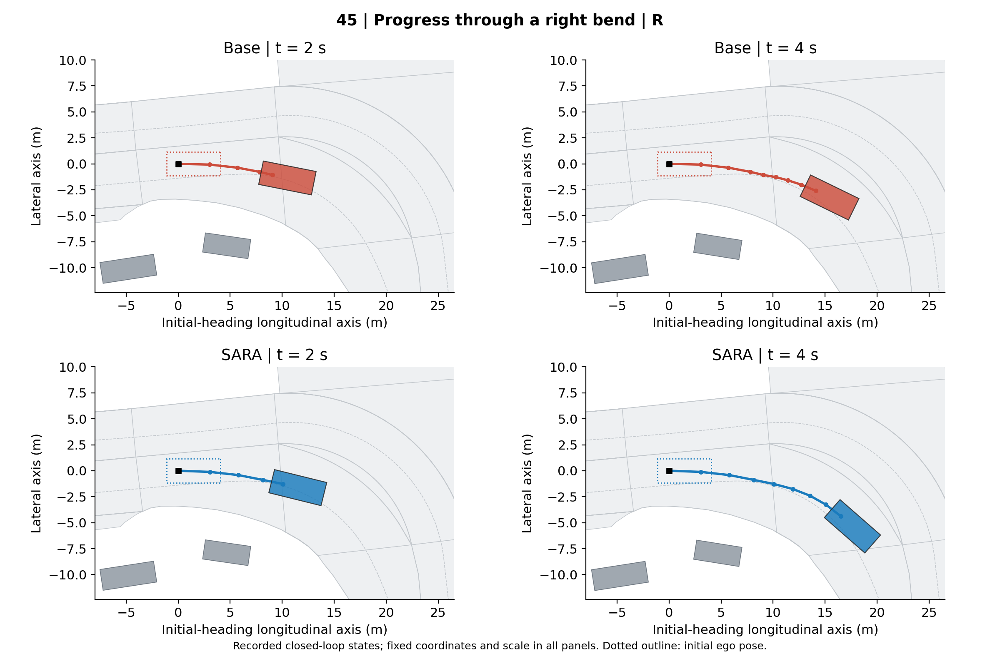
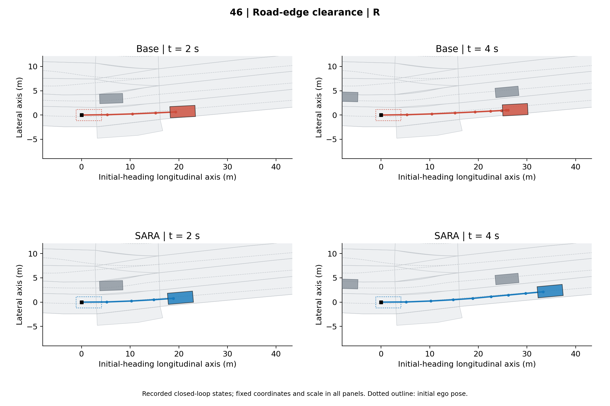

# 非碰撞候选 43–46

这轮重点换到 **转弯推进（43–45）与道路边缘车道保持（46）**。先看 43，再看 44；46 对应不同奖励项，可作备选。45 的优势比较弱。

**四例两边 NC、TTC 都为 1，且九个记录时刻均未检出与其他物体的车身重叠，差异不依赖碰撞分数。** 43–45 主要是 EP 提升；46 是 DAC 改善。它们仍是待挑选的定性候选：当前未找到同时具备复杂交互、明显非碰撞决策错误、又没有回退和逆向疑点的强案例，不能把这些图包装成已经验证的明显失败。

[完整 ZIP](sara_noncollision_cases_43_46.zip) · [可修改 Python](sara_noncollision_cases_43_46/plot_cases.py) · [复现说明](sara_noncollision_cases_43_46/README.md) · [数值汇总](sara_noncollision_cases_43_46/summary.csv)

上排 Base、下排 SARA；左列 2 秒、右列 4 秒。初始坐标与比例固定，无箭头。全部使用相同的 R 评测模式。GIF 保留 0–4 秒全部九帧记录，轨迹没有平滑、裁掉回退或重采样。

## 43 · 左转出口处的推进差异

两种模型前 2 秒的左转轨迹非常接近；后半段 Base 逐步降到约 1.0 m/s，SARA 沿左转出口多推进约 5.9 m，4 秒速度约 3.1 m/s。EP 0.695→0.966。这是本轮较值得先看的候选，但不能仅凭画面判断 Base 减速的内部原因；SARA 最后半秒也在减速，不能据此保证后续持续通行。

[完整 GIF](sara_noncollision_cases_43_46/figures/case_43.gif) · [原始前视画面](sara_noncollision_cases_43_46/camera/case_43_camera.jpg) · [PDF](sara_noncollision_cases_43_46/figures/case_43_2s_4s.pdf) · [SVG](sara_noncollision_cases_43_46/figures/case_43_2s_4s.svg)

## 44 · 宽路口左转过程

两者都按左转方向行驶，SARA 在宽路口内完成更多转向与推进，四秒行程约 15.4→21.7 m。EP 0.919→1.000。场景转弯意图清楚、速度适中，但 Base 本身并没有明显失败，适合作为转弯推进的备选。

[完整 GIF](sara_noncollision_cases_43_46/figures/case_44.gif) · [原始前视画面](sara_noncollision_cases_43_46/camera/case_44_camera.jpg) · [PDF](sara_noncollision_cases_43_46/figures/case_44_2s_4s.pdf) · [SVG](sara_noncollision_cases_43_46/figures/case_44_2s_4s.svg)

## 45 · 右转弯内的推进差异

两条路径几乎一致，SARA 在右弯内保留更多推进，四秒行程约 14.5→17.4 m，EP 0.643→0.772。它主要体现速度规划与推进差异，Base 减速也可能合理，因此优先级低，不建议写成“Base 错误决策”。

[完整 GIF](sara_noncollision_cases_43_46/figures/case_45.gif) · [原始前视画面](sara_noncollision_cases_43_46/camera/case_45_camera.jpg) · [PDF](sara_noncollision_cases_43_46/figures/case_45_2s_4s.pdf) · [SVG](sara_noncollision_cases_43_46/figures/case_45_2s_4s.svg)

## 46 · 道路边缘附近的车道保持

桥面道路边缘附近，Base 后段更贴近地图边界，SARA 留在车道内。正式 DAC 0→1；辅助车身同向车道覆盖最低约 90.7%→100%，未检出普通对向车道重叠。等行程轨迹偏移最大约 0.44 m，差异较细，不能描述成明显冲出道路。Base 实际走了约 26.1 m，EP=0 不代表停车。

[完整 GIF](sara_noncollision_cases_43_46/figures/case_46.gif) · [原始前视画面](sara_noncollision_cases_43_46/camera/case_46_camera.jpg) · [PDF](sara_noncollision_cases_43_46/figures/case_46_2s_4s.pdf) · [SVG](sara_noncollision_cases_43_46/figures/case_46_2s_4s.svg)

## 核对范围

- 从已有 R / NR 评测扩筛，排除此前展示场景后检查了 306 个模式/场景对，其中 294 对有可读的成对记录；先做运动筛查，再逐项检查地图方向、完整车身和相机。没有重新跑模型。
- 入选四例原始元数据 SHA256 已复核；两边初始自车/其他物体与时间戳一致。全部记录位移的车头方向投影非负，未发现之前 24/30 的回退。
- 两边各采样时刻均无其他物体车身重叠，也未检出普通对向车道车身重叠。这是采样与地图几何检查，不是连续时间无碰撞或全交通规则证明。43 的路由组 ID 匹配不完整，不能用 route coverage=0 判断走错路，也不能据此证明完整路线正确。
- 43–45 的差异主要仍是推进/速度规划，不能仅据这些图推出在线奖励的因果效果，也不能解释模型的内部意图。所有结论限于四秒片段。
