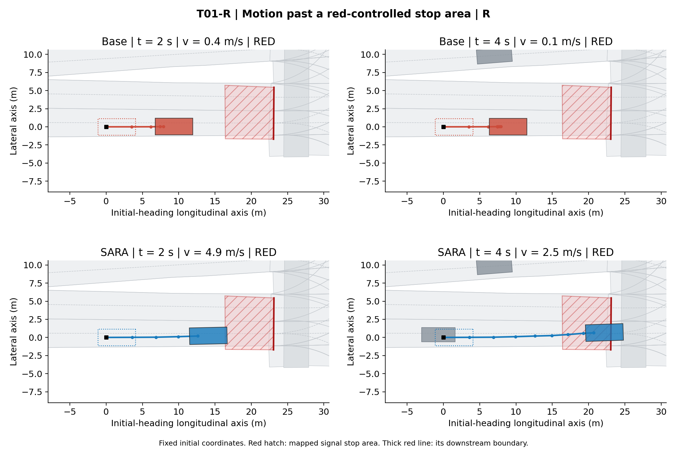
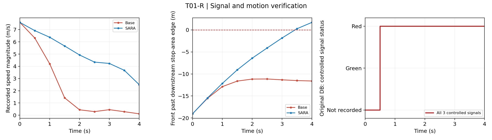
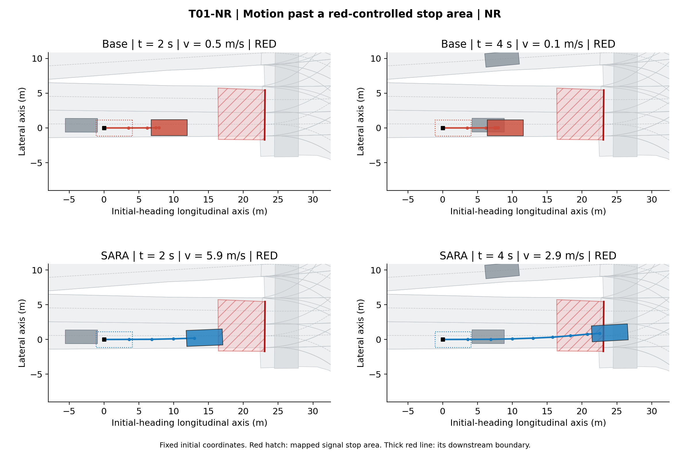
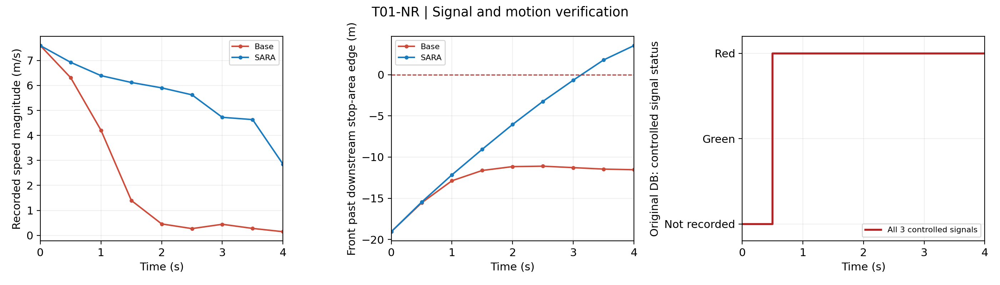

# 第三类失败：红灯停车约束（T01）

**这是一个新场景，给出 R 和 NR 两个版本，不把同一场景算成两个独立案例。** Base 留在停止区前，SARA 虽然减速，仍在对应信号为红灯时越过地图停止区的路口侧边界。排除“等待太久/恢复推进慢”这一类。

[下载完整 ZIP](sara_signal_failure_T01.zip) · [可编辑 Python](sara_signal_failure_T01/plot_cases.py) · [证据与限制](sara_signal_failure_T01/README.md)

该例的区别在于：**两种模型的 NC/DAC/TTC 都为 1，SARA 的 PDM 甚至为 1，但没有满足红灯停车约束。** 这可以独立于碰撞、道路越界来讨论规则约束；不能用“没有撞、仍在路面上、推进更多”代替信号遵守。

已核对初始车道、地图实际停止区、对应三个受控连接段、原始数据库灯色和两种模型的逐帧信号记录。三个控制信号在 0.5–4 秒的全部采样均为红灯。t=0 没有记录这三个信号，不画成已知红灯。SARA 在 3.0–3.5 秒之间车头越过所画边界；Base 四秒内始终在边界前。

红色斜线是地图 `stop_polygons` 中与信号关联的停止区，不是禁止行驶路面；粗红线是该多边形的下游边界，不是手工在相机图上猜出的停止线。所有模型轨迹原样保留，无箭头。

## T01 · R 模式

Base PDM=0.780，SARA PDM=1.000；两边 NC、DAC、TTC 都为 1。SARA 仍减速，但车头跨过停止区下游边界；Base 留在边界前约 11.5m。

[3/3.5/4s 关键帧](sara_signal_failure_T01/figures/case_01_critical_2s_4s.png) · [GIF](sara_signal_failure_T01/figures/case_01.gif) · [前视对照](sara_signal_failure_T01/camera/case_01_camera.jpg) · [SARA 4s 原始前视](sara_signal_failure_T01/camera/case_01_SARA_front_4s.jpg) · [PDF](sara_signal_failure_T01/figures/case_01_2s_4s.pdf)

## T01 · NR 模式

Base PDM=0.782，SARA PDM=1.000；两边 NC、DAC、TTC 都为 1。SARA 仍减速，但车头跨过停止区下游边界；Base 留在边界前约 11.5m。

[3/3.5/4s 关键帧](sara_signal_failure_T01/figures/case_02_critical_2s_4s.png) · [GIF](sara_signal_failure_T01/figures/case_02.gif) · [前视对照](sara_signal_failure_T01/camera/case_02_camera.jpg) · [SARA 4s 原始前视](sara_signal_failure_T01/camera/case_02_SARA_front_4s.jpg) · [PDF](sara_signal_failure_T01/figures/case_02_2s_4s.pdf)
