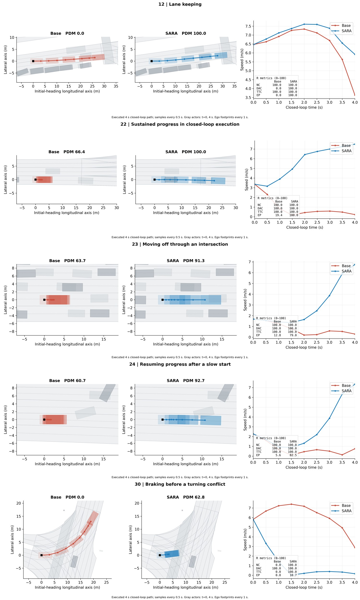

# 论文案例转交包：12、22、23、24、30

[下载独立 ZIP](sara_selected_12_22_23_24_30.zip?raw=true)

- 12：车道保持。
- 22、23、24：闭环中的持续推进与低速恢复。
- 30：转弯冲突避让。

包内有 PNG / PDF / SVG、五个动图、前视图、完整绘图数据、指标与中文说明。解压后直接修改 `plot_cases.py` 顶部的 `STYLE`，或修改绘图函数即可改图片，无需访问原服务器。

```bash
python -m pip install -r requirements.txt
python plot_cases.py
python animate_cases.py --cases 30
```

已验证：从 ZIP 解压后可独立重新生成五张静态图及五个动图。五例均为 R 模式，原始记录长度四秒。


