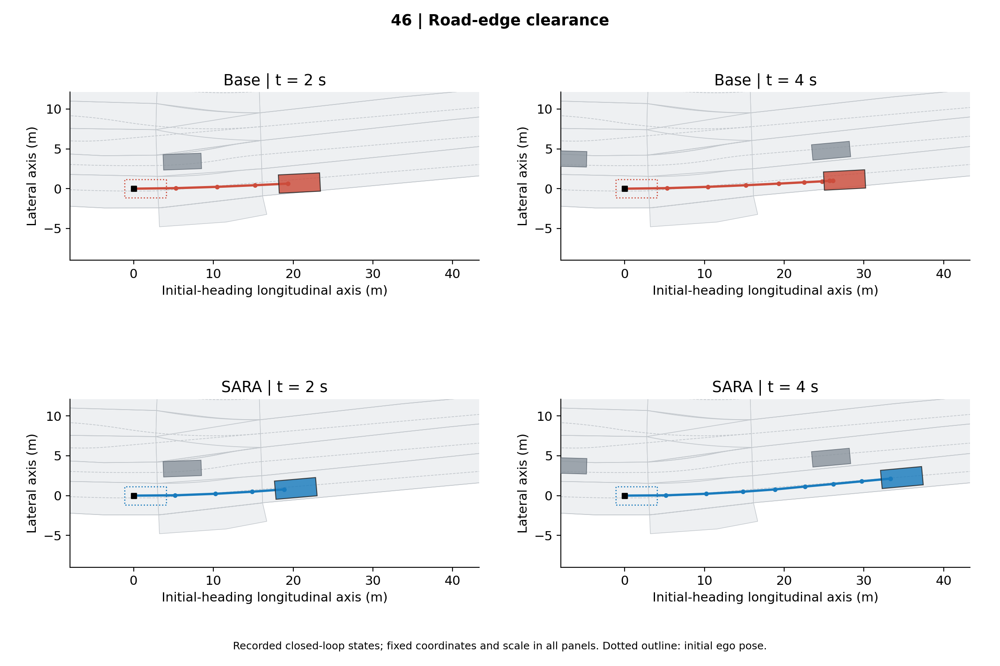
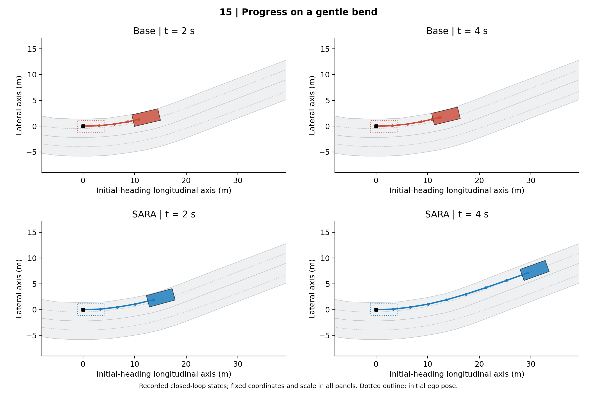
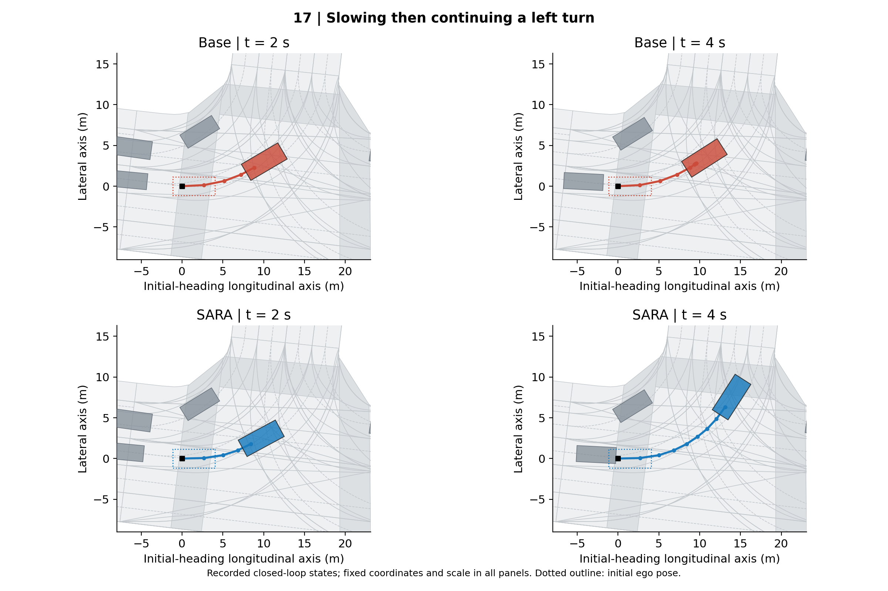
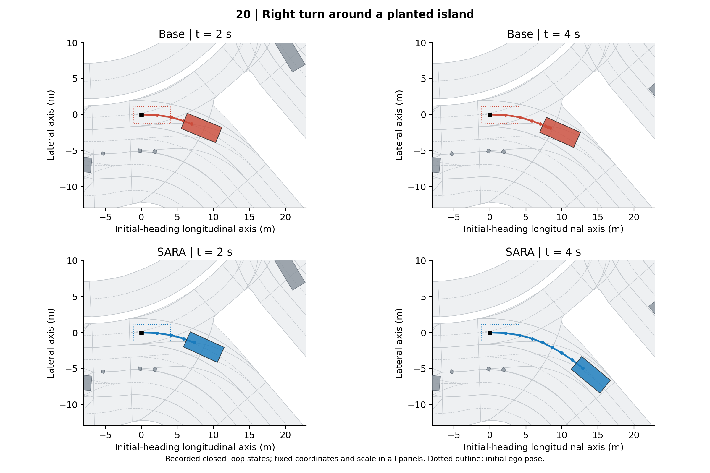
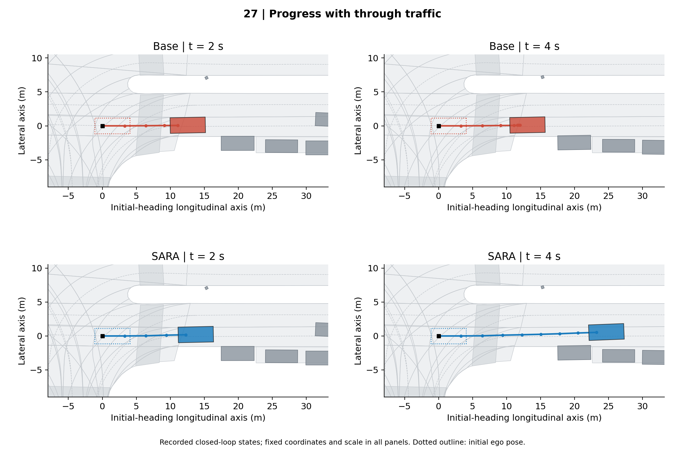

# 精选五例：46、15、17、20、27

按选定编号整理，保留原编号和原始记录。可以直接把整个 ZIP 发给合作者。

[下载完整 ZIP](sara_selected_46_15_17_20_27.zip) · [绘图 Python](sara_selected_46_15_17_20_27/plot_cases.py) · [修改说明](sara_selected_46_15_17_20_27/README.md)

包含原先预览图、统一 2s/4s 对比图（PNG/PDF/SVG）、0–4s GIF、原始前视画面、独立绘图数据和 Python。上排 Base、下排 SARA；左列 2 秒、右列 4 秒；坐标和比例固定，无箭头。

**记录核对：** 15、17、27 的 Base 原始采样分别有约 0.321、0.291、0.359 m 的累计车头反方向位移（累计回退，不是首尾净位移）；这是记录本身的低速回退，已原样保留。20、46 两边和本包五例的 SARA 均未检出采样回退。

## 46 · 道路边缘车道保持

[GIF](sara_selected_46_15_17_20_27/figures/case_46.gif) · [原先预览图](sara_selected_46_15_17_20_27/original_previews/case_46_original.png) · [前视画面](sara_selected_46_15_17_20_27/camera/case_46_camera.jpg) · [PDF](sara_selected_46_15_17_20_27/figures/case_46_2s_4s.pdf) · [SVG](sara_selected_46_15_17_20_27/figures/case_46_2s_4s.svg)

## 15 · 缓弯道路保持推进

[GIF](sara_selected_46_15_17_20_27/figures/case_15.gif) · [原先预览图](sara_selected_46_15_17_20_27/original_previews/case_15_original.png) · [前视画面](sara_selected_46_15_17_20_27/camera/case_15_camera.jpg) · [PDF](sara_selected_46_15_17_20_27/figures/case_15_2s_4s.pdf) · [SVG](sara_selected_46_15_17_20_27/figures/case_15_2s_4s.svg)

## 17 · 左转中减速后继续转入

[GIF](sara_selected_46_15_17_20_27/figures/case_17.gif) · [原先预览图](sara_selected_46_15_17_20_27/original_previews/case_17_original.png) · [前视画面](sara_selected_46_15_17_20_27/camera/case_17_camera.jpg) · [PDF](sara_selected_46_15_17_20_27/figures/case_17_2s_4s.pdf) · [SVG](sara_selected_46_15_17_20_27/figures/case_17_2s_4s.svg)

## 20 · 绕绿化岛右转

[GIF](sara_selected_46_15_17_20_27/figures/case_20.gif) · [原先预览图](sara_selected_46_15_17_20_27/original_previews/case_20_original.png) · [前视画面](sara_selected_46_15_17_20_27/camera/case_20_camera.jpg) · [PDF](sara_selected_46_15_17_20_27/figures/case_20_2s_4s.pdf) · [SVG](sara_selected_46_15_17_20_27/figures/case_20_2s_4s.svg)

## 27 · 沿车流保持直行推进

[GIF](sara_selected_46_15_17_20_27/figures/case_27.gif) · [原先预览图](sara_selected_46_15_17_20_27/original_previews/case_27_original.png) · [前视画面](sara_selected_46_15_17_20_27/camera/case_27_camera.jpg) · [PDF](sara_selected_46_15_17_20_27/figures/case_27_2s_4s.pdf) · [SVG](sara_selected_46_15_17_20_27/figures/case_27_2s_4s.svg)
