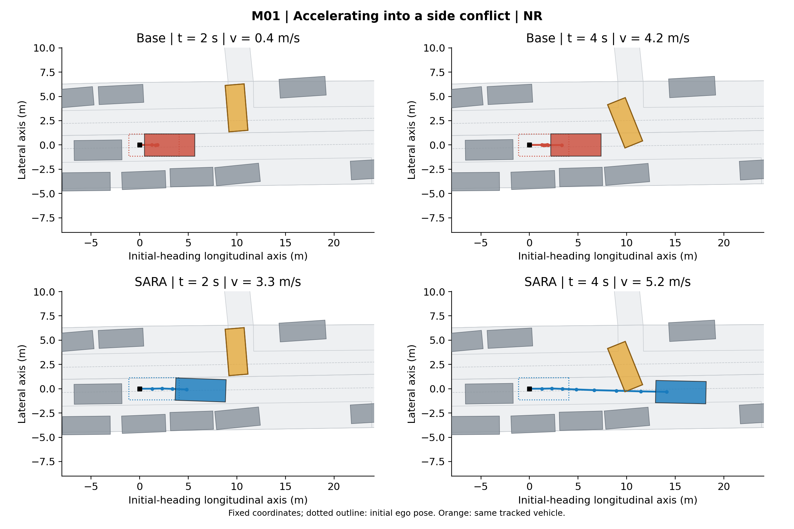
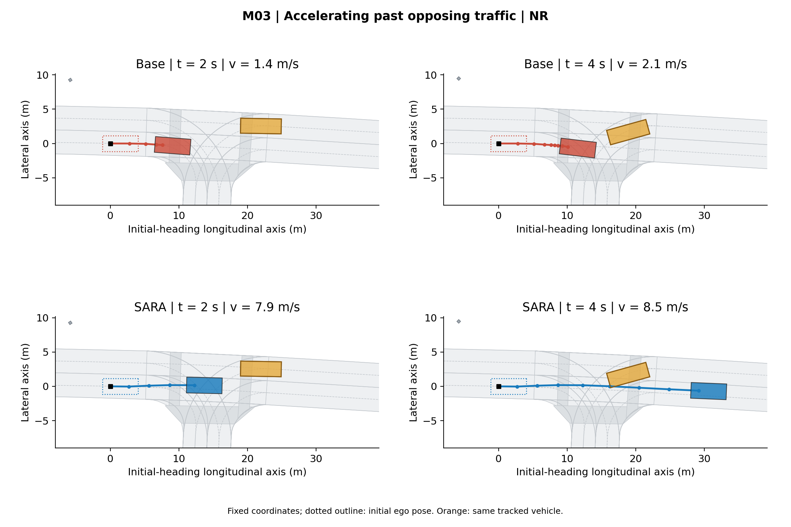
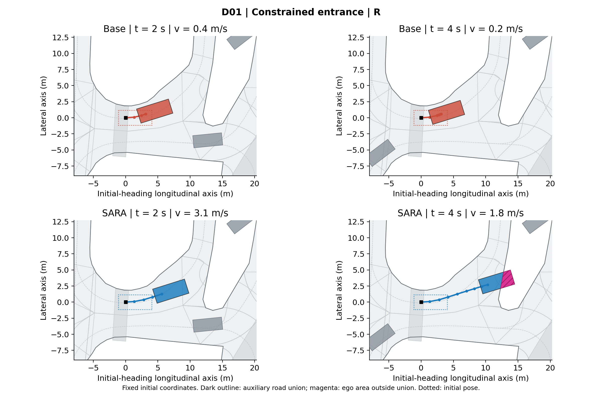
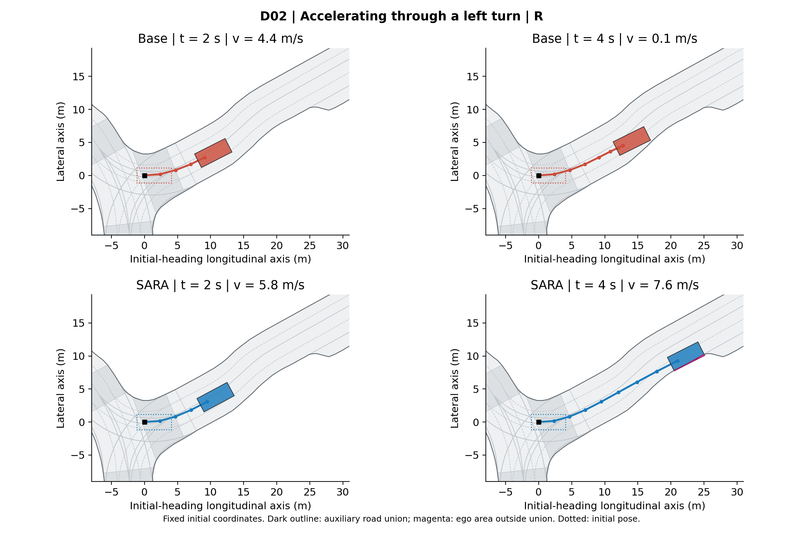
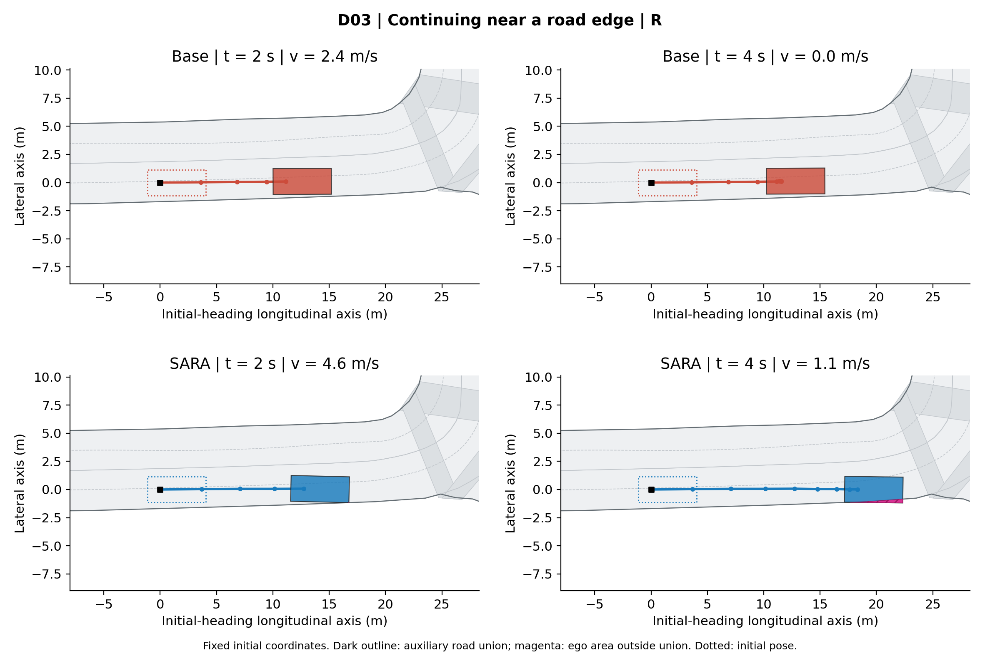
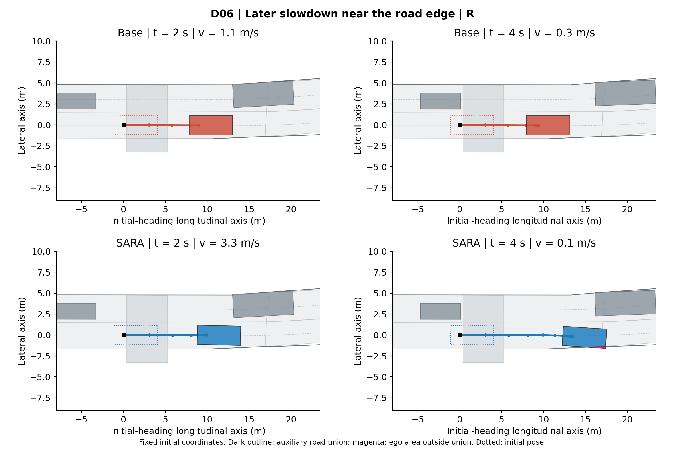

# 精选六个失败案例

包含 **M01、M03、D01、D02、D03、D06**，保留原编号。M01为碰撞，M03为危险接近，D组为DAC退化。

[下载完整ZIP](sara_selected_M01_M03_D01_D02_D03_D06.zip) · [绘图Python](sara_selected_M01_M03_D01_D02_D03_D06/plot_cases.py) · [完整场景与改图说明](sara_selected_M01_M03_D01_D02_D03_D06/README.md) · [指标表](sara_selected_M01_M03_D01_D02_D03_D06/summary.csv)

ZIP内有原图PNG/PDF/SVG、GIF、关键帧、前视画面、速度与间隙/越界曲线、场景token与模式、正式指标、数据来源，以及可独立运行的Python和全部绘图数据。

## M01 · 侧向车辆尚未通过就继续加速（NR）

侧向车辆尚未通过时继续加速。Base 等待后起步；SARA 更早加速，2.5–3.5 秒与橙色目标车出现采样车身重叠，正式 NC/TTC 从1降为0。

[GIF](sara_selected_M01_M03_D01_D02_D03_D06/M/figures/case_01.gif) · [诊断曲线](sara_selected_M01_M03_D01_D02_D03_D06/M/figures/case_01_diagnostics.png) · [前视画面](sara_selected_M01_M03_D01_D02_D03_D06/M/camera/case_01_camera.jpg)

## M03 · 遇到对向来车仍加速通过（NR）

面对对向车辆仍加速通过。两边 NC/DAC=1，TTC 从1降为0；SARA 与橙车最近采样车身间隙约0.11米，未检出采样车身重叠。适合讨论风险余量，不写成已碰撞。

[GIF](sara_selected_M01_M03_D01_D02_D03_D06/M/figures/case_03.gif) · [诊断曲线](sara_selected_M01_M03_D01_D02_D03_D06/M/figures/case_03_diagnostics.png) · [前视画面](sara_selected_M01_M03_D01_D02_D03_D06/M/camera/case_03_camera.jpg)

## D01 · 柱廊入口继续推进后越界（R）

原 F05：柱廊入口的弯曲通道。Base 较早收速，SARA 继续推进后越出地图通道，DAC 1→0；辅助最大车身角点超出约2.05米。不能根据该图声称已与柱子发生物理碰撞。

[GIF](sara_selected_M01_M03_D01_D02_D03_D06/D/figures/case_01.gif) · [诊断曲线](sara_selected_M01_M03_D01_D02_D03_D06/D/figures/case_01_diagnostics.png) · [前视画面](sara_selected_M01_M03_D01_D02_D03_D06/D/camera/case_01_camera.jpg)

## D02 · 左转后继续加速，压出道路边缘（R）

左转后 Base 减速，SARA 持续加速，随后车身贴出道路边缘，DAC 1→0。辅助最大角点超出约0.20米，属于较细的车身越界，不能夸大成整车冲出道路。

[GIF](sara_selected_M01_M03_D01_D02_D03_D06/D/figures/case_02.gif) · [诊断曲线](sara_selected_M01_M03_D01_D02_D03_D06/D/figures/case_02_diagnostics.png) · [前视画面](sara_selected_M01_M03_D01_D02_D03_D06/D/camera/case_02_camera.jpg)

## D03 · 路沿附近收速不足，车身越界增加（R）

路沿附近，Base 减速停在前方，SARA 保持更多推进，后段车身越界逐步增加，DAC 1→0；辅助最大角点超出约0.34米。

[GIF](sara_selected_M01_M03_D01_D02_D03_D06/D/figures/case_03.gif) · [诊断曲线](sara_selected_M01_M03_D01_D02_D03_D06/D/figures/case_03_diagnostics.png) · [前视画面](sara_selected_M01_M03_D01_D02_D03_D06/D/camera/case_03_camera.jpg)

## D06 · 减速较晚，多走后贴出路边（R）

简单路段的减速时机差异：SARA 收速较晚，多走之后车身贴出路边，DAC 1→0；辅助最大角点超出约0.23米。画面差异较细，结合局部细节与速度曲线查看。

[GIF](sara_selected_M01_M03_D01_D02_D03_D06/D/figures/case_06.gif) · [诊断曲线](sara_selected_M01_M03_D01_D02_D03_D06/D/figures/case_06_diagnostics.png) · [前视画面](sara_selected_M01_M03_D01_D02_D03_D06/D/camera/case_06_camera.jpg)
