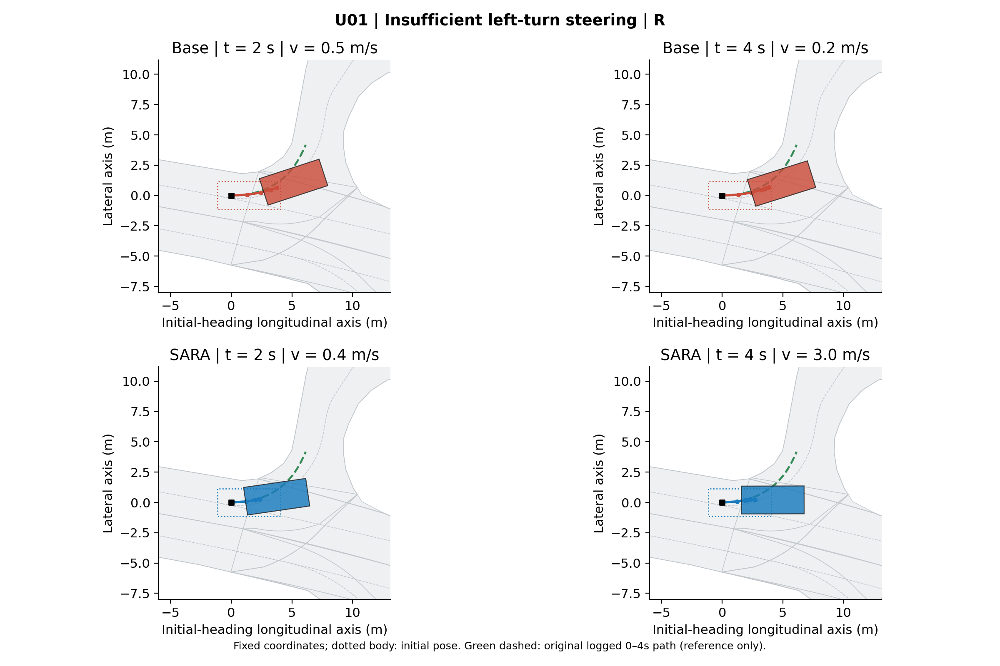
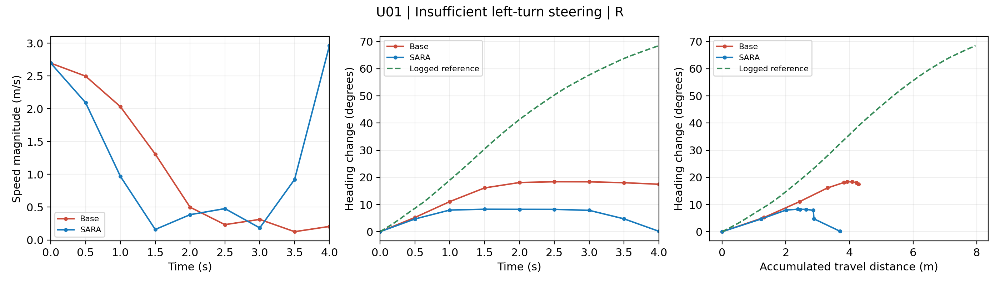
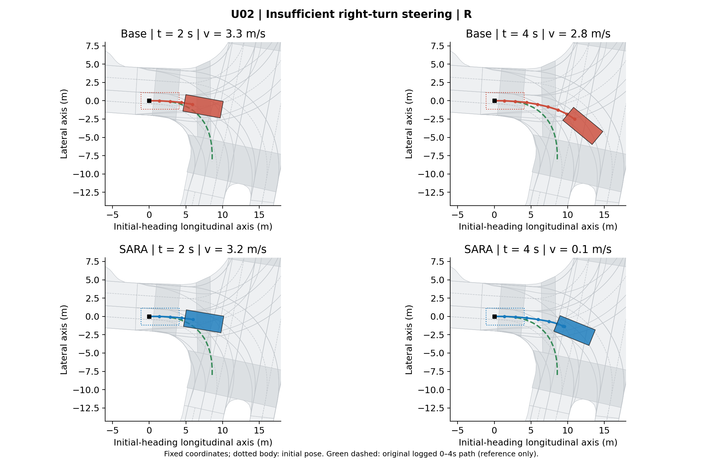
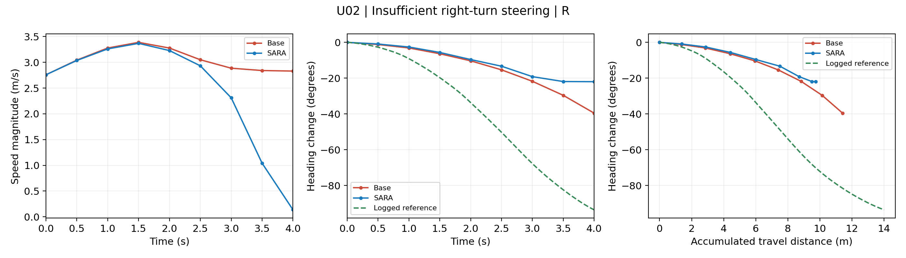

# 常见驾驶问题：转弯时转向不足（U01 / U02）

**优先看 U01：应该向左转，Base 已经开始转入，SARA 的车头却几乎没有转向。** U02 作为较弱的右转参考。两个都是本轮新筛出的场景，不是之前 F03/F04 的重新编号。

[下载 ZIP](sara_turning_cases_U01_U02.zip) · [绘图 Python](sara_turning_cases_U01_U02/plot_cases.py) · [说明](sara_turning_cases_U01_U02/README.md)

上排 Base、下排 SARA；左2秒、右4秒。绿色虚线为同起点原始人类0–4秒记录，只作转弯任务参照。固定坐标和比例，无箭头、轨迹修正。两边 NC/DAC/TTC 都为1，正式 comfort 也都为1。

## U01 · 左转时车头几乎未转入

优先看这一例。原始记录是左转，Base 四秒内车头左转约17.5°，SARA 仅约0.2°。两边行程约4.3m和3.7m；在相同行程约3.7m处比较，车头方向仍相差约17.5°，所以区别不只是前进速度。Base 也没有在四秒内完成整个左转，不能写成 Base 已完整成功通过。

[GIF](sara_turning_cases_U01_U02/figures/case_01.gif) · [前视画面](sara_turning_cases_U01_U02/camera/case_01_camera.jpg) · [PDF](sara_turning_cases_U01_U02/figures/case_01_2s_4s.pdf) · [SVG](sara_turning_cases_U01_U02/figures/case_01_2s_4s.svg)

## U02 · 右转时转向程度不足

弱备选。Base 右转约39.6°，SARA 约22.0°，但相同行程处只差约5.3°，相当部分差异与行程长短有关。可看作右转不足的参考，不建议作为证明独立转向缺陷的主例。

[GIF](sara_turning_cases_U01_U02/figures/case_02.gif) · [前视画面](sara_turning_cases_U01_U02/camera/case_02_camera.jpg) · [PDF](sara_turning_cases_U01_U02/figures/case_02_2s_4s.pdf) · [SVG](sara_turning_cases_U01_U02/figures/case_02_2s_4s.svg)
