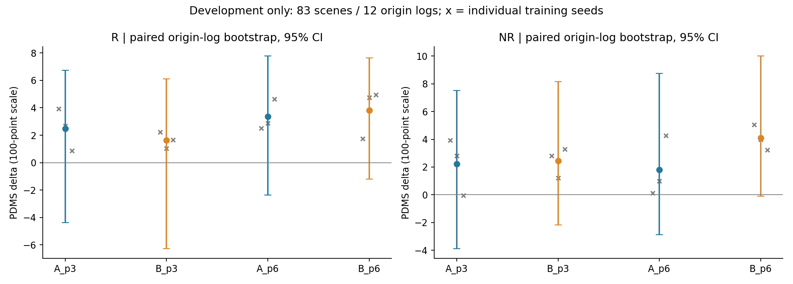
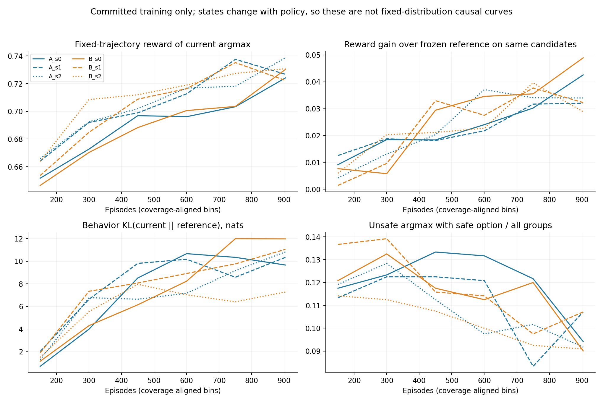
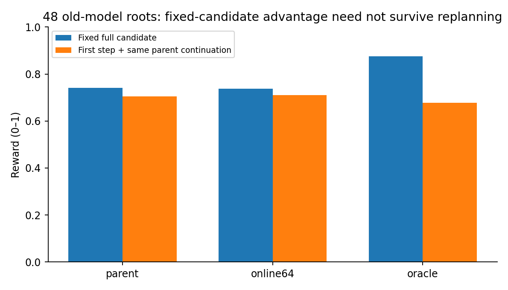
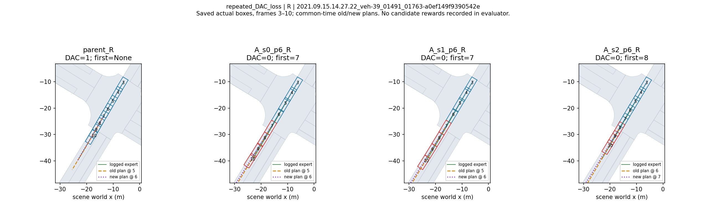

# V3 在线闭环 A/B：结果分析

本报告先回答“哪里变好、哪里变坏”，再区分已验证机制与待验证因果。全部结果来自既有实验；本次没有训练新模型、改变奖励或修改正式评测。

## 结论与边界

**目前最清楚的现象是：在线模型学会了提高当前的四秒固定候选评分，开发集的进度均值提高，但若干重复场景的可行驶区域安全退化。总分正增量不能替代安全门槛。**

已有证据支持继续排查两个问题：一是“完整候选执行价值”与“只执行首步、之后持续重规划的策略价值”之间的差距；二是较明显的策略漂移和有限的场景泛化。当前证据还不能分配两者的因果贡献。补齐 B p6 后，B 的平均总分更高、NR 的 DAC 退化有所缓解，但仍未恢复父模型安全水平，未通过原门槛；单纯“切换越大越容易越界”的解释与部分案例不符。

**开发集为 83 个 clip、12 个 origin logs，含历史训练来源日志，不是独立正式测试。** 三个在线 seed 共享同一个离线 rare_tuned V3 seed0 父模型。R 为响应式交通，NR 为非响应式交通。此处统计单位是短场景，不能描述为长期连续驾驶表现。

## 1. 完整性与模型来源

审计快照时间：`2026-10-01T09:18:42Z`。已接受并重新核验 32 项开发/间隔评测。缺少完整登记：无。

逐项核验了 status 指向的 result 哈希、原始 CSV 哈希及逐行数值、83 场景精确集合、有限性与 [0,1] 范围、重新计算的均值、evaluation_inputs 哈希与模型标识，以及 marker → checkpoint → selector → 完整评测模型文件的哈希链。只接受登记的 attempt，未取 glob 中最新目录替代。

另以原只读 fixed_protocol 验收函数重新检查全部 43,392 组反馈：候选身份、专家评分窗口、分支首步与主执行状态、根恢复和相邻历史连续性均通过；场景调度、随机种子命名空间、跨轮 learner hash、A 每步版本变化、B 冻结采集与缓存上下文顺序更新也通过。相同 seed 的 A/B 场景访问顺序完全相同。对已接受评测核对了冻结 config/scenarios 文件哈希及实际启动命令中的模型、配置、R/NR 交通策略、固定 eval seed=0。NR 省略 agent_policy 参数，使用冻结默认 trajectory_policy。详见 `contract_verification.json`。

六组训练均为 113 个八卡提交轮、904 episodes、150 场景，每场景 6–7 次。读取并核验全部 **5,424 个有效 report 哈希**，共 **43,392 个候选组、867,840 条固定四秒候选分支**。各组有 **904 次全局 DDP optimizer step**；7,232 是每组所有 rank 的局部候选组数，不能把副本更新相加当成 7,232 次独立模型更新。每个局部无信号组仍可能随其他 rank 的有效梯度更新，全局没有跳过优化步。

p3/p6 的 marker 与 committed progress 对齐，并核验 12 个边界的全部 8 rank checkpoint 文件哈希。未重新反序列化所有历史 checkpoint，也未独立重算每次 DDP 参数一致性；原回执包含此检查，本文不能将读取回执等同于重新执行它。已有导出模型的哈希审计通过。

A_s2、B_s1、B_s2 使用登记的数值容差 hotfix：atol 1e-5→5e-5、rtol 1e-4，学习公式不变。回执保留原 source contract，因此六组 source 字典相同不表示运行时没有 overlay；详细来源见 `training_provenance.json`。有效回执最大 training/inference logit 漂移约 2e-5–3e-5。

最初两项缺评测的工程解释已有日志支持：12 个 H100 评测日志均包含 `QUEUE_IDLE_EXIT`，文件最终更新时间在 05:57–06:08 UTC；B_s2 训练 06:29:42 UTC 才完成。mtime 是文件更新时间，不当作精确进程退出时间。B_s2 p6 的 R/NR 现已由用户在其他节点补齐，接受 attempt 分别为 `attempt_20261001T085157Z_1edac414`、`attempt_20261001T090340Z_0295c315`，已验证确实引用 coverage6 模型。本地没有启动重复作业。

## 2. 总体效果与不确定性

下表均使用 **100 分尺度的配对变化**；NC/DAC/TTC 的变化可读为百分点。区间为固定 seed=0、5,000 次 origin-log cluster bootstrap，先在同一场景内平均三个训练 seed，再整簇重采样日志，按抽中 clip 数加权。种子标准差另列；bootstrap 不覆盖独立离线父模型、全部数据分布或正式测试的不确定性。

| 方法 | 模式 | ΔPDMS | seed SD | 日志聚类 95% CI | ΔNC | ΔDAC | ΔTTC | ΔEP |
|---|---|---:|---:|---|---:|---:|---:|---:|
| A_p3 | R | +2.484 | 1.541 | [-4.363, +6.733] | -0.602 | -4.418 | +0.803 | +11.283 |
| A_p3 | NR | +2.233 | 2.047 | [-3.897, +7.513] | +0.201 | -4.418 | -0.402 | +11.163 |
| B_p3 | R | +1.644 | 0.595 | [-6.281, +6.102] | -0.803 | -4.418 | +0.402 | +9.248 |
| B_p3 | NR | +2.434 | 1.088 | [-2.187, +8.161] | -0.201 | -2.811 | -0.803 | +9.959 |
| A_p6 | R | +3.349 | 1.137 | [-2.355, +7.768] | -1.004 | -3.614 | -1.205 | +13.600 |
| A_p6 | NR | +1.793 | 2.183 | [-2.889, +8.758] | -0.602 | -4.819 | -2.008 | +12.396 |
| B_p6 | R | +3.816 | 1.790 | [-1.192, +7.632] | -0.402 | -3.213 | +0.402 | +13.015 |
| B_p6 | NR | +4.093 | 0.923 | [-0.094, +10.001] | +0.402 | -2.410 | -0.803 | +13.437 |

父模型绝对 PDMS：R 79.4294、NR 79.5931；DAC 均为 95.1807，comfort 均为 1。完整每种子绝对值见 `absolute_metrics.csv`，逐场景配对结果见 `paired_scenes.csv`。

完整三种子组的 PDMS 区间均跨 0，当前不能宣布统计上稳定提升。A 从 p3 到 p6：R ΔPDMS +0.865、NR -0.440；TTC 分别 -2.008、-1.606 个百分点。继续覆盖没有带来一致的安全改善。

p3 下 B−A：R ΔPDMS -0.839、NR +0.201；95% 区间分别约 [-3.961,+0.681]、[-2.300,+3.288]。B 的 NR DAC 比 A 高 1.606 个百分点，但 R DAC 无变化，不能把 B 当作已验证的解决方案。

### 固定选模门槛

原门槛保持不变：p6 三种子 R PDMS≥+0.005、NR PDMS≥−0.005，R/NR 的 NC、DAC、TTC 均≥−0.005（0–1 尺度）。独立重算状态：A=FAIL；B=FAIL。与原 registry 的 `NO_METHOD_QUALIFIED` 一致；本分析只读该选择文件，没有改写。B 未通过的具体项目为 R DAC、NR DAC、NR TTC；A 的 R/NR NC、DAC、TTC 六项均未通过。总分收益门槛两法均通过，失败原因是安全约束。

### B p6 补齐后的结论

B_s2 p6 的绝对 PDMS：R **84.3705**、NR **82.8167**。B p6 三种子绝对均值为 R **83.2459**、NR **83.6857**；相对父模型分别 **+3.8165**、**+4.0925** 分。日志聚类95%区间分别为 **[−1.1920,+7.6318]**、**[−0.0941,+10.0012]**，均仍跨0。NR 区间下界接近0不等于已经通过显著性检验。

| p6：B−A | ΔPDMS（95%日志区间） | ΔNC | ΔDAC（95%日志区间） | ΔTTC |
|---|---:|---:|---:|---:|
| R | +0.468 [−2.584,+3.279] | +0.602 | +0.402 [−2.339,+3.086] | +1.606 |
| NR | +2.300 [−0.551,+4.171] | +1.004 | +2.410 [+0.709,+4.403] | +1.205 |

因此应更新此前“B 尚缺完整证据”的判断：B p6 对 NR DAC 的缓解在这套配对日志 bootstrap 中得到支持，但总分 B−A 的区间仍跨0，不能宣布 B 全面优于 A，更不能声称安全问题已解决。上述是开发诊断中的多个比较，未作多重比较校正，也不是独立正式测试。

B 从 p3 到 p6：R ΔPDMS **+2.1721** 分，95%区间 **[+0.0159,+6.4742]**；NR **+1.6581** 分，区间 **[−0.3514,+4.1133]**。DAC 分别改善 +1.2048、+0.4016 个百分点，TTC 均值不变。与 A 的 NR 继续训练略降不同，B 的继续覆盖带来两模式均值改善；R 的区间下界仅略大于0，应按有限开发样本中的线索解释。

## 3. 安全损失与进度收益来自哪些场景

按每场景 NC=1 且 DAC=1 定义联合通过。以下四类对每个 seed 都构成同一 83 场景总体的分割，其贡献相加严格等于总分 delta。没有用“平均 NC×平均 DAC”代替联合通过率。

| 方法 | 模式 | 双方联合安全的贡献 | 安全→不安全的贡献 | 不安全→安全的贡献 | 双方不安全的贡献 |
|---|---|---:|---:|---:|---:|
| A p6 | R | +7.580 | -4.231 | +0.000 | +0.000 |
| A p6 | NR | +6.700 | -6.020 | +1.113 | +0.000 |
| B p6 | R | +6.881 | -4.269 | +1.205 | +0.000 |
| B p6 | NR | +5.450 | -3.273 | +1.916 | +0.000 |

A p6：R 的 DAC 成功→失败合计 9 个 seed×scene 事件，NR 合计 12 个；两个模式都没有 DAC 失败→成功。R 三种子分别新增 4/2/3 个 DAC 失败，NR 为 5/3/4 个。安全损失不是平均指标的计算幻象。

A p6 R 的 DAC 新失败分布在 5 个不同场景，NR 也为 5 个；两模式交集 4 个。`a0ef149f9390542e` 在 R/NR 的三个 seed 全部新失败；`2e7e98a0ead15fbf` 在两模式各 2/3 seed 失败。NR 的 `3c1b2912226b5a9a` 和 `199004ef5fbf5fde` 也都为 3/3。这是重复模式，但依然只涉及有限日志，不能外推整体道路分布。

B p6 的 DAC 成功→失败事件合计 R **11**、NR **8**；失败→成功分别 **3**、**2**，净损失为8/249、6/249，即3.213、2.410个百分点。因此 R 的 DAC 净变化虽略好于 A，新增失败数反而是11对9，收益来自额外修复，不能写成“B 的 R 新失败更少”。NR 的新增失败则从 A 的12降至8，并修复2个事件。逐 seed 的 R 新增/修复为5/1、3/1、3/1；NR为2/1、2/1、4/0。

B 的强重复问题仍在：`a0ef149f9390542e` 在R/NR三个seed全部新失败；`2e7e98a0ead15fbf` 在两模式各2/3；R的 `c2033e312633578d` 为3/3。B在R的新增失败涉及6个不同场景，NR涉及5个。NR的 `3c1b2912226b5a9a` 和 `199004ef5fbf5fde` 从A的3/3降为B的1/3（均为s2），说明缓解具有场景和种子异质性。详见 `repeated_failures.csv`，不把seed×scene事件当作独立日志样本。

进度改进与退化分布并不相同。A p6 的 R 正收益最大贡献日志含 32/83 clips，贡献约 +1.811 分；最负日志 `2021.09.15.14.27.22_veh-39` 只有 6 clips，贡献约 −1.362 分。NR 正贡献最大的 4-clip 日志贡献约 +1.409 分，最负的上述日志贡献 −1.402 分。留一日志分析后，A p6 总分均值仍为正，但 NR 去掉最有利日志后只剩约 +0.40 分；样本组成明显影响收益大小。

为避免条件子集选择偏差，另固定“父模型联合安全”的场景集合，R 为 77 场景、NR 为 78 场景，在所有模型上使用同一集合；结果见 `fixed_parent_safe_subset.csv`。四类分解仅用于解释贡献，不将每个模型自身安全子集均值直接比较为因果改善。开发 CSV 的 EP 是 scorer 的 **gated_EP**，不是原始行驶距离或未门控 EP。

## 4. 学习是否真的生效，候选是否限制了上限

| 训练组 | 当前 argmax 奖励 | 同候选冻结父模型 | oracle | 无 NC/DAC 安全候选 | 有安全候选却选不安全 | 全零组 | 平均更新 KL |
|---|---:|---:|---:|---:|---:|---:|---:|
| A_s0 | 0.6910 | 0.6671 | 0.8285 | 7.81% | 12.02% | 7.12% | 6.893 |
| A_s1 | 0.7054 | 0.6829 | 0.8332 | 7.87% | 11.16% | 7.11% | 7.450 |
| A_s2 | 0.7058 | 0.6819 | 0.8327 | 7.73% | 10.84% | 7.07% | 6.584 |
| B_s0 | 0.6901 | 0.6630 | 0.8249 | 7.88% | 11.55% | 7.18% | 7.027 |
| B_s1 | 0.7036 | 0.6800 | 0.8344 | 7.51% | 11.84% | 6.78% | 7.487 |
| B_s2 | 0.7103 | 0.6872 | 0.8345 | 7.31% | 10.29% | 6.62% | 5.753 |

这组对照是在**在线实际访问状态的同一候选集**上，比较当前 selector 与冻结 reference 的排序，避免把候选变好完全误算为 selector 变好。平均固定候选奖励增益为 +0.0225～+0.0271；六组最后一轮覆盖区间均高于第一轮。与此同时 oracle 与冻结 reference 的分数也随访问状态改变，训练曲线不是固定状态分布下的因果曲线。

完整排序也有改善：在奖励非恒定组内，当前 logits 与20候选 reward 的平均 Spearman 相关性为 0.605–0.623，冻结父模型为 0.569–0.584，六组都上升；并列名次使用平均秩，全零组排除。它衡量当前固定候选标签的排序一致性，不能直接当成闭环策略价值相关性。

全体 43,392 组中，3,028 组全零；其中 1,666 组在根已发生记录的 NC/DAC 违规（按首次违规时间=0）。其他全零组不能简单解释为已越界后的结果。没有安全候选约 7.3%–7.9%，其中根仍安全但候选全不安全，每组训练累计 215–247 个决策。候选覆盖不足确实存在，却解释不了全部错误：另有约 10.3%–12.0% 的全部决策是“有安全候选但当前 argmax 不安全”。NC 安全这里严格要求 1，NC=0.5 也计为非安全，故无安全候选不等于奖励全零。

与冻结父模型相比，当前 selector 的这种同候选安全误选率在六组均略有降低：父模型约 11.0%–12.9%，当前约 10.3%–12.0%。因此现有训练回执不支持“在线学习把训练状态上的排序全面学坏了”；更值得检验训练状态、开发状态与后续重规划价值之间的差异。

KL(current‖reference) 明显上升：按行为分布重算，第一覆盖区间约 0.70–2.02 nats，最后约 7.28–11.98 nats。回执中的 loss KL 对无信号组返回 0，且 B 在更新时重新前向，因此与行为 KL 均值不同。系数仅 1e-3；强漂移值得做对照，但不能仅凭数值判定“KL 导致 DAC”。平均熵约 0.13–0.16 nats、最大动作概率约 0.94；冻结 reference 本来也很尖锐，不能称为在线训练新造成的熵塌缩。训练保留 categorical 采样，评测使用 argmax，两者也应区分。

B 的记录确认采集期间策略版本固定、采集结束后重前向并顺序更新 8 组。A/B 都保留 GRPO exact-group 目标、AdamW 与相同学习率/KL。有效组的未裁剪梯度范数未保存，不能从 logits 变化冒充梯度大小；B 每个缓存上下文的完整重前向 logits 也没有逐组落盘，只保存 drift/版本/更新回执，不能补造相关曲线。

## 5. 奖励计算正确不等于重规划目标正确

在 roots48 的 960 个候选上，使用同一实际轨迹、对齐动态量后的训练 scorer 与 legacy scorer 最大差为 **0**。训练奖励包含完整 9 帧（根及未来 8 帧）、实际周围交通、车辆角点与地图；已审阅坐标平移、后轴到车身中心、专家窗口重锚定和门控 EP 的代码。全部训练反馈声明 canonical 恢复，且同组候选对“根时刻已违规”的判断无分歧。以上支持已审计路径的一致性，不是全环境所有未来状态无 bug 的证明。

仍存在真实的 train/eval 输入差异：原 evaluator 将部分动态量填零，训练保留实际动态量。roots48 有 **479/960** 个候选 comfort 不同，平均训练 reward 比 legacy 低 **0.01997**，最高分候选在 **3/48** 个根改变。主训练候选 comfort 平均约 0.53–0.55、所选约 0.86–0.87，而开发最终 comfort 恒为 1。不能因为组件名称相同就宣称训练奖励与评测数值完全同分布；也不能据此把全部 DAC 退化归因于 comfort。

更直接的目标错配证据来自同根首步实验：给定 20 候选，oracle 的完整固定执行平均奖励 0.8765，比 parent 的 0.7411 高 **0.13535**；只执行所选首步并接同一个冻结 parent continuation 后，oracle 平均变为 0.6777，parent 为 0.7056，差为 **−0.02791**。28 个固定执行严格有优势的根中，**6 个出现严格优劣反转**。

**这是 old online64/parent、headless warmup roots 上的证据，不是本轮 A/B p6 的直接归因。** 它证明这两种价值在现有系统中可能不等价；不能证明所有失败都由此产生，也不能将 common parent continuation 称为各模型自身策略价值。完整候选的排序好转，并不保证仅提交 0.5 秒后再次决策的闭环排序好转。

## 6. 轨迹切换与真实越界案例

已重算 2,656 条逐场景计划汇总、18,592 对相邻计划。按同一 scene-world 坐标对齐共同未来时刻，重新计算的数值与保存的 `common_future` 一致。恢复评测的 15,936 个计划文件另核验归档哈希；8 项较早基线/间隔评测的 5,312 个计划没有同类型 archive 哈希，只能核验内容与几何一致性。新增B_s2 p6两项共166个场景的计划已纳入；以下48条地图重建轨迹仍是前次固定的A p6/parent案例，不当作B p6的地图复核。

从 A p6 各模式确定性选取：3 个重复 DAC 退化案例、2 个联合安全且总分改善案例、1 个近乎不变的联合安全案例，共 12 组比较。使用真实保存的 rear pose、原 Pacifica 车辆参数与原 PDMDrivableMap 的 100 m 地图查询重建角点，核验 48 条轨迹的第 3–10 帧。NC=1 的 DAC 失败案例首次角点越界与原 CSV 完全一致。第 11 帧、碰撞/TTC、真实候选分数不在这次地图重建范围。

强重复案例 `a0ef149f9390542e`：父模型 R/NR 均安全，三个 A p6 seed 在帧 7/7/8 开始越界。R 的保存轨迹平均速度（帧3–10 路程/3.5秒）父模型约 6.60 m/s，在线约 9.66/9.85/7.90 m/s。日志专家第3–11帧角点在同地图内通过；因此这里不是“日志专家本身也被这张图判越界”的简单解释。速度和路径同时变化，尚不能把速度差当成原因。

“切换幅度大”不是必要现象。例如 NR `3c1b2912226b5a9a` 的三个 seed 都在帧6越界；另一个 NR `199004ef5fbf5fde` 三个 seed 都在帧8越界。A p6 新增 DAC 失败的 R 9 个 seed×scene 事件中，5 个在违规前同一决策前缀上的平均计划变化比父模型小；NR 为 12 个中的 9 个。这些事件跨 seed 相关，不能当作独立样本做显著性声称。公平的同一决策前缀比较见 `pre_violation_matched_plan_comparison.csv`；不拿失败前短前缀与父模型整段混算。平滑地走向错误位置同样可能失败。

1秒计划复用的确显著提高旧模型开发总分，但 parent 改善更大：交互项（online64 的间隔收益−parent 的间隔收益）R −1.110 分，95% CI [−6.655,+3.582]；NR −2.696 分，CI [−9.733,+1.551]。因此它更像值得研究的共同执行接口因素，尚无证据说明它特别修复在线训练。它还改变后缀复用、观察后动作选择，不能把所有收益解释成“少切换”。

## 7. 效率、失败重试与证据缺口

| 组 | 已提交轮 max-rank 耗时之和（小时） | 登记累计训练墙钟（小时） | resume segments |
|---|---:|---:|---:|
| A_s0 | 7.897 | 7.953 | 1 |
| A_s1 | 7.779 | 7.833 | 1 |
| A_s2 | 8.000 | 8.081 | 2 |
| B_s0 | 7.269 | 7.324 | 1 |
| B_s1 | 6.165 | 6.243 | 2 |
| B_s2 | 7.992 | 8.127 | 3 |

第一列是每个有效 DDP 轮中最慢 rank 的 elapsed_seconds 求和；不等于独占计算内核时间。第二列是恢复系统累计登记值，二者差额不能直接当作全部失败重试时间。节点排队、失败 attempt、导出与磁盘故障需按独立日志边界核算；目前没有完整的全 campaign 资源账单，不伪造该数值。

决策 profile 平均每步：候选反馈等待约 8.9–11.5秒，learner update 约 8.1–11.2秒，输入准备约 1秒，模型 forward 约 0.67–0.69秒。profile 的等待项含同步与主机差异，不能把 B_s1 更快单独归因于 B 方法。每组候选分支 144,640 条、仿真步 1,157,120；候选分支渲染/模型调用为零，但主闭环仍渲染并调用候选生成器。每个 episode 只执行 4 秒，另有历史 warmup。

B_s2 p6 两项最终验收已经完成。仍无法从既有存档回答：A/B p6 在正式失败根的 full20 奖励/logits；自身 continuation 与 common continuation 的对照；所有边界 checkpoint 张量级独立复审；全训练候选 scorer parity；逐步梯度范数与完整失败重试费用。正式四表没有接受的完整结果，不作最终论文收益声明。

## 8. 下一轮最小对照与停止条件

**完整p6三种子结果现已确认A/B都不合格。** 保持原门槛，报告无合格方法，不把B均值较高登记成正式获选方法。B可作为下一轮机制诊断的对照，其NR安全缓解和跨模式共同失败值得保留；不据此直接重训或启动正式获选方法四表。

第一优先：**不更新参数，同根验证价值排名**。使用 `selected_cases.json` 中预先列出的重复退化、改善、未变场景，冻结 parent 和各 A/B p6 checkpoint，恢复正式 evaluator 的真实失败前根（另保留代表性开发根作对照）。保存候选、logits、完整状态 hash、地图角点、首次违规和 full20 组件。每根先固定4秒完整执行，再比较相同首步接 common parent continuation；最后再接各自策略 continuation。先只对 parent/current/oracle 所选动作分支，发现反转后再扩展全20，避免一开始重跑整个训练。

该实验回答“当前标签是否给首步错误信用”。**继续条件**：在根仍安全且存在可行候选时，固定价值优势在 common continuation 下重复反转，并能在多个 origin logs 观察到；若只在极少挑选案例出现，作为诊断记录而非一般机制。**停止/改方向条件**：排名大体一致且主要失败发生在无安全候选或根已违规，此时先研究候选覆盖与更早的诱因，不急于设计 continuation-aware 奖励。自身 continuation 用于解释策略后续影响，不与 common continuation 混为一个因果量。

第二优先（若排序仍好但泛化/漂移突出）：冻结 reward、0.5秒执行间隔、场景顺序和更新时序，只改变更新强度；预先选定一个较小学习率或较少更新预算，与原配置作配对多种子比较。用同根候选排序、KL、开发 NC/DAC/TTC 一起验收。不要同时改变 KL、奖励权重、horizon 和生成器。若 KL 降低但安全不改善，停止把漂移作为主要解释。

对已量化的 comfort 输入差异，可先在同一轨迹上双评分做标签排序敏感性分析；若需训练对照则单独版本，不修改正式 scorer。当前只在 3/48 根改变 argmax，优先级低于直接价值排名验证。

上述是可检验的后续方案，尚未执行。当前先不加切换惩罚、不改安全权重、不重写专家 EP，也不直接将主实验间隔改为1秒。

## 文件与复现

- `audit.json` / `source_hashes.json` / `contract_verification.json`：接受结果、模型文件来源、审计哈希与协议核验。
- `absolute_metrics.csv` / `paired_statistics.csv` / `paired_scenes.csv`：完整绝对值、每种子/三种子统计、逐场景 delta。
- `origin_log_effects.csv` / `leave_one_log_out.csv`：日志贡献及敏感性。
- `safety_transitions.csv` / `repeated_failures.csv` / `joint_safety_decomposition.csv`：安全变化、重复场景与总分分解。
- `training_summary.json` / `training_groups.csv` / `training_rounds.csv` / `training_pass_bins.csv`：有效学习动态及计时。
- `roots48.csv` / `continuations144.csv` / `root_diagnostics.json`：旧模型同根对照。
- `plan_steps.csv` / `plan_scenes.csv` / `pre_violation_matched_plan_comparison.csv`：共同未来几何与越界前对齐。
- `selected_cases.json` / `map_case_audit.json` / `figures/case_*.png`：确定性案例抽样、地图复核及图。

CPU 复现：在仓库根目录运行 `python research/online_closedloop_analysis_20261001/analyze.py`、`training.py`、`plans.py`、`diagnostics.py`（均使用同目录完整路径）。`map_cases.py` 使用登记的 simengine Python；`report.py` 使用带 matplotlib 的 algengine Python。全部脚本只向本分析目录写结果，不运行 registry 汇总或选模入口。本次补齐顺序为 analyze→plans、verify_contracts --evaluations-only→report；病例抽样固定为 A p6，已核验的训练与 roots 原始结果未变时无需重复读取。

本报告的确定性重建、配对分解和哈希检查均已实际运行。所有因果机制在文中明确区分为线索、反证与待实验验证。
